# UP02: ENTORNOS DE DESARROLLO. INSTALACIÓN Y CONFIGURACIÓN

> [!WARNING]
> MATERIAL DE AMPLIACION: WORK IN PROGRES

## ÍNDICE

- [OBJETIVOS](#objetivos)
- [CÓMO TRABAJAR ESTA UNIDAD](#cómo-trabajar-esta-unidad)
- [0. ANTES DE EMPEZAR](#0-antes-de-empezar)
- [1. QUÉ ES UN ENTORNO DE DESARROLLO](#1-qué-es-un-entorno-de-desarrollo)
  - [1.1. Programar sin IDE](#11-programar-sin-ide)
  - [1.2. Componentes de un IDE](#12-componentes-de-un-ide)
  - [1.3. Editor, editor ampliable e IDE](#13-editor-editor-ampliable-e-ide)
  - [1.4. Qué hace «inteligente» a un IDE](#14-qué-hace-inteligente-a-un-ide)
  - [1.5. IDE, SDK, framework, herramienta de construcción y plugin](#15-ide-sdk-framework-herramienta-de-construcción-y-plugin)
- [2. PANORAMA DE ENTORNOS DE DESARROLLO](#2-panorama-de-entornos-de-desarrollo)
  - [2.1. Criterios para comparar entornos](#21-criterios-para-comparar-entornos)
  - [2.2. Libre, código abierto, gratuito y propietario](#22-libre-código-abierto-gratuito-y-propietario)
  - [2.3. Entornos de propósito general](#23-entornos-de-propósito-general)
  - [2.4. Entornos para móvil, escritorio y videojuegos](#24-entornos-para-móvil-escritorio-y-videojuegos)
  - [2.5. Entornos para desarrollo web](#25-entornos-para-desarrollo-web)
  - [2.6. Entornos en la nube y desarrollo remoto](#26-entornos-en-la-nube-y-desarrollo-remoto)
  - [2.7. Características comunes y específicas](#27-características-comunes-y-específicas)
- [3. EL JDK: LO QUE NECESITA JAVA](#3-el-jdk-lo-que-necesita-java)
  - [3.1. JDK, JRE y JVM](#31-jdk-jre-y-jvm)
  - [3.2. Versiones y distribuciones](#32-versiones-y-distribuciones)
  - [3.3. Instalar el JDK](#33-instalar-el-jdk)
  - [3.4. Compilar y ejecutar desde la terminal](#34-compilar-y-ejecutar-desde-la-terminal)
- [4. INTELLIJ IDEA](#4-intellij-idea)
  - [4.1. Licencia y ediciones](#41-licencia-y-ediciones)
  - [4.2. Instalación y actualizaciones](#42-instalación-y-actualizaciones)
  - [4.3. La interfaz](#43-la-interfaz)
  - [4.4. Primer proyecto](#44-primer-proyecto)
  - [4.5. Configuraciones de ejecución](#45-configuraciones-de-ejecución)
  - [4.6. Atajos imprescindibles](#46-atajos-imprescindibles)
- [5. PERSONALIZAR Y AUTOMATIZAR INTELLIJ IDEA](#5-personalizar-y-automatizar-intellij-idea)
  - [5.1. Niveles de configuración](#51-niveles-de-configuración)
  - [5.2. Apariencia y editor](#52-apariencia-y-editor)
  - [5.3. Estilo de código, formateo y EditorConfig](#53-estilo-de-código-formateo-y-editorconfig)
  - [5.4. Acciones al guardar](#54-acciones-al-guardar)
  - [5.5. Plantillas de código](#55-plantillas-de-código)
  - [5.6. Macros](#56-macros)
  - [5.7. Atajos propios y keymaps](#57-atajos-propios-y-keymaps)
  - [5.8. Exportar y sincronizar la configuración](#58-exportar-y-sincronizar-la-configuración)
- [6. PLUGINS: AÑADIR Y ELIMINAR MÓDULOS](#6-plugins-añadir-y-eliminar-módulos)
  - [6.1. Qué es un plugin](#61-qué-es-un-plugin)
  - [6.2. Instalar, desactivar y desinstalar](#62-instalar-desactivar-y-desinstalar)
  - [6.3. Plugins requeridos y sugeridos](#63-plugins-requeridos-y-sugeridos)
  - [6.4. Plugins recomendados para el curso](#64-plugins-recomendados-para-el-curso)
  - [6.5. Buenas prácticas](#65-buenas-prácticas)
- [7. GENERAR EJECUTABLES](#7-generar-ejecutables)
  - [7.1. Qué entendemos por ejecutable](#71-qué-entendemos-por-ejecutable)
  - [7.2. Compilar en IntelliJ IDEA](#72-compilar-en-intellij-idea)
  - [7.3. Empaquetar en un JAR](#73-empaquetar-en-un-jar)
  - [7.4. Otro lenguaje en el mismo entorno: Kotlin](#74-otro-lenguaje-en-el-mismo-entorno-kotlin)
  - [7.5. Ejecutables nativos: C con CLion](#75-ejecutables-nativos-c-con-clion)
  - [7.6. Del JAR a una aplicación instalable: jpackage](#76-del-jar-a-una-aplicación-instalable-jpackage)
  - [7.7. Herramientas de construcción: Maven y Gradle](#77-herramientas-de-construcción-maven-y-gradle)
- [8. VISUAL STUDIO CODE](#8-visual-studio-code)
  - [8.1. Otra filosofía](#81-otra-filosofía)
  - [8.2. Extensiones](#82-extensiones)
  - [8.3. El mismo programa en VS Code](#83-el-mismo-programa-en-vs-code)
  - [8.4. Personalizar y automatizar VS Code](#84-personalizar-y-automatizar-vs-code)
  - [8.5. Actualizaciones](#85-actualizaciones)
- [9. MISMO CÓDIGO, VARIOS ENTORNOS](#9-mismo-código-varios-entornos)
- [10. ASISTENTES DE IA EN EL ENTORNO](#10-asistentes-de-ia-en-el-entorno)
- [11. ERRORES FRECUENTES](#11-errores-frecuentes)
- [12. COMPRUEBA LO APRENDIDO](#12-comprueba-lo-aprendido)
- [REFERENCIAS](#referencias)

## OBJETIVOS

Al terminar esta unidad deberíais poder:

- Explicar qué es un **entorno de desarrollo integrado (IDE)**, qué componentes reúne y en qué se diferencia de un editor de texto, un SDK, un framework, una herramienta de construcción y un plugin.
- **Evaluar** distintos entornos de desarrollo según criterios como lenguajes, plataforma de destino, licencia, recursos y posibilidades de ampliación.
- Distinguir entre software **libre**, de **código abierto**, **gratuito** y **propietario**, y clasificar con esos criterios los entornos más habituales.
- **Instalar** entornos de desarrollo libres y propietarios, y el **JDK** necesario para trabajar con Java.
- **Añadir, desactivar y eliminar** plugins o extensiones en un entorno de desarrollo.
- **Personalizar y automatizar** el entorno: apariencia, estilo de código, plantillas, acciones al guardar, macros, atajos, tareas y sincronización de la configuración.
- **Configurar el sistema de actualización** de un entorno de desarrollo y de sus extensiones.
- **Generar ejecutables** a partir de código fuente de **diferentes lenguajes** en un mismo entorno.
- **Generar ejecutables** a partir de un **mismo código fuente** con **varios entornos**, y comparar los resultados.
- Identificar las **características comunes y específicas** de varios entornos de desarrollo.
- Utilizar los asistentes de IA del entorno de forma **responsable**, sin que sustituyan vuestra comprensión del código.


## CÓMO TRABAJAR ESTA UNIDAD

En la UP01 vimos que el código fuente tiene que transformarse para llegar a ejecutarse y que existen herramientas para cada fase del desarrollo. Ahora nos centramos en la herramienta con la que pasaréis más horas: el **entorno de desarrollo**.

La unidad sigue un hilo conductor sencillo. Escribiremos un pequeño programa que muestra las tutorías disponibles de la academia que usamos como ejemplo en la UP01 y lo llevaremos por distintos caminos:

1. Lo compilaremos y ejecutaremos **sin IDE**, desde la terminal, para saber qué trabajo hace el entorno por nosotros.
2. Lo crearemos, ejecutaremos y empaquetaremos en **IntelliJ IDEA**, nuestro IDE principal.
3. Escribiremos el mismo programa en **Kotlin** dentro de IntelliJ IDEA y en **C** con CLion, para comparar qué tipo de ejecutable se obtiene en cada caso.
4. Llevaremos el mismo código Java a **Visual Studio Code** y compararemos el proceso y el resultado.

Entre medias aprenderéis a adaptar el entorno a vuestra forma de trabajar y a automatizar tareas repetitivas. Ese es el criterio con más peso del RA2, así que no lo dejéis para el final.

> [!NOTE]
> IntelliJ IDEA no tiene traducción oficial al castellano, así que los nombres de menús y opciones aparecen **en inglés**, tal y como los veréis en pantalla. La ruta de un menú se escribe con barras verticales: **Settings | Editor | Font** significa «abrid Settings, después Editor y después Font».

## 0. ANTES DE EMPEZAR

En la UP01 instalasteis **JetBrains Toolbox App**, **IntelliJ IDEA**, **CLion** y **Visual Studio Code**. Comprobad antes de seguir:

- [ ] Abrís Toolbox y veis IntelliJ IDEA y CLion en la lista de herramientas instaladas.
- [ ] IntelliJ IDEA llega a su pantalla de bienvenida (*Welcome to IntelliJ IDEA*).
- [ ] VS Code se abre y sabéis abrir una carpeta con **File | Open Folder...**.
- [ ] Tenéis una carpeta `EDE` donde guardar el trabajo del módulo.
- [ ] Sabéis abrir una **terminal**: en Windows, *Terminal* o *PowerShell*; en macOS y Linux, *Terminal*.

Si alguno falla, volved a la UP01 antes de continuar.

En la terminal usaremos muy pocos comandos. Estos bastan para moverse:

| Acción | Windows (PowerShell) | macOS / Linux |
|---|---|---|
| Ver en qué carpeta estoy | `pwd` | `pwd` |
| Listar el contenido | `ls` o `dir` | `ls` |
| Entrar en una carpeta | `cd EDE` | `cd EDE` |
| Subir un nivel | `cd ..` | `cd ..` |
| Crear una carpeta | `mkdir prueba` | `mkdir prueba` |

> [!TIP]
> Si arrastráis una carpeta desde el explorador de archivos a la ventana de la terminal, se escribe su ruta completa. Es un atajo cómodo para el `cd`.

## 1. QUÉ ES UN ENTORNO DE DESARROLLO

### 1.1. Programar sin IDE

Para escribir y ejecutar un programa en Java solo hacen falta dos cosas: un **editor de texto** para escribir el código fuente y el **JDK** para compilarlo y ejecutarlo. Con el Bloc de notas y la terminal se puede programar:

```text
1. Escribir HolaMundo.java en un editor de texto.
2. Compilar:             javac HolaMundo.java   →  HolaMundo.class
3. Ejecutar:             java HolaMundo
4. Leer el error, volver al editor, buscar la línea, corregir, guardar.
5. Repetir desde el paso 2.
```

Funciona, pero en cuanto el programa crece aparecen los problemas: errores que solo descubrís al compilar, decenas de archivos repartidos en carpetas, librerías externas que hay que añadir a mano, un depurador de terminal poco amigable, cambios que no sabéis quién hizo ni cuándo...

Un **entorno de desarrollo integrado** (IDE, *Integrated Development Environment*) reúne en una sola aplicación las herramientas que intervienen en ese ciclo y las conecta entre sí. El editor sabe qué ha dicho el compilador y subraya la línea del error; el depurador abre el archivo exacto donde se ha detenido la ejecución; el control de versiones marca en el margen las líneas que habéis cambiado.

**El IDE no sustituye a las herramientas: las coordina.** Por debajo, IntelliJ IDEA sigue usando un JDK para compilar y ejecutar Java. Por eso en el apartado 3 aprenderemos a hacerlo también sin IDE: cuando algo falle, saber qué ocurre por debajo os permitirá entender el error.

### 1.2. Componentes de un IDE

| Componente | Para qué sirve | Ejemplo en IntelliJ IDEA |
|---|---|---|
| **Editor de código** | Escribir código con resaltado de sintaxis, autocompletado, plegado de bloques y formateo automático. | La zona central con pestañas para cada archivo. |
| **Análisis de código** | Detectar errores y posibles problemas mientras escribís, sin necesidad de compilar. | Subrayados rojos y amarillos; la bombilla de *Alt+Enter*. |
| **Navegación** | Moverse por el proyecto: ir a la declaración de un método, buscar dónde se usa una clase, ver la estructura de un archivo. | *Ctrl+clic*, *Search Everywhere*, ventana *Structure*. |
| **Gestión de proyectos** | Organizar archivos, carpetas, librerías y configuración del proyecto. | Ventana *Project*, *Project Structure*. |
| **Compilación y construcción** | Traducir el código y preparar el resultado para ejecutarlo o distribuirlo. | *Build Project*, *Build Artifacts*, integración con Maven y Gradle. |
| **Ejecución** | Lanzar el programa con la configuración adecuada y mostrar su salida. | Botón *Run* y ventana *Run*. |
| **Depurador** | Detener el programa en un punto, avanzar paso a paso e inspeccionar variables. | Botón *Debug* |
| **Refactorización** | Cambiar la estructura del código sin cambiar su comportamiento: renombrar, extraer métodos... | Menú *Refactor* |
| **Control de versiones** | Registrar y consultar cambios, trabajar con ramas, sincronizar con GitHub. | Ventanas *Commit* y *Git* |
| **Pruebas** | Escribir, ejecutar y ver el resultado de pruebas automáticas. | Integración con JUnit (UP11). |
| **Terminal integrada** | Ejecutar comandos sin salir del entorno. | Ventana *Terminal*. |
| **Sistema de plugins** | Añadir funcionalidades que el IDE no trae de serie. | **Settings \| Plugins**. |

Fijaos en la última columna: casi todas las unidades del módulo trabajan alguna parte del IDE. Lo que aprendáis aquí sobre cómo moveros por él lo vais a usar todo el curso.

### 1.3. Editor, editor ampliable e IDE

La frontera entre «editor» e «IDE» no es una línea, sino un espectro:

| Tipo | Qué ofrece | Ejemplos |
|---|---|---|
| **Editor de texto** | Escribir y guardar texto. Como mucho, resaltado de sintaxis. | Bloc de notas, nano, gedit. |
| **Editor de código ampliable** | Editor ligero cuyas capacidades crecen mediante **extensiones**. Con las adecuadas, se comporta casi como un IDE. | Visual Studio Code, Sublime Text, Zed, Vim/Neovim. |
| **IDE** | Todas las herramientas integradas de serie y un conocimiento profundo de uno o varios lenguajes. | IntelliJ IDEA, Eclipse, NetBeans, Visual Studio, Android Studio. |

VS Code recién instalado es un editor de código. Si le añadís las extensiones de Java, aparecen autocompletado, depurador, ejecución de pruebas y gestión de proyectos. ¿Es entonces un IDE? En la práctica, para muchos lenguajes, sí. La diferencia está en **cómo se consigue**: IntelliJ IDEA trae esas capacidades integradas y diseñadas juntas; VS Code las obtiene de extensiones que pueden venir de autores distintos.

### 1.4. Qué hace «inteligente» a un IDE

Cuando abrís un proyecto en IntelliJ IDEA, durante unos segundos aparece en la parte inferior el mensaje *Indexing...*. El IDE está leyendo todo el código del proyecto y de sus librerías para construir un **modelo** del programa: qué clases existen, qué métodos tiene cada una, de qué tipo es cada variable, quién llama a quién.

Gracias a ese modelo puede:

- Proponer solo los métodos que tienen sentido en ese punto del código.
- Avisar de que una variable nunca se usa o de que un `if` siempre es verdadero.
- Renombrar un método y actualizar automáticamente todas sus llamadas, sin tocar un texto que casualmente se llame igual.
- Llevaros a la declaración de cualquier elemento con un clic.

Un editor de texto solo ve caracteres; un IDE entiende la **estructura** del programa. Esa es la diferencia esencial.

Los editores ampliables consiguen algo parecido mediante el **Language Server Protocol (LSP)**, un estándar que creó Microsoft para VS Code. Un **servidor de lenguaje** es un programa independiente que analiza el código de un lenguaje concreto y responde a preguntas del editor: «¿qué puedo autocompletar aquí?», «¿dónde está declarado esto?», «¿qué errores hay en este archivo?». El editor no necesita saber nada de Java: pregunta al servidor de lenguaje de Java y muestra la respuesta.

```text
   VS Code  ──── «¿qué hay en la línea 12?» ────►  Servidor de lenguaje de Java
  (editor)  ◄──── «el método imprimir(), etc.» ───  (analiza el código)
```

Gracias a LSP, el mismo servidor de lenguaje sirve para VS Code, Neovim, Zed y muchos otros editores. Es una **característica común** que explica por qué hoy casi cualquier editor ofrece autocompletado inteligente.


> [!NOTE]
> Un detalle curioso: el servidor de lenguaje de Java que usa VS Code está construido sobre el compilador y el analizador de **Eclipse**. Cuando programáis Java en VS Code, por debajo trabaja parte de otro IDE.

Aunque el LSP ha acercado los editores ampliables a los IDE, los IDE frontera siguen teniendo importantes ventajas. Por ejemplo, JetBrains no usa LSP para su soporte de Java: su análisis (PSI. *Program Structure Interface*) vive dentro del propio proceso del IDE, con acceso directo y en memoria al modelo, sin serializar JSON. Eso permite refactorizaciones y análisis mucho más ricos de lo que LSP sabe expresar.

### 1.5. IDE, SDK, framework, herramienta de construcción y plugin

Son conceptos que aparecen juntos constantemente y que conviene no confundir:

| Concepto | Qué es | Ejemplo |
|---|---|---|
| **IDE** | Aplicación para escribir, ejecutar, depurar y gestionar el código. | IntelliJ IDEA. |
| **SDK** (*Software Development Kit*) | Conjunto de herramientas y librerías para desarrollar con una tecnología: compilador, librerías estándar, utilidades. | El **JDK** es el SDK de Java; el Android SDK, el de Android. |
| **Framework** | Estructura de código reutilizable sobre la que construís vuestra aplicación. Marca cómo organizarla y hace parte del trabajo por vosotros. | Spring (Java), Django (Python), Angular, Next.js. |
| **Librería** | Código reutilizable que vuestra aplicación llama cuando lo necesita. | JUnit, Gson. |
| **Herramienta de construcción** | Automatiza compilar, descargar dependencias, ejecutar pruebas y empaquetar. | Maven, Gradle. |
| **Plugin o extensión** | Módulo que añade funcionalidad al IDE. | El plugin de Kotlin, la extensión de Java para VS Code. |

Una forma de recordarlo, según la analogía:

- El **IDE** es el taller.
- El **SDK** son las herramientas básicas.
- El **framework** es el plano de la casa.
- La **herramienta de construcción** (*build tool*) es la cadena de montaje.
- Los **plugins** son accesorios para el taller.

Veamos un ejemplo con todos juntos. Para crear una aplicación web en Java podríais usar **IntelliJ IDEA** (IDE) con el **JDK 25** (SDK), construir la aplicación sobre **Spring Boot** (framework), gestionar las dependencias con **Maven** (herramienta de construcción) e instalar el plugin **SonarQube for IDE** para revisar la calidad del código. Podríais cambiar el IDE por VS Code sin tocar nada más: el proyecto seguiría siendo el mismo. Cabe señalar que, no todos los proyectos 

Una diferencia clave entre librería y framework es **quién llama a quién**. Vuestro código llama a una librería cuando la necesita. En cambio, un framework llama a vuestro código cuando le conviene: vosotros rellenáis los huecos que deja. A esto se le llama **inversión de control**.

## 2. PANORAMA DE ENTORNOS DE DESARROLLO

### 2.1. Criterios para comparar entornos

No existe «el mejor IDE». Existe el más adecuado para una situación. Para evaluarlo, haceos estas preguntas:

| Criterio | Pregunta |
|---|---|
| **Lenguajes y tecnologías** | ¿Qué lenguajes y frameworks soporta bien, de serie o con plugins? |
| **Plataforma de destino** | ¿Para qué voy a desarrollar: escritorio, web, Android, iOS, videojuegos? |
| **Sistema operativo** | ¿Funciona en mi sistema? Xcode, por ejemplo, solo funciona en macOS. |
| **Licencia y coste** | ¿Es libre? ¿Es gratuito para mi caso? ¿Qué funciones son de pago? |
| **Recursos** | ¿Cuánta memoria y CPU consume? ¿Funciona con fluidez en mi equipo? |
| **Ampliación** | ¿Tiene un ecosistema de plugins activo? |
| **Integración** | ¿Se integra con Git, herramientas de construcción, pruebas, contenedores...? |
| **Comunidad y soporte** | ¿Hay documentación, tutoriales y gente que resuelva dudas? ¿Se actualiza a menudo? |
| **Uso en el sector** | ¿Lo usan las empresas donde querría trabajar? |

En este módulo usamos **IntelliJ IDEA** como entorno principal porque es el IDE de referencia para Java y Kotlin, y **VS Code** como segundo entorno porque es el editor más extendido y os servirá para casi cualquier otro lenguaje.

### 2.2. Libre, código abierto, gratuito y propietario

Estos cuatro términos se usan a menudo como si fueran sinónimos, pero no lo son:

- **Software libre**: respeta las cuatro libertades de usar, estudiar, modificar y redistribuir el programa. Requiere acceso al código fuente. Es un concepto ético-legal promovido por la Free Software Foundation.
- **Código abierto** (*open source*): el código fuente está disponible bajo una licencia que permite usarlo, modificarlo y redistribuirlo. En la práctica, casi todo el software libre es de código abierto y viceversa; la diferencia está en el énfasis (libertad frente a ventajas prácticas de desarrollo).
- **Gratuito** (*freeware*): no cuesta dinero, pero puede ser cerrado y con condiciones de uso.
- **Propietario**: su licencia restringe el uso, el estudio, la modificación o la redistribución. Puede ser de pago o gratuito.

**Gratuito no significa libre.** Xcode es gratuito, pero propietario. Y algo libre puede venderse.

En el mundo de los entornos de desarrollo es frecuente un **modelo mixto**, conocido como ***open core***: un núcleo de código abierto sobre el que la empresa distribuye un producto con componentes o funciones propietarios. Es el caso de **VS Code**: su código fuente es libre (licencia MIT), pero la versión que se descarga desde Microsoft se distribuye con licencia propietaria e incluye añadidos como la telemetría o el acceso a su Marketplace de extensiones. El mismo modelo se da fuera de los IDE, por ejemplo en **Odoo**, un ERP cuya edición Community es libre, mientras que la edición Enterprise, de pago, añade módulos propietarios.

| Entorno | Modelo de licencia |
|---|---|
| **Eclipse IDE** | Libre (Eclipse Public License). |
| **Apache NetBeans** | Libre (Apache License 2.0). |
| **VSCodium** | Libre (MIT). Es una compilación de VS Code sin los componentes de Microsoft. |
| **Visual Studio Code** | El código fuente (*Code - OSS*) es abierto, con licencia MIT, pero el programa que descargáis de la web de Microsoft se distribuye con una **licencia propietaria** e incluye telemetría y otros componentes de Microsoft. Es gratuito. |
| **IntelliJ IDEA** | Su núcleo (*IntelliJ Platform*) es de código abierto (Apache 2.0). La distribución oficial ofrece funciones gratuitas y funciones avanzadas de pago. |
| **Android Studio** | Basado en el núcleo abierto de IntelliJ, distribuido por Google de forma gratuita con licencia propia. |
| **CLion, WebStorm, Rider** | Propietarios. Gratuitos para uso **no comercial** (aprendizaje, proyectos personales). |
| **PhpStorm** | Propietario y de pago, con licencia educativa gratuita. |
| **Visual Studio** | Propietario. La edición *Community* es gratuita para estudiantes, proyectos de código abierto y equipos pequeños. |
| **Xcode** | Propietario y gratuito. Solo para macOS. |

> [!WARNING]
> Las condiciones de licencia de los IDE comerciales cambian con cierta frecuencia. La tabla refleja la situación a finales de 2026; ante la duda, consultad la web oficial de cada producto.

### 2.3. Entornos de propósito general

#### Visual Studio Code

Editor de código de Microsoft, gratuito y disponible para Windows, macOS y Linux. Es, con diferencia, el entorno más utilizado según las encuestas a desarrolladores de los últimos años. Su éxito se apoya en tres pilares: es **ligero**, tiene un **ecosistema de extensiones** enorme y, gracias a LSP, permite trabajar con prácticamente cualquier lenguaje.

Funcionalidades destacadas:

- Terminal integrada y control de versiones con Git de serie.
- Paleta de comandos (*Ctrl+Shift+P*) para acceder a cualquier función por su nombre.
- Desarrollo remoto: trabajar sobre un servidor por SSH, dentro de un contenedor Docker o en WSL como si fuera local.
- Asistentes de IA integrados, como GitHub Copilot.
- Perfiles de configuración y sincronización de ajustes entre equipos.

Su código abierto ha permitido que aparezcan **derivados** (*forks*): VSCodium, y también varios editores centrados en IA, como Cursor, que parten de VS Code y comparten su interfaz y sus extensiones.

#### Familia JetBrains

JetBrains es una empresa que desarrolla una familia de IDE especializados, todos construidos sobre la misma plataforma (*IntelliJ Platform*). Comparten interfaz, atajos y forma de trabajar: si sabéis usar uno, sabéis usarlos todos.

| IDE | Especialidad |
|---|---|
| **IntelliJ IDEA** | Java, Kotlin y lenguajes de la JVM. Con funciones de pago, también desarrollo web y empresarial (Spring, bases de datos...). |
| **PyCharm** | Python, ciencia de datos y frameworks como Django o Flask. |
| **WebStorm** | JavaScript, TypeScript y frameworks web (React, Angular, Vue). |
| **PhpStorm** | PHP y frameworks como Laravel o Symfony. |
| **CLion** | C y C++. |
| **Rider** | .NET y C#, y desarrollo de videojuegos con Unity o Unreal. |
| **GoLand, RustRover, DataGrip...** | Go, Rust, bases de datos... |

**JetBrains Toolbox App** gestiona la instalación y actualización de todos ellos desde un único lugar.

Los estudiantes pueden solicitar una **licencia educativa gratuita** que desbloquea todas las funciones de pago de todos los IDE de JetBrains mientras dure la matrícula.

> [!NOTE]
> Una ventaja de aprender con un IDE de JetBrains es que todos los de la familia comparten interfaz, atajos y filosofía, así que dominar uno os facilita usar cualquiera de los demás. Esto incluye a **Android Studio**, que Google ha construido sobre la plataforma de IntelliJ IDEA: lo que aprendáis ahora os servirá directamente para el desarrollo de aplicaciones móviles Android. Y lo mismo ocurre en el mundo profesional: si en una empresa usan PyCharm y en otra WebStorm, no hay que volver a aprender a manejar el IDE.

#### Eclipse IDE

IDE libre y de código abierto mantenido por la Eclipse Foundation. Fue durante muchos años el IDE dominante para Java y sigue muy presente en empresas y en herramientas basadas en él. Algunas características propias:

- **Workspace**: una carpeta que agrupa varios proyectos y la configuración del entorno.
- **Perspectivas**: disposiciones de ventanas pensadas para una tarea (*Java*, *Debug*, *Git*...).
- **Compilador propio** (ECJ), que compila de forma incremental cada vez que guardáis.
- Publica una versión nueva cada trimestre (2026-03, 2026-06...).
- Se amplía desde el *Eclipse Marketplace*.

#### Apache NetBeans

IDE libre, mantenido por la Apache Software Foundation. Muy usado en enseñanza durante años. Trabaja de forma nativa con proyectos Maven y Gradle y es una opción sencilla para Java, PHP y desarrollo web.

#### Visual Studio

El IDE completo de Microsoft (no confundir con VS Code). Solo funciona en Windows: la versión para macOS se retiró en 2024. Es el entorno de referencia para **.NET y C#** y para **C++ en Windows**, con diseñadores de interfaces, herramientas avanzadas de rendimiento e integración con Azure. Es mucho más pesado que VS Code.

### 2.4. Entornos para móvil, escritorio y videojuegos

Estos entornos son especialmente relevantes en **DAM**. Están ligados a una **plataforma de destino** concreta: incluyen el SDK, emuladores y herramientas para diseñar interfaces y empaquetar la aplicación para esa plataforma.

| Entorno | Para qué | Características propias |
|---|---|---|
| **Android Studio** | Aplicaciones Android. | Basado en IntelliJ IDEA. Construcción obligatoria con **Gradle**. Emulador de dispositivos, editor visual y vista previa de interfaces con Jetpack Compose. Genera paquetes APK y AAB. |
| **Xcode** | Aplicaciones para iPhone, iPad, Mac, Apple Watch y Apple TV. | Solo en macOS. Lenguajes Swift y Objective-C. Simuladores de dispositivos y vista previa de SwiftUI. Necesario para publicar en la App Store. |
| **Unity** | Videojuegos 2D y 3D multiplataforma. | Editor visual de escenas; los scripts se escriben en C# con un IDE externo (Visual Studio, Rider o VS Code). Su licencia *Personal* es gratuita y permite uso comercial hasta cierto nivel de ingresos. |
| **Godot** | Videojuegos 2D y 3D. | Motor libre (MIT). Editor ligero con lenguaje propio, **GDScript**, parecido a Python. También admite C#. |

Fijaos en un matiz: **Unity y Godot no son solo IDE**, son **motores de videojuegos**. Proporcionan un editor (el entorno) y un motor con librerías (el framework sobre el que se construye el juego). Unity, además, delega la edición del código en un IDE externo: es un buen ejemplo de cómo se combinan varias herramientas.

> [!NOTE]
> Para crear aplicaciones **multiplataforma** con un único código existen frameworks como Kotlin Multiplatform, Flutter o .NET MAUI. No son IDE: se usan desde Android Studio, IntelliJ IDEA, VS Code o Visual Studio con los plugins correspondientes.

### 2.5. Entornos para desarrollo web

Estos entornos son especialmente relevantes en **DAW**:

- **Visual Studio Code**: el más utilizado en desarrollo web gracias a sus extensiones para HTML, CSS, JavaScript, TypeScript y cualquier framework.
- **WebStorm**: el IDE de JetBrains para JavaScript y TypeScript. Muy completo para *front-end* y Node.js. Gratuito para uso no comercial.
- **PhpStorm**: el IDE de JetBrains para PHP, con soporte para Laravel, Symfony y WordPress. De pago, con licencia educativa gratuita.
- **IntelliJ IDEA** con funciones de pago: incluye las capacidades de WebStorm y PhpStorm (con plugin), además de Spring para el *back-end* en Java.

En desarrollo web hay una herramienta que forma parte del entorno aunque no esté en el IDE: las **herramientas para desarrolladores del navegador** (*DevTools*, tecla *F12*). Permiten inspeccionar el HTML y el CSS de una página, depurar JavaScript, analizar las peticiones de red y medir el rendimiento.

### 2.6. Entornos en la nube y desarrollo remoto

El entorno de desarrollo no tiene por qué estar instalado en vuestro ordenador:

- **github.dev**: pulsad la tecla `.` (punto) en cualquier repositorio de GitHub y se abrirá un VS Code en el navegador para editar sus archivos. No permite ejecutar código, pero es útil para cambios rápidos. Si al pulsar el punto no se abre, cambiad `github.com` por `github.dev` en la URL del repositorio.
- **Contenedores de desarrollo** (*Dev Containers*): un archivo `devcontainer.json` en el repositorio describe el entorno (versión del JDK, extensiones, herramientas) y el editor lo reproduce dentro de un contenedor Docker. Así, cualquiera que abra el proyecto trabaja con el mismo entorno.
- **GitHub Codespaces**: lleva la idea anterior a la nube. Crea un entorno a partir del `devcontainer.json` del repositorio y os conecta a él con VS Code, ya sea en el navegador o desde vuestro VS Code local. A diferencia de github.dev, sí permite ejecutar y depurar. Las cuentas personales tienen una cuota mensual gratuita, que es mayor si tenéis una cuenta de estudiante de GitHub Education.
- **Desarrollo remoto por SSH**: el código y las herramientas están en otra máquina (un servidor, una máquina virtual) y el editor se conecta a ella. En VS Code se hace con la extensión *Remote - SSH*; en los IDE de JetBrains, con **JetBrains Gateway**, que ejecuta el IDE en el servidor y os deja un cliente ligero en local.

Los contenedores de desarrollo y Codespaces resuelven además un problema clásico de los equipos: «en mi ordenador funciona». Si el entorno se describe en un archivo y se reproduce automáticamente, todos trabajan con lo mismo.

### 2.7. Características comunes y específicas

Casi todos los entornos actuales comparten un conjunto de **características comunes**:

- Editor con resaltado de sintaxis, autocompletado y formateo.
- Detección de errores mientras se escribe.
- Ejecución y depuración integradas.
- Integración con Git.
- Terminal integrada.
- Sistema de plugins o extensiones.
- Configuración personalizable (temas, atajos, estilo de código).
- Asistentes de IA, integrados o mediante plugins.

Las diferencias aparecen en las **características específicas**:

| Aspecto | IntelliJ IDEA | VS Code | Eclipse | Android Studio |
|---|---|---|---|---|
| Tipo | IDE | Editor ampliable | IDE | IDE especializado |
| Licencia | Núcleo abierto; funciones de pago | Binario propietario gratuito sobre código abierto | Libre | Gratuito, basado en IntelliJ |
| Unidad de trabajo | Proyecto con carpeta `.idea/` y archivos `.iml` | Carpeta o *workspace*, con carpeta `.vscode/` | *Workspace* con varios proyectos (`.project`, `.classpath`) | Proyecto Gradle |
| Soporte de Java | Integrado | Mediante extensiones (servidor de lenguaje basado en Eclipse) | Integrado | Integrado, orientado a Android |
| Compilación | Compilador propio del IDE o delegada en Maven/Gradle | La realiza la extensión o una herramienta de construcción | Incremental con su compilador propio (ECJ) | Siempre con Gradle |
| Ampliación | JetBrains Marketplace | Visual Studio Marketplace | Eclipse Marketplace | JetBrains Marketplace |
| Consumo de recursos | Alto | Bajo a medio, según extensiones | Medio | Muy alto (emulador incluido) |
| Herramientas propias | Refactorizaciones e inspecciones muy avanzadas | Desarrollo remoto, contenedores | Perspectivas | Emulador, editor de interfaces, perfiles de energía |

**Conclusión práctica:** las funciones básicas son equivalentes, de modo que lo que aprendáis en un entorno se transfiere a otro. Lo que cambia es dónde está cada opción, cómo se configura y cuánta potencia ofrece de serie.

## 3. EL JDK: LO QUE NECESITA JAVA

### 3.1. JDK, JRE y JVM

En la UP01 vimos que Java sigue un **modelo híbrido**: el código fuente se compila a **bytecode** y una **máquina virtual** lo ejecuta. Esas piezas se reparten así:

| Pieza | Qué es | Contiene |
|---|---|---|
| **JVM** (*Java Virtual Machine*) | La máquina virtual que ejecuta el bytecode. | El intérprete, el compilador JIT, el recolector de basura. |
| **JRE** (*Java Runtime Environment*) | Lo necesario para **ejecutar** programas Java. | La JVM y las librerías estándar. |
| **JDK** (*Java Development Kit*) | Lo necesario para **desarrollar** en Java. Es el SDK de Java. | El JRE y las herramientas de desarrollo. |

```text
┌──────────────────────────────── JDK ────────────────────────────────┐
│  javac, jar, javadoc, jdb, jpackage, jshell...                      │
│ ┌──────────────────────────── JRE ───────────────────────────────┐  │
│ │  Librerías estándar (API de Java: java.lang, java.util, ...)   │  │
│ │ ┌──────────────────────────  JVM  ───────────────────────────┐ │  │
│ │ │  Ejecuta el bytecode (.class)                              │ │  │
│ │ └────────────────────────────────────────────────────────────┘ │  │
│ └────────────────────────────────────────────────────────────────┘  │
└─────────────────────────────────────────────────────────────────────┘
```

Herramientas del JDK que usaremos:

| Herramienta | Función |
|---|---|
| `javac` | Compilador: traduce `.java` a `.class` (bytecode). |
| `java` | Lanzador: inicia la JVM y ejecuta un programa. |
| `jar` | Empaqueta archivos `.class` y recursos en un archivo `.jar`. |
| `javadoc` | Genera documentación HTML a partir de los comentarios (UP13). |
| `jdb` | Depurador de línea de comandos. |
| `jshell` | Consola interactiva para probar código Java línea a línea. |
| `jpackage` | Crea aplicaciones instalables con su propia JVM incluida (apartado 7.6). |
| `javap` | Muestra el contenido de un `.class`, incluido el bytecode. |

> [!NOTE]
> Desde Java 11, Oracle ya no distribuye un JRE independiente: se instala el JDK completo o, para distribuir una aplicación, se genera un entorno de ejecución a medida con `jlink` o `jpackage`. Otros distribuidores, como Eclipse Temurin, sí siguen ofreciendo paquetes JRE, que se usan sobre todo en servidores y contenedores para ejecutar aplicaciones sin incluir las herramientas de desarrollo. El concepto de JRE, por tanto, sigue siendo útil, pero vosotros, para desarrollar, instalaréis siempre un JDK. Los más veteranos tenemos la costumbre de hablar de «instalar el JRE», pero es una herencia de otra época.

### 3.2. Versiones y distribuciones

Java publica una versión nueva **cada seis meses** (marzo y septiembre). Algunas son **LTS** (*Long-Term Support*): reciben actualizaciones de seguridad durante años, y son las que usan las empresas. Las versiones LTS recientes son **Java 17** (2021), **Java 21** (2023) y **Java 25** (2025).

> [!NOTE]
> En general, salvo que un proyecto exija otra cosa, usad la versión **LTS** más reciente del JDK. Podéis descargarla de Adoptium (Eclipse Temurin) o directamente desde IntelliJ IDEA, que permite descargar e instalar JDK desde el propio IDE. Si un proyecto necesita otra versión, instaladla también y seleccionadla solo para ese proyecto, idealmente declarándola en su configuración de Maven o Gradle para que cualquiera que lo abra use la misma. Es lo que ocurrirá, por ejemplo, en los proyectos de Android, que funcionan con la versión que requiere su sistema de construcción.

En este curso usaremos **Java 25 LTS**. Si un proyecto o una librería requiere otra versión, podéis tener varios JDK instalados a la vez sin problema.

Java es una especificación con una implementación de referencia libre, **OpenJDK**. A partir de ella, varias organizaciones publican sus **distribuciones** del JDK. Todas ejecutan el mismo código:

| Distribución | Quién la publica | Observaciones |
|---|---|---|
| **Eclipse Temurin** | Fundación Eclipse (proyecto Adoptium) | Libre, gratuita y certificada. **Recomendada para el curso.** |
| **Oracle OpenJDK** | Oracle | Builds libres de OpenJDK, solo con soporte durante seis meses por versión. |
| **Oracle JDK** | Oracle | Con condiciones de licencia propias para uso comercial. |
| **Amazon Corretto** | Amazon | Libre y gratuita. |
| **Microsoft Build of OpenJDK, Azul Zulu, Red Hat...** | Varias empresas | Libres; algunas con soporte comercial opcional. |

### 3.3. Instalar el JDK

Hay dos formas de hacerlo y os conviene conocer las dos.

#### Opción A: desde IntelliJ IDEA (la más rápida)

IntelliJ IDEA puede descargar e instalar un JDK por vosotros:

1. Al crear un proyecto, en el desplegable **JDK** elegid **Download JDK...**.
2. Seleccionad la versión (**25**) y la distribución (**Eclipse Temurin**).
3. IntelliJ lo descarga en la carpeta `.jdks` de vuestro usuario y lo configura para el proyecto.

También podéis gestionarlo desde **File | Project Structure | Platform Settings | SDKs**.

**Limitación:** el JDK descargado así solo lo conoce IntelliJ IDEA. La terminal del sistema no lo encuentra, y tampoco VS Code.

#### Opción B: en el sistema operativo (la más completa)

Instalar el JDK en el sistema permite usarlo desde la terminal y desde cualquier entorno.

**Windows.** Descargad el instalador `.msi` de **Temurin 25** desde [adoptium.net](https://adoptium.net/). Durante la instalación, en la pantalla de componentes, activad:

- **Add to PATH** (normalmente activado por defecto).
- **Set JAVA_HOME variable** (normalmente **desactivado** por defecto: activadlo).

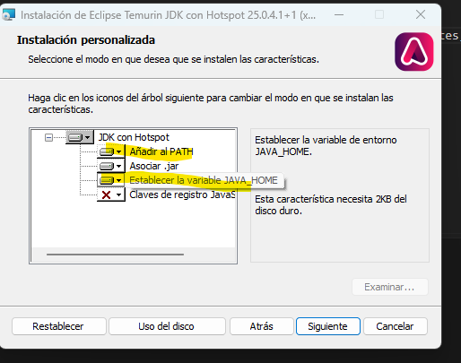

También podéis instalarlo desde la terminal con el gestor de paquetes de Windows:

```powershell
winget install EclipseAdoptium.Temurin.25.JDK
```

**macOS.** Instalador `.pkg` de [adoptium.net](https://adoptium.net/) o, si usáis Homebrew, `brew install --cask temurin@25`.

**Linux.** Desde el gestor de paquetes de la distribución (por ejemplo, `sudo apt install openjdk-25-jdk` en Ubuntu si está disponible) o siguiendo las instrucciones de Adoptium.

#### ¿Qué son PATH y JAVA_HOME?

- **PATH** es una variable de entorno con la lista de carpetas en las que el sistema busca los programas cuando escribís un comando. Si la carpeta `bin` del JDK no está en el PATH, al escribir `javac` el sistema responderá que no reconoce el comando.
- **JAVA_HOME** es una variable de entorno que apunta a la carpeta del JDK. No la usa el sistema, sino otras herramientas (Maven, Gradle, algunos IDE) para saber qué JDK utilizar.

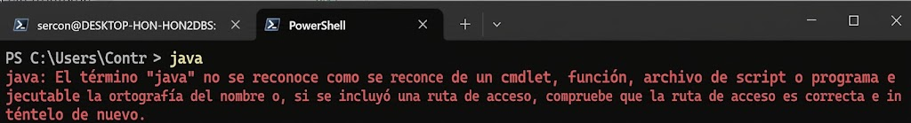

> [!TIP]
> En Windows, puedes abrir terminal (PowerShell) y escribir `echo $Env:PATH` para ver el PATH y `echo $Env:JAVA_HOME` para ver JAVA_HOME.

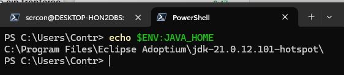

> [!NOTE]
> En la captura aparece un JDK 21 porque es el que tenía instalado en ese equipo. Con Temurin 25, la ruta será similar pero terminará en `jdk-25...-hotspot`.

#### Comprobar la instalación

Cerrad y volved a abrir la terminal (las variables de entorno se recargan al abrirla) y escribid:

```text
java -version
javac -version
```

Deberíais ver algo parecido a:

```text
openjdk version "25.0.1" 2025-10-21 LTS
OpenJDK Runtime Environment Temurin-25.0.1+8 (build 25.0.1+8-LTS)
OpenJDK 64-Bit Server VM Temurin-25.0.1+8 (build 25.0.1+8-LTS, mixed mode, sharing)

javac 25.0.1
```

Los números concretos pueden variar. Lo importante es que ambos comandos respondan y que la versión principal sea la misma.

### 3.4. Compilar y ejecutar desde la terminal

Antes de usar el IDE, vamos a hacer todo el proceso a mano. Así sabréis qué está automatizando el IDE. Si habeís hecho esta actividad de ampliación, ya os sonará familiar.

**1.** Dentro de vuestra carpeta `EDE`, cread esta estructura de carpetas con el explorador o con `mkdir`:

```text
terminal/
└── src/
    └── ejemplo/
        └── HolaMundo.java
```

**2.** Escribid en `HolaMundo.java` (con VS Code o el Bloc de notas):

```java
package ejemplo;

public class HolaMundo {

    public static void main(String[] args) {
        String nombre = "estudiante";
        if (args.length > 0) {
            nombre = args[0];
        }

        String[] huecos = {"Lunes 16:00", "Martes 17:30", "Jueves 19:00"};

        System.out.println("Hola, " + nombre + ". Tutorías disponibles:");
        for (String hueco : huecos) {
            System.out.println(" - " + hueco);
        }
    }
}
```

Este será nuestro programa de referencia durante toda la unidad. Si recibe un argumento, lo usa como nombre; si no, saluda de forma genérica.

**3.** Desde la carpeta `terminal`, compilad indicando con `-d` dónde dejar los `.class`:

```text
javac -d out src/ejemplo/HolaMundo.java
```

Aparecerá `out/ejemplo/HolaMundo.class`. Fijaos en que `javac` respeta la estructura de paquetes: el paquete `ejemplo` se convierte en la carpeta `ejemplo`.

**4.** Ejecutad indicando con `-cp` (*classpath*) dónde están las clases y el **nombre completo** de la clase, con su paquete:

```text
java -cp out ejemplo.HolaMundo
java -cp out ejemplo.HolaMundo Lucía
```

**5.** Empaquetad en un JAR indicando cuál es la clase principal:

```text
jar --create --file HolaMundo.jar --main-class ejemplo.HolaMundo -C out .
java -jar HolaMundo.jar
```

`-C out .` significa «entra en `out` y añade todo su contenido». La opción `--main-class` escribe dentro del JAR un archivo `META-INF/MANIFEST.MF` con la línea `Main-Class: ejemplo.HolaMundo`. Gracias a ello, `java -jar` sabe qué clase ejecutar.

**6.** Por curiosidad, mirad el bytecode que ha generado el compilador:

```text
javap -c -cp out ejemplo.HolaMundo
```

Veréis instrucciones como `getstatic`, `ldc` o `invokevirtual`: es el código intermedio que ejecuta la JVM y del que hablamos en la UP01.

> [!TIP]
> Para programas de un solo archivo, desde Java 11 podéis saltaros la compilación explícita: `java src/ejemplo/HolaMundo.java` compila en memoria y ejecuta directamente. Es muy cómodo para pruebas rápidas, pero no genera ningún `.class` ni ningún ejecutable que distribuir.

> [!NOTE]
> Desde Java 25 un programa sencillo puede escribirse sin declarar la clase: un archivo con `void main() { IO.println("Hola"); }` es un programa válido. Esta sintaxis está pensada para empezar a programar; en este módulo seguiremos usando la forma clásica, que es la que encontraréis en proyectos reales.

**Resultado esperado:** tenéis `HolaMundo.jar` funcionando sin haber abierto un IDE. Guardad este JAR, porque en el apartado 9 lo compararemos con los que generen IntelliJ IDEA y VS Code.

Aquí tenéis un resumen en vídeo del proceso: [https://youtu.be/BYyw7sHTSHM](https://youtu.be/BYyw7sHTSHM). Acordaros de ajustar la calidad del vídeo, por defecto puede que te lo coja a 240p y no se vea bien el texto.

## 4. INTELLIJ IDEA

### 4.1. Licencia y ediciones

Hasta 2025, IntelliJ IDEA se distribuía en dos productos: **Community Edition**, gratuita y de código abierto, y **Ultimate**, de pago. Desde la versión **2025.3**, JetBrains distribuye un **único IntelliJ IDEA**:

- Las funciones de la antigua Community (Java, Kotlin, Maven, Gradle, Git, depurador, JUnit...) siguen siendo **gratuitas**. Es todo lo que necesitáis en este módulo.
- Las funciones avanzadas (Spring y otros frameworks empresariales, desarrollo web completo, herramientas de bases de datos, perfilador...) requieren una **suscripción**.
- El código del núcleo sigue siendo abierto y se puede consultar en GitHub (`JetBrains/intellij-community`).

Encontraréis muchos tutoriales y apuntes antiguos que hablan de «Community» y «Ultimate». Ahora sabéis a qué se refieren.

#### Licencia educativa

Como estudiantes, podéis solicitar gratis la **licencia educativa de JetBrains**, que desbloquea las funciones de pago de **todos** sus IDE mientras estéis estudiando:

1. Entrad en [jetbrains.com/community/education](https://www.jetbrains.com/community/education/#students) y elegid la opción para estudiantes.
2. Verificad vuestra condición de estudiante con el correo institucional `@alu.edu.gva.es` o, si ya lo tenéis, con el **GitHub Student Developer Pack**.
3. Se creará una cuenta de JetBrains. Al abrir IntelliJ IDEA, iniciad sesión con ella en **Help | Register...** (o desde el aviso de licencia de la pantalla de bienvenida).

La licencia se renueva anualmente mientras sigáis siendo estudiantes. Si la verificación da problemas, no os preocupéis: para este módulo bastan las funciones gratuitas.

### 4.2. Instalación y actualizaciones

#### Instalación

Ya lo instalasteis con **Toolbox App**. Toolbox es la forma recomendada porque gestiona en un único lugar la instalación, las actualizaciones y las versiones de todos los IDE de JetBrains. También es posible descargar el instalador directamente desde [jetbrains.com/idea/download](https://www.jetbrains.com/idea/download/) o, en Linux, usar paquetes Snap o Flatpak.

**Requisitos orientativos:** 8 GB de RAM como mínimo (16 GB recomendados), unos 3,5 GB de disco y un sistema operativo de 64 bits actualizado. Con 8 GB funciona, pero conviene cerrar el navegador y otras aplicaciones pesadas.

#### Configurar las actualizaciones con Toolbox

En Toolbox, pulsad los tres puntos (**⋮**) junto a IntelliJ IDEA y elegid **Settings**. Encontraréis:

| Opción | Qué hace |
|---|---|
| **Update channel** | Elegir el canal: **Release** (versiones estables) o **Early Access Program (EAP)**, versiones previas para probar novedades antes de que se publiquen. |
| **Update automatically** | Instalar las actualizaciones automáticamente o esperar a que las confirméis. |
| **Rollback / versiones anteriores** | Volver a la versión anterior si una actualización da problemas, o instalar una versión concreta. |
| **Configuration** | Opciones de memoria máxima del IDE (*Maximum heap size*), carpeta de instalación... |

En la configuración general de Toolbox (icono del engranaje del propio Toolbox) podéis decidir si Toolbox se actualiza solo, si se inicia con el sistema y si se conservan versiones anteriores para poder volver a ellas.

**Recomendación para el curso:** canal **Release**, actualización automática **desactivada**. Una actualización, puede cambiar menús o romper un plugin. Actualizad cuando tengáis tiempo para comprobar que todo funciona.

#### Configurar las actualizaciones desde el IDE

Dentro de IntelliJ IDEA, en **Settings | Appearance & Behavior | System Settings | Updates**, podéis:

- Activar o desactivar la comprobación automática de **actualizaciones del IDE** y elegir el canal.
- Activar o desactivar la comprobación de **actualizaciones de plugins**.
- Comprobar manualmente si hay actualizaciones (*Check for updates...*).

Si el IDE está gestionado por Toolbox, las actualizaciones del propio IDE se gestionan desde Toolbox, y la pantalla del IDE os lo indicará. Las actualizaciones de **plugins** se gestionan siempre desde el IDE: cuando hay alguna disponible, aparece un aviso y un número junto a la pestaña **Installed** de **Settings | Plugins**.

### 4.3. La interfaz

Desde 2024, IntelliJ IDEA usa por defecto la **nueva interfaz** (*New UI*), más limpia que la clásica. Si veis capturas antiguas con muchos iconos y barras, corresponden a la interfaz clásica.

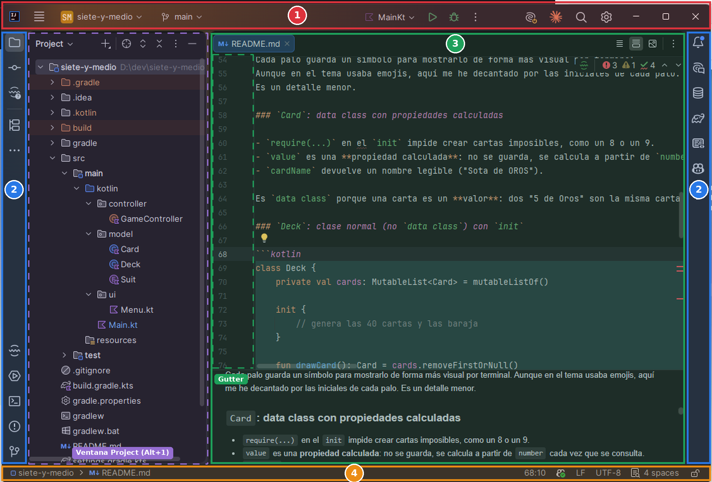

| Zona | Dónde está | Qué contiene |
|---|---|---|
| **1. Barra superior** (*main toolbar*) | Arriba | Menú principal (icono ☰ en Windows y Linux), selector de proyecto, rama de Git, **widget de ejecución** (configuración, botones *Run* y *Debug*), búsqueda y ajustes. |
| **2. Barras laterales de ventanas** | Bordes izquierdo y derecho | Iconos que abren las **ventanas de herramientas** (*tool windows*): *Project*, *Commit*, *Structure*, *Terminal*, *Run*, *Problems*, *Maven*, *Gradle*... |
| **3. Editor** | Centro | Los archivos abiertos, en pestañas. El margen izquierdo (*gutter*) muestra números de línea, iconos de ejecución y puntos de ruptura. |
| **4. Barra de estado** | Abajo | Ruta del archivo, posición del cursor, codificación (UTF-8), tipo de salto de línea, indentación y tareas en segundo plano (como *Indexing...*). |

Las ventanas de herramientas se abren y cierran con un clic en su icono o con *Alt+número*: *Alt+1* para *Project*, *Alt+4* para *Run*, *Alt+F12* para *Terminal*. Podéis arrastrar sus iconos para recolocarlas.

> [!TIP]
> En la pantalla de bienvenida, la sección **Learn** ofrece un curso interactivo dentro del propio IDE (*IDE Features Trainer*) con lecciones sobre edición, navegación, refactorización y depuración. Dedicadle media hora: es la forma más rápida de soltarse con IntelliJ IDEA.

### 4.4. Primer proyecto

Vamos a crear en IntelliJ IDEA el mismo programa que compilasteis desde la terminal.

**1. Nuevo proyecto.** En la pantalla de bienvenida, **New Project** (o, con un proyecto abierto, **File | New | Project...**).

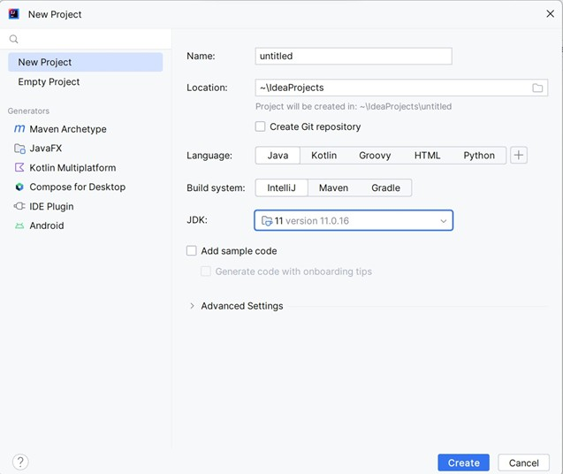

**2. Configurad el proyecto:**

| Campo | Valor | Explicación |
|---|---|---|
| **Name** | `MiPrimerProyectoJava` | Nombre del proyecto y de su carpeta. |
| **Location** | Vuestra carpeta `EDE` | Dónde se creará la carpeta del proyecto. |
| **Create Git repository** | Desmarcado | Lo trabajaremos más adelante. |
| **Language** | Java | IntelliJ IDEA también ofrece Kotlin, Groovy y otros con plugins. |
| **Build system** | IntelliJ | El sistema de construcción propio del IDE. Maven y Gradle los presentaremos más adelante. |
| **JDK** | 25 | Si no aparece, **Download JDK...** (apartado 3.3). |
| **Add sample code** | Desmarcado | Escribiremos el código nosotros. |

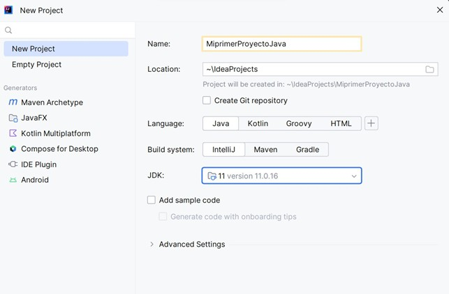

> [!NOTE]
> En la captura aparece el JDK 11 porque se tomó con una instalación antigua. Vosotros debéis seleccionar el **JDK 25**.

**3. Estructura del proyecto.** IntelliJ IDEA crea:

```text
MiPrimerProyectoJava/
├── .idea/                    ← configuración del proyecto para IntelliJ IDEA
├── src/                      ← código fuente (carpeta marcada como Sources Root)
├── .gitignore                ← archivos que Git no debe registrar (UP04)
└── MiPrimerProyectoJava.iml  ← descripción del módulo: carpetas, dependencias
```

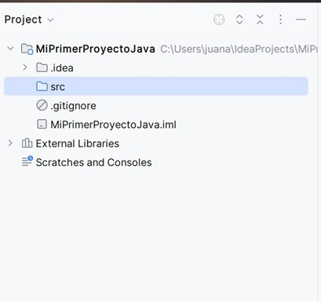

La carpeta `src` aparece en azul porque está marcada como **Sources Root**: IntelliJ IDEA sabe que ahí está el código que hay que compilar. La carpeta `out`, donde irán los `.class`, aparecerá al compilar por primera vez.

En **External Libraries** veréis el JDK con el que trabaja el proyecto. Si desplegáis sus librerías, encontraréis las clases de la API estándar, como `String` o `System`.

**4. Crear la clase.** Clic derecho sobre `src` → **New | Java Class** y escribid `ejemplo.HolaMundo`. Al poner el paquete delante con un punto, IntelliJ IDEA crea a la vez el paquete `ejemplo` y la clase `HolaMundo` dentro.

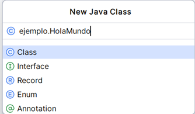

**5. Escribir el código.** Dentro de la clase, escribid `main` y pulsad *Enter* (o *Tab*): IntelliJ IDEA completa la cabecera del método `main`. Es una **plantilla** (*live template*); veremos cómo crear las vuestras en el apartado 5.5.

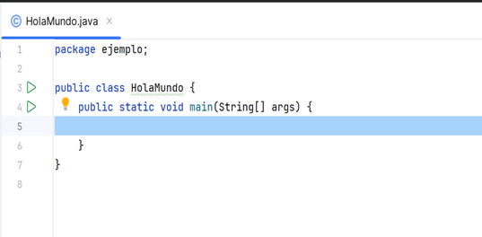

Completad el código con el mismo contenido del apartado 3.4. Mientras escribís, fijaos en estas ayudas:

- Escribid `sout` y pulsad *Tab*: se convierte en `System.out.println();`.
- Escribid `huecos.for` y pulsad *Tab*: se genera un bucle *for-each* sobre el array.
- Si cometéis un error, el código se subraya en rojo antes de compilar. Situad el cursor encima y pulsad *Alt+Enter* para ver posibles soluciones.

**6. Ejecutar.** Pulsad el triángulo verde que aparece en el margen junto a la clase o al método `main` y elegid **Run 'HolaMundo.main()'** (o *Ctrl+Shift+F10* con el cursor en el archivo). La salida aparecerá en la ventana **Run**.

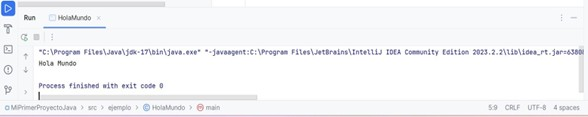

### 4.5. Configuraciones de ejecución

Al ejecutar por primera vez, IntelliJ IDEA crea una **configuración de ejecución** (*Run Configuration*): un conjunto guardado de instrucciones sobre **qué** ejecutar y **cómo**. La veréis seleccionada en el widget de ejecución de la barra superior.

Abrid **Run | Edit Configurations...** (o el desplegable del widget de ejecución → **Edit Configurations...**) y observad sus campos:

| Campo | Para qué sirve |
|---|---|
| **Name** | Nombre de la configuración. |
| **JDK / JRE** | Con qué Java se ejecuta. |
| **Main class** | Clase con el método `main`. |
| **Program arguments** | Argumentos que recibe `main` en `args`. |
| **VM options** | Opciones para la JVM, por ejemplo `-Xmx512m` para limitar la memoria. |
| **Working directory** | Carpeta desde la que se ejecuta el programa (importa al leer archivos con rutas relativas). |
| **Environment variables** | Variables de entorno para el programa. |
| **Before launch** | Tareas previas: por defecto, **Build**; se pueden añadir otras. |
| **Store as project file** | Guarda la configuración en una carpeta `.run/` del proyecto para compartirla con el equipo mediante Git. |

**Práctica:**

1. Duplicad la configuración (icono de copiar) y llamadla `HolaMundo (Lucía)`.
2. En **Program arguments**, escribid `Lucía`.
3. Ejecutad las dos configuraciones y comparad la salida.

Esto equivale a escribir `java -cp out ejemplo.HolaMundo Lucía` en la terminal. Las configuraciones de ejecución son una forma de **automatización**: guardáis una vez cómo se lanza el programa y la repetís con un clic.

Existen muchos tipos de configuración: *Application*, *JAR Application* (ejecutar un `.jar`), *JUnit* (pruebas), *Shell Script*, *Maven*, *Gradle*... Con el tipo **Compound** podéis lanzar varias configuraciones a la vez.

### 4.6. Atajos imprescindibles

No intentéis memorizar cien atajos. Aprended estos conforme los vayáis necesitando y añadid otros cuando notéis que repetís una acción con el ratón:

| Atajo (Windows / Linux) | Acción |
|---|---|
| **Shift, Shift** (dos veces) | *Search Everywhere*: buscar archivos, clases, acciones y opciones. |
| **Ctrl+Shift+A** | *Find Action*: buscar cualquier acción del IDE por su nombre. |
| **Alt+Enter** | Mostrar soluciones y mejoras para el código bajo el cursor. |
| **Ctrl+Space** | Autocompletado. |
| **Ctrl+Alt+L** | Reformatear el código. |
| **Ctrl+/** | Comentar o descomentar la línea. |
| **Ctrl+D** | Duplicar la línea. |
| **Ctrl+Y** | Borrar la línea. |
| **Shift+F6** | Renombrar (variable, método, clase...) en todo el proyecto. |
| **Ctrl+B** o **Ctrl+clic** | Ir a la declaración. |
| **Ctrl+E** | Archivos recientes. |
| **Shift+F10** / **Shift+F9** | Ejecutar / depurar la configuración seleccionada. |
| **Ctrl+F9** | Compilar el proyecto (*Build Project*). |
| **Ctrl+Alt+S** | Abrir **Settings**. |
| **Ctrl+Alt+Shift+S** | Abrir **Project Structure**. |
| **Alt+1** | Mostrar u ocultar la ventana *Project*. |

En macOS, la mayoría de los atajos sustituyen *Ctrl* por *⌘* y *Alt* por *⌥*, aunque no todos. Por ejemplo, **Settings** se abre con *⌘,*. Podéis consultar la lista completa en **Help | Keyboard Shortcuts PDF**.

> [!TIP]
> **Ctrl+Shift+A** es el atajo que lo resuelve todo. Si no recordáis dónde está una opción, buscadla por su nombre. Funciona incluso para activar o desactivar ajustes.

## 5. PERSONALIZAR Y AUTOMATIZAR INTELLIJ IDEA

Un entorno bien configurado os ahorra tiempo cada día.

Todos los ajustes se abren con **Settings** (*Ctrl+Alt+S*). La ventana tiene un buscador arriba a la izquierda: escribid lo que buscáis (`font`, `tabs`, `save`) y se filtrarán las opciones.

### 5.1. Niveles de configuración

IntelliJ IDEA guarda los ajustes en distintos niveles:

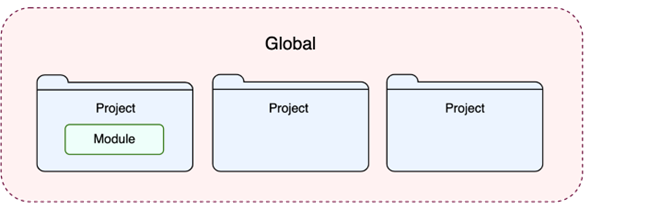

- **Global (IDE)**: se aplica a todos los proyectos que abráis con esa instalación. Incluye la apariencia (tema, fuente, menús), los atajos, los plugins, las plantillas y la configuración del depurador. Se guarda en la carpeta de configuración de vuestro usuario.
- **Proyecto**: solo afecta al proyecto actual. Incluye el JDK del proyecto, el estilo de código (si elegís el esquema *Project*), las inspecciones, las configuraciones de ejecución y la configuración de Git. Se guarda en la carpeta `.idea/` del proyecto.
- **Módulo**: un proyecto puede dividirse en **módulos** con sus propias carpetas de código, dependencias y JDK. Se guarda en los archivos `.iml`.

En la ventana **Settings**, las opciones que solo afectan al proyecto actual muestran un pequeño icono o el texto *For current project*.

**¿Por qué importa?** Lo que se guarda en el proyecto puede compartirse con el resto del equipo mediante Git, de forma que todos formateen el código igual o lancen el programa con la misma configuración. Lo que es global es solo vuestro.

Si necesitáis configurar los ajustes que tendrán los proyectos **nuevos**, usad **File | New Projects Setup | Settings for New Projects...**.

### 5.2. Apariencia y editor

| Qué | Dónde | Sugerencia |
|---|---|---|
| **Tema** | **Settings \| Appearance & Behavior \| Appearance \| Theme** | Claro, oscuro o alto contraste. Con *Sync with OS*, el tema sigue al del sistema. |
| **Fuente del editor** | **Settings \| Editor \| Font** | Tamaño 14–16 y una fuente monoespaciada como JetBrains Mono. Las **ligaduras** (*ligatures*) muestran `!=` o `->` como un solo símbolo: probadlas. |
| **Esquema de colores** | **Settings \| Editor \| Color Scheme** | Colores del código. Se pueden instalar más esquemas como plugins. |
| **Zoom con la rueda** | **Settings \| Editor \| General \| Mouse Control** | Activad *Change font size with Ctrl+Mouse Wheel*. |
| **Mostrar espacios** | **Settings \| Editor \| General \| Appearance** | *Show whitespaces* ayuda a ver si se indenta con espacios o tabuladores. |
| **Pestañas del editor** | **Settings \| Editor \| General \| Editor Tabs** | Número máximo de pestañas abiertas y su posición. |
| **Idioma de la interfaz** | **Settings \| Appearance & Behavior \| System Settings \| Language and Region** | No hay traducción oficial al castellano; mejor acostumbrarse al inglés. |

Para explicar código a otras personas o grabar un vídeo, usad **View | Appearance | Enter Presentation Mode**: amplía la fuente y oculta todo excepto el editor. Para concentraros, **Zen Mode** hace algo parecido sin ampliar la letra.

### 5.3. Estilo de código, formateo y EditorConfig

El **estilo de código** define cómo se presenta el código: indentación, espacios, posición de las llaves, longitud máxima de línea, orden de los `import`... No cambia lo que hace el programa, pero hace que todo el código de un equipo se lea igual.

Se configura en **Settings | Editor | Code Style | Java**. En la parte superior, **Scheme** permite elegir entre:

- **Default (IDE)**: el estilo se aplica a todos vuestros proyectos.
- **Project**: el estilo se guarda en el proyecto y se comparte con el equipo.

Algunas opciones útiles:

| Pestaña | Opción | Ejemplo |
|---|---|---|
| *Tabs and Indents* | Usar espacios o tabuladores; tamaño de indentación. | 4 espacios. |
| *Wrapping and Braces* | Longitud máxima de línea (*Hard wrap at*). | 120 caracteres. |
| *Imports* | Cuándo agrupar los `import` con `*`. | Nunca, para ver qué se importa exactamente. |

Para aplicar el estilo, usad **Code | Reformat Code** (*Ctrl+Alt+L*). Con un archivo seleccionado se formatea ese archivo; con una carpeta seleccionada en la ventana *Project*, todos los archivos que contiene.

#### EditorConfig: un estilo para todos los entornos

¿Qué ocurre si una persona del equipo usa IntelliJ IDEA y otra VS Code? Cada IDE tiene su propia configuración de estilo. Para eso existe **EditorConfig**: un archivo `.editorconfig` en la raíz del proyecto con reglas básicas que respetan la mayoría de editores e IDE.

```ini
# .editorconfig
root = true

[*]
charset = utf-8
end_of_line = lf
insert_final_newline = true
trim_trailing_whitespace = true

[*.java]
indent_style = space
indent_size = 4
max_line_length = 120

[*.md]
trim_trailing_whitespace = false
```

El archivo no existe por defecto: hay que crearlo y añadirlo al repositorio, igual que cualquier otro archivo del proyecto. La línea `root = true` indica que es el archivo principal y que no hay que buscar otros en las carpetas superiores. En Markdown se desactiva la eliminación de espacios finales porque dos espacios al final de una línea equivalen a un salto de línea.

IntelliJ IDEA lo soporta de serie: si existe el archivo, sus reglas tienen prioridad sobre la configuración del IDE. Además, podéis crearlo desde el menú contextual (*New → EditorConfig File*), que permite exportar la configuración de estilo actual del IDE. VS Code lo soporta instalando la extensión **EditorConfig for VS Code**, que también añade una opción para generar el archivo desde el explorador.

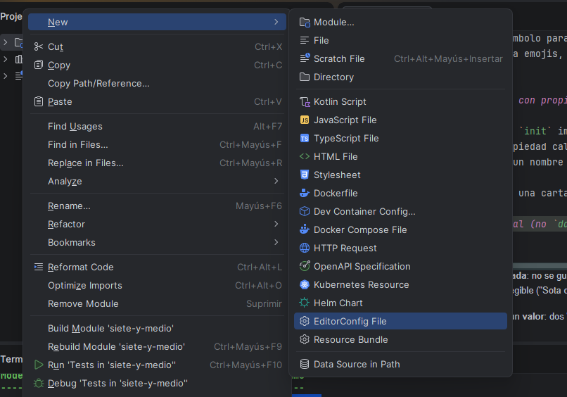

Las reglas se aplican a medida que escribís y guardáis; no reformatean automáticamente los archivos existentes. Y no todos los editores soportan todas las propiedades: las básicas (codificación, finales de línea, sangría) funcionan en casi todos, pero otras, como `max_line_length`, dependen de cada editor.

Es un buen ejemplo de **característica común** entre entornos conseguida mediante un estándar.

### 5.4. Acciones al guardar

IntelliJ IDEA guarda los archivos automáticamente: no hace falta pulsar *Ctrl+S* (aunque podéis hacerlo). Además, puede ejecutar tareas cada vez que se guarda. Activadlas en **Settings | Tools | Actions on Save**:

| Acción | Qué hace |
|---|---|
| **Reformat code** | Aplica el estilo de código. Podéis limitarlo a las líneas modificadas. |
| **Optimize imports** | Elimina los `import` que no se usan y los ordena. |
| **Rearrange code** | Reordena los miembros de la clase según unas reglas. |
| **Run code cleanup** | Aplica correcciones automáticas de algunas inspecciones. |

Con *Reformat code* y *Optimize imports* activados, vuestro código estará siempre formateado sin que tengáis que pensar en ello. Es una de las automatizaciones más rentables.

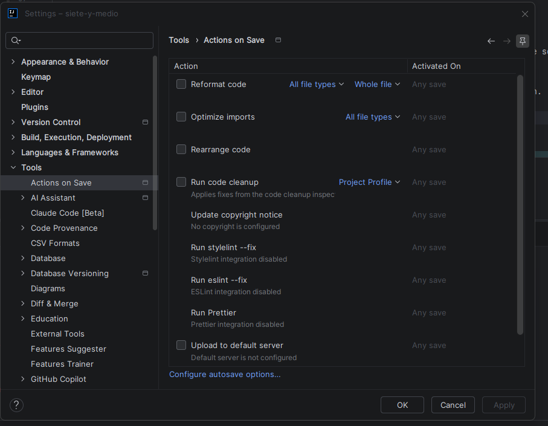

### 5.5. Plantillas de código

#### Live templates

Las **plantillas** (*live templates*) son abreviaturas que se expanden en un fragmento de código. Ya habéis usado `main` y `sout`. Otras útiles en Java:

| Abreviatura | Se convierte en |
|---|---|
| `main` o `psvm` | `public static void main(String[] args) { }` |
| `sout` | `System.out.println();` |
| `soutv` | `System.out.println("variable = " + variable);` con la última variable. |
| `fori` | Un bucle `for` con índice. |
| `iter` | Un bucle *for-each* sobre una colección o un array. |
| `ifn` | `if (variable == null) { }` |

Podéis verlas todas, modificarlas y crear las vuestras en **Settings | Editor | Live Templates**.

**Práctica: crear una plantilla.** Vamos a crear `cab`, que inserte una cabecera con vuestro nombre y la fecha:

1. En **Live Templates**, seleccionad el grupo **Java** y pulsad **+ | Live Template**.
2. **Abbreviation**: `cab`. **Description**: `Cabecera de ejercicio`.
3. **Template text**:

   ```text
   // Autor: $AUTOR$
   // Fecha: $FECHA$
   // Ejercicio: $END$
   ```

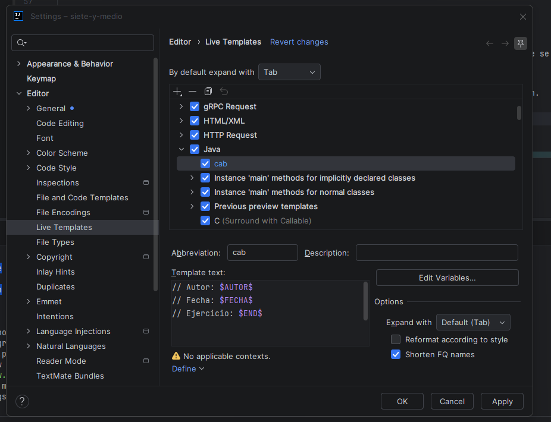

4. Pulsad **Edit Variables** y, en la columna **Expression**, asignad `user()` a `AUTOR` y `date()` a `FECHA`.

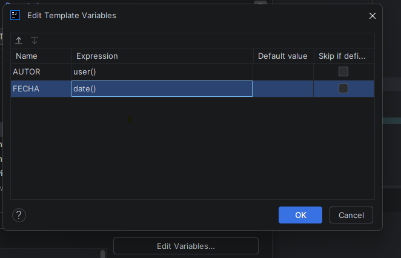

5. Abajo, en **No applicable contexts. Define**, marcad **Java**.

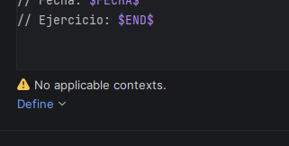

6. Aplicad, id a un archivo Java, escribid `cab` y pulsad *Tab*.

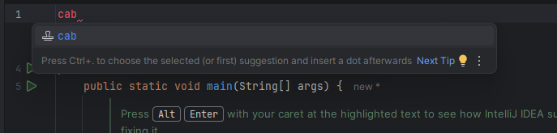

`$END$` marca dónde queda el cursor al terminar. Cualquier otra variable entre `$` se rellena con su expresión o se deja para que la escribáis.

#### Postfix completion

Las plantillas **postfix** se escriben **después** de una expresión, con un punto. Son muy rápidas:

| Escribís | Obtenéis |
|---|---|
| `nombre.sout` | `System.out.println(nombre);` |
| `nombre.var` | `String nombre1 = nombre;` (declara una variable con el tipo correcto) |
| `huecos.for` | `for (String hueco : huecos) { }` |
| `huecos.fori` | `for (int i = 0; i < huecos.length; i++) { }` |
| `args.length > 0.if` | `if (args.length > 0) { }` |
| `nombre.null` | `if (nombre == null) { }` |

La lista completa está en **Settings | Editor | General | Postfix Completion**.

#### Plantillas de archivo

Cuando creáis una clase nueva, IntelliJ IDEA usa una **plantilla de archivo**. Podéis modificarlas en **Settings | Editor | File and Code Templates**. Por ejemplo, en la pestaña **Includes**, la plantilla **File Header** se inserta al principio de cada clase nueva. Probad con:

```java
/**
 * @author ${USER}
 * @since ${DATE}
 */
```

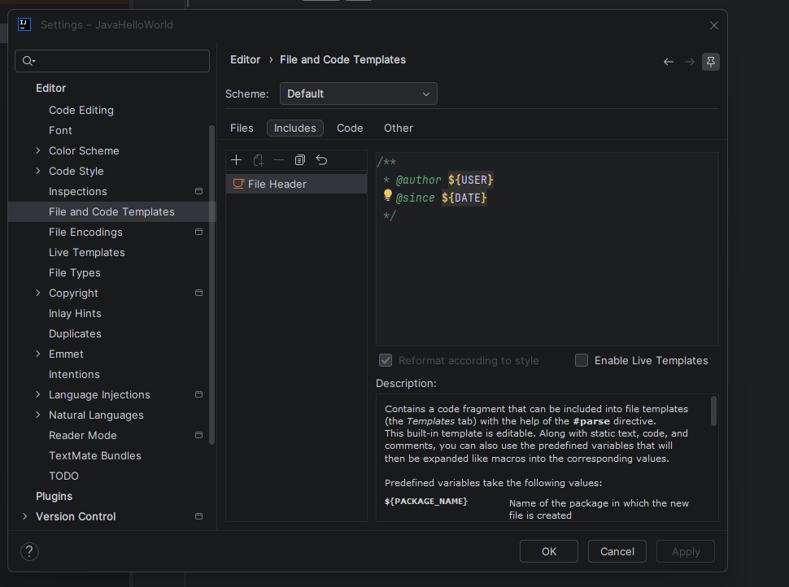

Si lo habéis creado, a partir de ahora, cada clase que creéis llevará esa cabecera de documentación. Lo retomaremos al estudiar Javadoc.

### 5.6. Macros

Una **macro** graba una secuencia de acciones de edición para repetirla después. Es útil cuando tenéis que hacer la misma transformación en muchas líneas.

1. **Edit | Macros | Start Macro Recording**. Aparecerá un indicador en la barra de estado.
2. Realizad las acciones: por ejemplo, ir al final de la línea (*End*), escribir `;` y bajar a la siguiente (*flecha abajo*).
3. **Edit | Macros | Stop Macro Recording** y dadle un nombre.
4. Reproducidla con **Edit | Macros | Play Back Last Macro** o eligiéndola por su nombre.

Podéis asignar un atajo a una macro desde **Settings | Keymap**, en la carpeta **Macros**.

> [!NOTE]
> Las macros graban acciones del editor, no el movimiento del ratón ni las acciones dentro de diálogos. Para cambios estructurales en muchos archivos suele ser mejor la búsqueda y sustitución (*Ctrl+Shift+R*), que admite expresiones regulares, o las refactorizaciones del IDE.

### 5.7. Atajos propios y keymaps

En **Settings | Keymap** podéis:

- Elegir un **keymap** completo predefinido. Si venís de otro entorno, existen keymaps (algunos como plugins) que imitan los atajos de **VS Code**, **Eclipse** o **NetBeans**.
- Buscar una acción por su nombre o **por su atajo** (icono de la lupa con teclado) para saber qué hace una combinación.
- Asignar, cambiar o eliminar el atajo de cualquier acción: clic derecho sobre ella → **Add Keyboard Shortcut**.

Si modificáis un keymap predefinido, IntelliJ IDEA crea una copia con vuestros cambios: siempre podréis volver al original.

> [!TIP]
> El plugin **Key Promoter X** muestra un aviso cada vez que hacéis con el ratón algo que tiene atajo de teclado, y os dice cuál es. Es la forma más eficaz de aprenderlos, volveremos sobre esto cuando hablemos de plugins.

### 5.8. Exportar y sincronizar la configuración

Después de dedicar un rato a configurar el entorno, os interesa no perderlo y poder llevarlo a otro ordenador (por ejemplo, del aula a casa).

- **Sincronizar con la cuenta de JetBrains**: **File | Manage IDE Settings | Backup and Sync** guarda vuestros ajustes en vuestra cuenta de JetBrains y los aplica en cualquier IDE en el que iniciéis sesión. Podéis elegir qué sincronizar: apariencia, keymap, plantillas, plugins...
- **Exportar a un archivo**: **File | Manage IDE Settings | Export Settings...** genera un `.zip` con los ajustes elegidos. Con **Import Settings...** los cargáis en otra instalación.
- **Restaurar valores predeterminados**: **File | Manage IDE Settings | Restore Default Settings...** devuelve el IDE a su estado inicial (hace antes una copia de seguridad). Útil si habéis tocado algo y no sabéis cómo deshacerlo.

## 6. PLUGINS: AÑADIR Y ELIMINAR MÓDULOS

### 6.1. Qué es un plugin

Un **plugin** (o complemento) es un módulo que **amplía** las capacidades del IDE. Gran parte de lo que hace IntelliJ IDEA está implementado como plugins: el soporte de Kotlin, la integración con Git, Maven o Gradle son plugins incluidos de serie (*bundled*).

JetBrains clasifica los plugins en varios tipos:

| Tipo | Qué aporta | Ejemplo |
|---|---|---|
| **Soporte de lenguajes** (*Custom language support*) | Reconocer un lenguaje: resaltado, análisis, autocompletado, formateo. | Python, Rust, Markdown. |
| **Integración con frameworks** (*Framework integration*) | Ayudas específicas para un framework: navegación, asistentes, inspecciones. | Spring, Quarkus, Jakarta EE. |
| **Integración con herramientas** (*Tool integration*) | Usar herramientas externas sin salir del IDE. | Docker, SonarQube for IDE, GitHub Copilot. |
| **Complementos de la interfaz** (*User interface add-ons*) | Cambiar o ampliar la interfaz del IDE. | Key Promoter X, Rainbow Brackets. |
| **Temas** (*Themes*) | Cambiar el aspecto visual del IDE. | Material Theme UI, Catppuccin. |

### 6.2. Instalar, desactivar y desinstalar

Todo se gestiona desde **Settings | Plugins** (*Ctrl+Alt+S* → *Plugins*), que tiene dos pestañas:

- **Marketplace**: buscar e instalar plugins desde **JetBrains Marketplace**, el repositorio oficial.
- **Installed**: ver los plugins instalados, tanto los incluidos de serie (*bundled*) como los que habéis añadido; activarlos, desactivarlos, actualizarlos o eliminarlos.

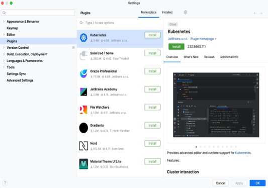

#### Instalar desde Marketplace

1. Pestaña **Marketplace**. Escribid el nombre del plugin en el buscador.
2. Antes de instalar, revisad su ficha: autor, número de descargas, valoración, fecha de la última actualización y compatibilidad con vuestra versión del IDE.
3. Pulsad **Install**. Algunos plugins requieren reiniciar el IDE: aparecerá el botón **Restart IDE**.

#### Instalar desde disco

Útil para instalar una versión concreta de un plugin (por ejemplo, si la última falla) o un plugin que no está publicado en el Marketplace:

1. Descargad el archivo del plugin (`.zip` o `.jar`), por ejemplo desde la pestaña *Versions* de su página en [plugins.jetbrains.com](https://plugins.jetbrains.com/).
2. En **Settings | Plugins**, pulsad el engranaje (⚙) → **Install Plugin from Disk...**.
3. Seleccionad el archivo y reiniciad si os lo pide.

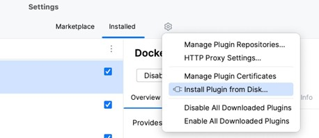

Desde ese mismo menú del engranaje podéis añadir **repositorios de plugins personalizados** (*Manage Plugin Repositories...*), algo habitual en empresas con plugins propios.

#### Desactivar

Desactivar un plugin lo deja instalado pero inactivo. Es la opción adecuada si no lo necesitáis ahora o si sospecháis que causa problemas:

1. Pestaña **Installed**. Buscad y seleccionad el plugin.
2. Pulsad **Disable** en su ficha (o desmarcad su casilla en la lista).

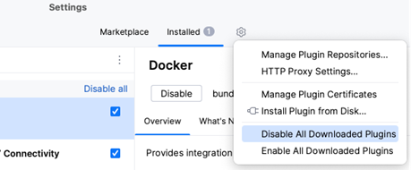

Desactivar plugins incluidos de serie que no usáis (por ejemplo, soporte de lenguajes que no vais a utilizar) puede mejorar el rendimiento del IDE.

#### Desinstalar

1. Pestaña **Installed**. Seleccionad el plugin.
2. Desplegad la flecha junto a **Disable** y elegid **Uninstall**.

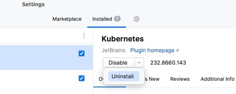

Los plugins incluidos de serie (*bundled*) **no se pueden desinstalar**, solo desactivar, porque forman parte de la distribución del IDE.

### 6.3. Plugins requeridos y sugeridos

**Plugins requeridos.** Un proyecto puede declarar qué plugins necesita. Si alguien abre el proyecto sin ellos, IntelliJ IDEA le avisará y le ofrecerá instalarlos. Se configura en **Settings | Build, Execution, Deployment | Required Plugins** pulsando **+**. Como se guarda en la carpeta `.idea/`, se comparte con el equipo. Es una forma de **automatizar** que todos tengan el mismo entorno.

**Plugins sugeridos.** Al abrir un proyecto, IntelliJ IDEA analiza sus archivos y librerías y puede **sugerir** plugins útiles (por ejemplo, el de Docker si encuentra un `Dockerfile`). Aparecen como notificación y en la sección **Suggested** de la pestaña *Marketplace*. Si no os interesa, pulsad **Don't suggest again**.

No confundáis ambos: los **requeridos** los define el proyecto a propósito; los **sugeridos** los propone el IDE automáticamente.

### 6.4. Plugins recomendados para el curso

| Plugin | Para qué | Cuándo lo usaremos |
|---|---|---|
| **Key Promoter X** | Enseña los atajos de teclado de lo que hacéis con el ratón. | Desde ya. |
| **SonarQube for IDE** (antes SonarLint) | Analiza la calidad del código y señala errores potenciales y malas prácticas mientras escribís. | Desde ya; Refactorización |
| **PlantUML Integration** | Escribir diagramas UML en texto y verlos dentro del IDE. | UML |
| **GitHub Copilot** | Asistente de IA. | Opcional. |

El soporte de **Markdown**, **Git**, **Maven**, **Gradle**, **JUnit** y **Kotlin** ya viene incluido: no tenéis que instalar nada para ellos.

**Práctica:**

1. Instalad **Key Promoter X** desde Marketplace y usad el IDE unos minutos con el ratón. Observad los avisos.
2. Instalad **SonarQube for IDE**. Abrid `HolaMundo.java`, declarad una variable que no uséis y observad qué ocurre.
3. Desactivad **Key Promoter X**, comprobad que dejan de aparecer avisos y volved a activarlo.
4. Instalad un **tema** cualquiera desde Marketplace, aplicadlo y después **desinstaladlo**. Comprobad que el IDE vuelve al tema anterior.

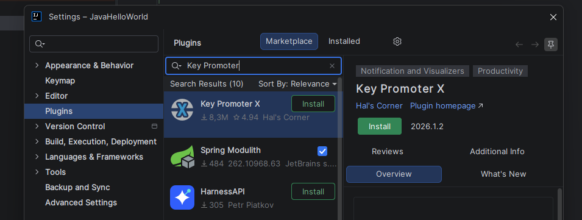

### 6.5. Buenas prácticas

- **Instalad solo lo que uséis.** Cada plugin consume memoria y puede ralentizar el arranque y la indexación.
- **Revisad la procedencia.** Un plugin se ejecuta con los mismos permisos que el IDE: puede leer vuestro código y vuestros archivos. Preferid plugins de autores conocidos, con muchas descargas y mantenimiento reciente.
- **Cuidado con los plugins abandonados.** Si un plugin no se actualiza, puede dejar de funcionar con la siguiente versión del IDE.
- **Si el IDE falla tras instalar algo**, desactivad primero el último plugin instalado. Si el IDE ni siquiera arranca, podéis volver a una versión anterior desde Toolbox o eliminar la carpeta del plugin del directorio de plugins de vuestro usuario.

## 7. GENERAR EJECUTABLES

### 7.1. Qué entendemos por ejecutable

En la UP01 definimos el **código ejecutable** como un archivo que el sistema operativo puede cargar y ejecutar. En el mundo Java el concepto tiene matices, porque entre el código fuente y la CPU está la JVM:

| Resultado | ¿Qué es? | ¿Qué necesita para ejecutarse? | ¿Depende del sistema operativo? |
|---|---|---|---|
| `.class` | Bytecode de una clase. | Una JVM y el resto de clases del programa. | No. |
| `.jar` | Archivo comprimido con los `.class`, recursos y un manifiesto. Si indica la clase principal, es un **JAR ejecutable**. | Una JVM (`java -jar`). | No. |
| Aplicación con `jpackage` | Ejecutable nativo que lleva dentro su propia JVM y el JAR. | Nada: se instala y se ejecuta como cualquier aplicación. | Sí. Se genera para un sistema concreto. |
| Imagen nativa (GraalVM) | El programa Java compilado por adelantado a código máquina. | Nada. | Sí. |
| `.exe` / binario de C | Código máquina generado por el compilador y el enlazador. | Nada (salvo librerías del sistema). | Sí. |

En este apartado generaremos varios de ellos y, en particular, ejecutables a partir de **distintos lenguajes en un mismo entorno**: Java y Kotlin en IntelliJ IDEA. Como contraste, generaremos con CLion un ejecutable nativo en C.

### 7.2. Compilar en IntelliJ IDEA

Cuando ejecutáis el programa, IntelliJ IDEA compila antes lo necesario (es la tarea **Build** de *Before launch*). También podéis compilar explícitamente:

| Acción | Menú | Qué hace |
|---|---|---|
| **Build Project** (*Ctrl+F9*) | **Build \| Build Project** | Compila los archivos modificados desde la última compilación (**compilación incremental**). |
| **Rebuild Project** | **Build \| Rebuild Project** | Borra lo compilado y compila todo de nuevo. Útil cuando algo se comporta de forma extraña. |
| **Recompile** (*Ctrl+Shift+F9*) | **Build \| Recompile 'HolaMundo.java'** | Compila solo el archivo actual. |

Los `.class` se guardan en `out/production/<nombre del módulo>/`, respetando la estructura de paquetes:

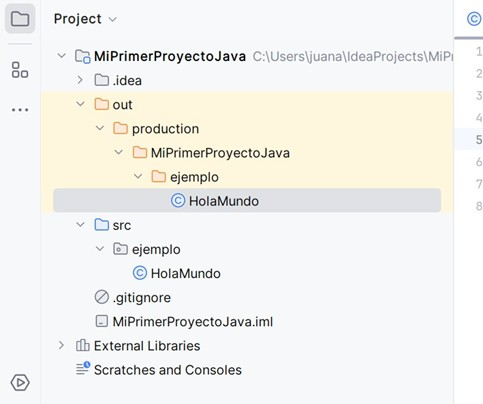

Si hay errores de compilación, aparecen en la ventana **Build**. Haced doble clic sobre un error para ir a la línea que lo provoca.

> [!NOTE]
> Con el sistema de construcción *IntelliJ*, la carpeta `out` la gestiona el IDE. Con Maven sería `target/` y con Gradle `build/`. Son carpetas generadas: no se editan a mano y no se suben a Git, porque se pueden volver a generar en cualquier momento a partir del código fuente.

### 7.3. Empaquetar en un JAR

Para distribuir el programa, lo empaquetaremos en un **JAR ejecutable**. En IntelliJ IDEA un resultado distribuible se llama **artefacto** (*artifact*).

**Crear la configuración del artefacto:**

1. **File | Project Structure** (*Ctrl+Alt+Shift+S*) → **Artifacts**.
2. Pulsad **+** → **JAR** → **From modules with dependencies...**.

   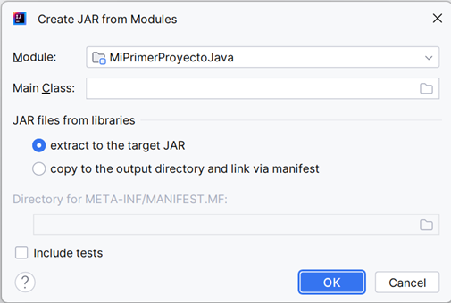

3. En **Main Class**, pulsad el icono de la carpeta y elegid `ejemplo.HolaMundo`.

   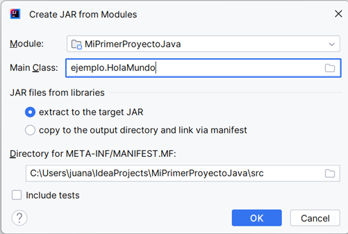

4. En **JAR files from libraries**, dejad **extract to the target JAR**: las librerías que use el programa se incluirán dentro del propio JAR. Ahora no usamos ninguna, pero será importante con Kotlin.
5. Revisad **Directory for META-INF/MANIFEST.MF**: debe ser la carpeta `src` del proyecto. Pulsad **OK**.
6. En la configuración del artefacto que aparece, revisad el **Output directory** y pulsad **Apply** y **OK**.

IntelliJ IDEA habrá creado `src/META-INF/MANIFEST.MF` con este contenido:

```text
Manifest-Version: 1.0
Main-Class: ejemplo.HolaMundo
```

**Generar el JAR:**

1. **Build | Build Artifacts...**.
2. Elegid `MiPrimerProyectoJava:jar` → **Build**.
3. El JAR aparece en `out/artifacts/MiPrimerProyectoJava_jar/`.

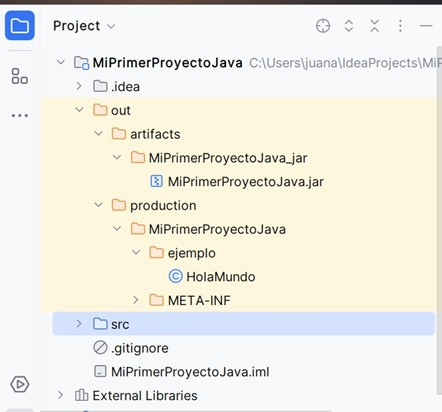

**Probarlo fuera del IDE.** Clic derecho sobre el JAR → **Open In | Terminal** y ejecutad:

```text
java -jar MiPrimerProyectoJava.jar
java -jar MiPrimerProyectoJava.jar Lucía
```

Si funciona, habéis generado un ejecutable que cualquiera con una JVM compatible puede usar, en Windows, macOS o Linux.

> [!TIP]
> Podéis automatizar la ejecución del JAR creando una configuración de ejecución de tipo **JAR Application** que apunte a ese archivo y añadiendo en *Before launch* la tarea **Build Artifacts**. Con un clic se reconstruirá el JAR y se ejecutará.

**¿Qué hay dentro de un JAR?** Un JAR es un archivo ZIP. Podéis comprobarlo listando su contenido:

```text
jar --list --file MiPrimerProyectoJava.jar
```

Veréis `META-INF/MANIFEST.MF` y `ejemplo/HolaMundo.class`. También podéis copiarlo, cambiar la extensión a `.zip` y abrirlo con el explorador. Recordad lo que vimos en la UP01: cambiar la extensión no cambia el contenido, solo cómo lo trata el sistema.

### 7.4. Otro lenguaje en el mismo entorno: Kotlin

**Kotlin** es un lenguaje moderno creado por JetBrains que se compila, como Java, a **bytecode de la JVM**. Es el lenguaje recomendado por Google para Android y viene integrado en IntelliJ IDEA sin instalar nada.

**1.** Cread un proyecto nuevo, **File | New | Project...**, con estos valores:

| Campo | Valor |
|---|---|
| Name | `MiPrimerProyectoKotlin` |
| Language | **Kotlin** |
| Build system | IntelliJ |
| JDK | 25 |
| Add sample code | Desmarcado |

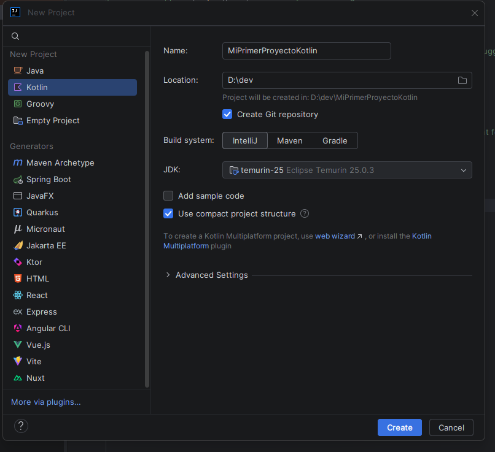

**2.** Clic derecho sobre `src` → **New | Kotlin Class/File** → elegid **File** y llamadlo `Main`. Escribid:

```kotlin
fun main(args: Array<String>) {
    val nombre = if (args.isNotEmpty()) args[0] else "estudiante"
    val huecos = listOf("Lunes 16:00", "Martes 17:30", "Jueves 19:00")

    println("Hola, $nombre. Tutorías disponibles:")
    huecos.forEach { println(" - $it") }
}
```

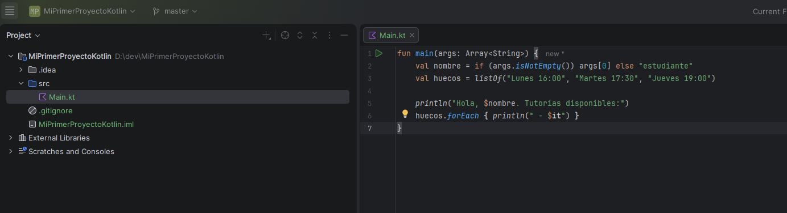

Es el mismo programa. Fijaos en algunas diferencias: no hace falta una clase, `val` declara una variable que no se reasigna, el tipo se deduce automáticamente y `$nombre` inserta el valor de la variable dentro del texto.

**3.** Ejecutadlo con el triángulo verde del margen.

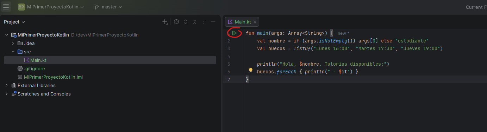

**4.** Compilad (*Ctrl+F9*) y buscad en `out/production/MiPrimerProyectoKotlin/` el resultado: encontraréis **`MainKt.class`**. Kotlin ha generado una clase con el nombre del archivo terminado en `Kt` para alojar la función `main`. **Es bytecode, igual que el de Java**: la misma JVM ejecuta los dos.

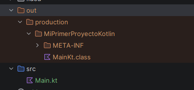

**5.** Generad un JAR como en el apartado anterior. Al elegir la clase principal, seleccionad `MainKt`, y mantened **extract to the target JAR**.

**6.** Ejecutadlo con `java -jar MiPrimerProyectoKotlin.jar`.

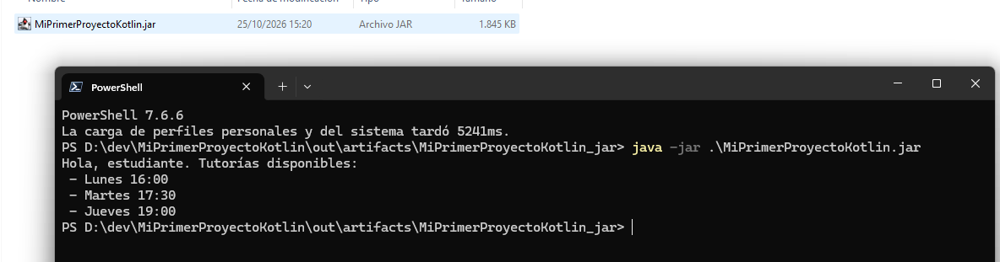

**¿Por qué es importante extraer las librerías en el JAR en el caso de Kotlin?** Un programa Kotlin necesita la **librería estándar de Kotlin** (`kotlin-stdlib`), que no forma parte de la JVM. Si no se incluye en el JAR, al ejecutarlo obtendréis un error `NoClassDefFoundError: kotlin/...`. Abrid el JAR con `jar --list` y comparad su tamaño y contenido con el de Java: veréis cientos de clases de Kotlin dentro.

> [!NOTE]
> Java y Kotlin pueden convivir en un **mismo proyecto**: una clase Kotlin puede usar clases Java y viceversa. Es habitual en proyectos Android que migran poco a poco de Java a Kotlin.

**Conclusión:** en un mismo entorno, IntelliJ IDEA, hemos generado ejecutables a partir de dos lenguajes distintos. Ambos producen bytecode y un JAR ejecutable con `java -jar`, pero el de Kotlin necesita incluir su librería estándar.

### 7.5. Ejecutables nativos: C con CLion

Para ver la diferencia con un ejecutable nativo, vamos a usar **CLion**, el IDE de JetBrains para C y C++ que instalasteis en la UP01. Como pertenece a la misma familia, su interfaz os resultará conocida desde el primer momento.

**1.** En CLion, **New Project** → **C Executable**. Llamadlo `tutorias_c` y dejad el estándar del lenguaje por defecto.

**2.** CLion crea un `main.c` y un archivo `CMakeLists.txt`. **CMake** es la herramienta de construcción más habitual en C y C++; cumple un papel parecido al de Maven o Gradle en Java.

**3.** Sustituid el contenido de `main.c` por:

```c
#include <stdio.h>

int main(int argc, char *argv[]) {
    const char *nombre = (argc > 1) ? argv[1] : "estudiante";
    const char *huecos[] = {"Lunes 16:00", "Martes 17:30", "Jueves 19:00"};

    printf("Hola, %s. Tutorias disponibles:\n", nombre);
    for (int i = 0; i < 3; i++) {
        printf(" - %s\n", huecos[i]);
    }
    return 0;
}
```

(Hemos quitado la tilde de «Tutorías» porque la consola de Windows puede mostrar mal los caracteres acentuados que imprime un programa en C.)

**4.** Ejecutadlo con el botón *Run*. CLion compila con el compilador de C incluido (**MinGW** en Windows) y enlaza el programa.

**5.** Buscad el resultado en la carpeta `cmake-build-debug`: hay un archivo **`tutorias_c.exe`** en Windows (o `tutorias_c` en macOS y Linux). Abrid una terminal en esa carpeta y ejecutadlo directamente:

```text
.\tutorias_c.exe Lucía        (Windows)
./tutorias_c Lucía            (macOS / Linux)
```

**No necesita ninguna máquina virtual**: es código máquina para vuestro procesador y sistema operativo. A cambio, ese `.exe` no funcionará en macOS ni en Linux: habría que compilar de nuevo el código fuente en cada sistema.

| | Java / Kotlin (JAR) | C (ejecutable nativo) |
|---|---|---|
| Resultado | Bytecode dentro de un `.jar` | Código máquina en un `.exe` o binario |
| Para ejecutarlo | Hace falta una JVM | Se ejecuta directamente |
| Portabilidad | El mismo JAR funciona en cualquier sistema con JVM | Hay que compilar para cada sistema |
| Tamaño | Pequeño, pero requiere la JVM instalada | Pequeño y autónomo |

> [!NOTE]
> CLion es gratuito para uso no comercial. Si no vais a programar en C, podéis desinstalarlo desde Toolbox después de esta práctica: también es una forma de practicar la gestión de entornos.

### 7.6. Del JAR a una aplicación instalable: jpackage

Un JAR obliga a que el usuario tenga Java instalado. Para distribuir una aplicación a personas que no saben qué es una JVM, el JDK incluye **`jpackage`**, que crea una aplicación con su propio entorno de ejecución incluido.

Desde la carpeta donde está el JAR que generasteis en IntelliJ IDEA:

```text
jpackage --type app-image --name Tutorias --input . --main-jar MiPrimerProyectoJava.jar
```

Se creará una carpeta `Tutorias` con un **`Tutorias.exe`** (en Windows) y, dentro, una JVM reducida con solo los módulos de Java que necesita el programa. Ejecutad el `.exe` desde la terminal para ver la salida:

```text
.\Tutorias\Tutorias.exe Lucía
```

Comparad tamaños: el JAR ocupa unos pocos kilobytes y la carpeta generada por `jpackage`, decenas de megabytes, porque incluye la JVM.

Con `--type exe` o `--type msi` (Windows), `--type dmg` o `--type pkg` (macOS) y `--type deb` o `--type rpm` (Linux) se genera directamente un **instalador**. En Windows, esos dos tipos requieren tener instalado el **WiX Toolset**; `app-image` no necesita nada adicional.

> [!NOTE]
> En DAM, preparar «paquetes autoinstalables con asistentes incorporados» es una de las competencias del título. `jpackage` es la herramienta estándar del JDK para hacerlo con aplicaciones Java.

### 7.7. Herramientas de construcción: Maven y Gradle

Hasta ahora hemos usado el sistema de construcción propio de IntelliJ IDEA. Funciona bien para proyectos sencillos, pero tiene un problema: **la configuración vive dentro del IDE**. Si alguien abre el proyecto con VS Code o Eclipse, o si queremos compilarlo en un servidor de integración continua (UP05), esa configuración no sirve.

Las **herramientas de construcción** describen el proyecto en un archivo de texto independiente del IDE:

| | Maven | Gradle |
|---|---|---|
| Archivo de configuración | `pom.xml` (XML) | `build.gradle.kts` (Kotlin) o `build.gradle` (Groovy) |
| Carpeta de salida | `target/` | `build/` |
| Empaquetar | `mvn package` | `gradle build` |
| Uso típico | Proyectos Java empresariales | Android, Kotlin, proyectos grandes |

Ambas siguen la misma **estructura de carpetas convencional**:

```text
src/
├── main/
│   ├── java/        ← código fuente
│   └── resources/   ← archivos de configuración, imágenes...
└── test/
    └── java/        ← pruebas (UP11)
```

Sus grandes ventajas son:

- **Gestión de dependencias**: declaráis «necesito JUnit 5» y la herramienta descarga la librería de un repositorio central, junto con las librerías de las que esta depende.
- **Independencia del IDE**: IntelliJ IDEA, VS Code, Eclipse y NetBeans entienden un `pom.xml` o un `build.gradle.kts`. El proyecto se abre igual en todos.
- **Automatización**: compilar, ejecutar pruebas y empaquetar con un único comando, también en servidores sin interfaz gráfica.

**Práctica opcional:** cread un proyecto con **Build system: Maven** en IntelliJ IDEA y copiad dentro la clase `ejemplo.HolaMundo` (en `src/main/java`). Abrid la ventana **Maven** (barra lateral derecha), desplegad **Lifecycle** y haced doble clic en **package**. Aparecerá un JAR en `target/`. Ejecutadlo con:

```text
java -cp target/<nombre>-1.0-SNAPSHOT.jar ejemplo.HolaMundo
```

Fijaos en que aquí usamos `-cp` y el nombre de la clase, no `-jar`: por defecto, Maven no indica la clase principal en el manifiesto. Se puede configurar en el `pom.xml`, pero eso lo dejaremos para más adelante. Volveremos a usar estas herramientas cuando trabajemos con JUnit y con la integración continua.

## 8. VISUAL STUDIO CODE

### 8.1. Otra filosofía

VS Code parte de un enfoque opuesto al de IntelliJ IDEA: un **editor ligero** que no sabe casi nada de ningún lenguaje y al que se le añaden capacidades con **extensiones**.

Algunas diferencias de concepto:

- **No hay «proyectos»**: VS Code abre **carpetas**. La configuración específica de esa carpeta se guarda en una subcarpeta `.vscode/`. Si abrís varias carpetas a la vez, se forma un **workspace** multicarpeta.
- **Todo está en la paleta de comandos**: *Ctrl+Shift+P* abre un buscador con todas las acciones del editor y de las extensiones. Es el equivalente de *Find Action* en IntelliJ IDEA.
- **La configuración es texto**: los ajustes, atajos, tareas y configuraciones de ejecución son archivos JSON que podéis editar directamente, copiar o compartir.

Atajos básicos:

| Atajo | Acción |
|---|---|
| **Ctrl+Shift+P** | Paleta de comandos. |
| **Ctrl+P** | Abrir un archivo por su nombre. |
| **Ctrl+,** | Ajustes. |
| **Ctrl+Shift+X** | Extensiones. |
| **Ctrl+ñ** o **Ctrl+`** | Terminal integrada (según la distribución del teclado). |
| **Shift+Alt+F** | Formatear el documento. |
| **F5** | Iniciar la depuración. |
| **Ctrl+K Ctrl+S** | Ver y editar los atajos. |

> [!NOTE]
> A diferencia de IntelliJ IDEA, VS Code sí tiene traducción oficial al castellano mediante la extensión **Spanish Language Pack**. Os recomendamos mantenerlo en inglés: la documentación, los tutoriales y los mensajes de error que encontraréis estarán en inglés.

### 8.2. Extensiones

Las extensiones se gestionan desde la vista **Extensions** (*Ctrl+Shift+X*) y se descargan del **Visual Studio Marketplace**.

**Para Java**, instalad **Extension Pack for Java** (de Microsoft). Es un paquete que instala a la vez varias extensiones:

| Extensión incluida | Qué aporta |
|---|---|
| Language Support for Java (Red Hat) | El servidor de lenguaje: autocompletado, errores, navegación, refactorizaciones. |
| Debugger for Java | Depuración. |
| Test Runner for Java | Ejecutar pruebas JUnit. |
| Maven for Java | Soporte de proyectos Maven. |
| Project Manager for Java | Vista de proyectos Java, creación de proyectos y exportación de JAR. |
| Gradle for Java | Soporte de proyectos Gradle. |

Al abrir por primera vez un archivo Java, la extensión mostrará una página de bienvenida (*Java Getting Started*) y comprobará si encuentra un JDK. Usará el que esté configurado en `JAVA_HOME` o en el PATH. **Por eso necesitáis haber instalado el JDK en el sistema** (apartado 3.3, opción B).

**Gestionar extensiones (RA2.b):**

| Acción | Cómo |
|---|---|
| Instalar | Buscar en la vista *Extensions* → **Install**. |
| Desactivar | Rueda dentada de la extensión → **Disable**, o **Disable (Workspace)** para desactivarla solo en esta carpeta. |
| Desinstalar | Rueda dentada → **Uninstall**. |
| Instalar una versión concreta | Rueda dentada → **Install Specific Version...**. |
| Instalar desde archivo | Menú **...** de la vista *Extensions* → **Install from VSIX...**. |

La opción **Disable (Workspace)** es una característica específica de VS Code muy útil: podéis tener las extensiones de Python activadas solo en las carpetas de proyectos Python.

**Desde la terminal.** VS Code incluye el comando `code`, que permite gestionar extensiones sin interfaz gráfica, algo muy útil para automatizar la preparación de un equipo:

```text
code --list-extensions
code --install-extension vscjava.vscode-java-pack
code --install-extension EditorConfig.EditorConfig
code --uninstall-extension EditorConfig.EditorConfig
```

**Extensiones recomendadas del proyecto.** El equivalente a los *plugins requeridos* de IntelliJ IDEA es el archivo `.vscode/extensions.json`. Quien abra la carpeta recibirá un aviso para instalar las extensiones recomendadas:

```json
{
  "recommendations": [
    "vscjava.vscode-java-pack",
    "SonarSource.sonarlint-vscode",
    "EditorConfig.EditorConfig"
  ]
}
```

### 8.3. El mismo programa en VS Code

**1.** Abrid la paleta de comandos (*Ctrl+Shift+P*) y ejecutad **Java: Create Java Project...**.

**2.** Elegid **No build tools**, seleccionad vuestra carpeta `EDE` y llamad al proyecto `MiPrimerProyectoVSCode`. Se abrirá una carpeta con esta estructura:

```text
MiPrimerProyectoVSCode/
├── .vscode/
│   └── settings.json   ← dónde está el código, dónde va lo compilado
├── bin/                ← aquí irán los .class
├── lib/                ← librerías externas (.jar)
├── src/
│   └── App.java        ← clase de ejemplo
└── README.md
```

Abrid `.vscode/settings.json`: veréis que indica la carpeta de código (`src`), la de salida (`bin`) y la de librerías (`lib`). Es la misma información que IntelliJ IDEA guarda en `.idea/` y en el `.iml`, pero en un JSON legible.

**3.** Borrad `App.java`. Cread la carpeta `src/ejemplo` y, dentro, `HolaMundo.java` con **exactamente el mismo código** de los apartados anteriores. Podéis copiar el archivo desde el proyecto de IntelliJ IDEA.

**4. Ejecutar.** Encima del método `main` aparecen los enlaces **Run | Debug** (*CodeLens*). Pulsad **Run**. La salida aparece en la terminal integrada. Si os fijáis, VS Code ha lanzado un comando `java` con el *classpath* adecuado: lo mismo que hicisteis a mano en el apartado 3.4.

**5. Argumentos.** Para ejecutar con argumentos, cread una configuración de ejecución: vista **Run and Debug** (*Ctrl+Shift+D*) → **create a launch.json file** → **Java**. Se generará `.vscode/launch.json`. Añadid `"args"` a la configuración de `HolaMundo`:

```json
{
  "type": "java",
  "name": "HolaMundo (Lucía)",
  "request": "launch",
  "mainClass": "ejemplo.HolaMundo",
  "args": "Lucía"
}
```

Es el equivalente de las *Run Configurations* de IntelliJ IDEA, pero escrito en JSON.

**6. Exportar el JAR.** En la vista **Explorer**, abajo, desplegad la sección **Java Projects**. Pasad el ratón sobre el proyecto y pulsad el icono **Export Jar** (o ejecutad **Java: Export Jar...** desde la paleta). Elegid `ejemplo.HolaMundo` como clase principal y confirmad los elementos que se incluyen. Se generará `MiPrimerProyectoVSCode.jar` en la raíz del proyecto.

**7. Probarlo:**

```text
java -jar MiPrimerProyectoVSCode.jar Lucía
```

**Resultado esperado:** el mismo programa funciona igual empaquetado desde VS Code.

### 8.4. Personalizar y automatizar VS Code

#### Ajustes de usuario y de workspace

VS Code tiene dos niveles de configuración principales, equivalentes a los niveles global y de proyecto de IntelliJ IDEA:

- **User**: se aplica a todas las carpetas que abráis.
- **Workspace**: solo a la carpeta actual. Se guarda en `.vscode/settings.json` y tiene prioridad sobre *User*.

Abrid los ajustes con *Ctrl+,*. Podéis usar la interfaz gráfica o, con el icono **Open Settings (JSON)** de la esquina superior derecha, editar el JSON directamente:

```json
{
  "editor.fontSize": 15,
  "editor.fontFamily": "'JetBrains Mono', Consolas, monospace",
  "editor.fontLigatures": true,
  "editor.formatOnSave": true,
  "editor.rulers": [120],
  "files.autoSave": "afterDelay",
  "workbench.colorTheme": "Default Dark Modern"
}
```

Con `editor.formatOnSave` conseguís lo mismo que con *Actions on Save* en IntelliJ IDEA.

#### Snippets

Los **snippets** son el equivalente a las *live templates*. Paleta de comandos → **Snippets: Configure Snippets** → **java**, y añadid:

```json
{
  "Cabecera de ejercicio": {
    "prefix": "cab",
    "body": [
      "// Autor: ${1:$TM_FILENAME_BASE}",
      "// Fecha: $CURRENT_DATE/$CURRENT_MONTH/$CURRENT_YEAR",
      "// Ejercicio: $0"
    ],
    "description": "Inserta una cabecera de ejercicio"
  }
}
```

`$1` y `$0` marcan las posiciones del cursor y `$CURRENT_YEAR` y similares son variables que VS Code rellena automáticamente.

#### Tareas

Las **tareas** (*tasks*) automatizan comandos externos. Por ejemplo, compilar y empaquetar con las herramientas del JDK sin escribir los comandos cada vez. Paleta → **Tasks: Configure Task** → **Create tasks.json file from template** → **Others**, y sustituid el contenido por:

```json
{
  "version": "2.0.0",
  "tasks": [
    {
      "label": "Compilar",
      "type": "shell",
      "command": "javac -d bin src/ejemplo/HolaMundo.java"
    },
    {
      "label": "Empaquetar JAR",
      "type": "shell",
      "command": "jar --create --file HolaMundo.jar --main-class ejemplo.HolaMundo -C bin .",
      "dependsOn": "Compilar",
      "group": { "kind": "build", "isDefault": true }
    }
  ]
}
```

Pulsad *Ctrl+Shift+B* (ejecutar la tarea de construcción por defecto): se compilará y después se generará el JAR. Fijaos en que son los mismos comandos del apartado 3.4. **Automatizar es, muchas veces, guardar lo que haríais a mano para que el entorno lo repita.**

#### Atajos

**Ctrl+K Ctrl+S** abre el editor de atajos. Se pueden buscar acciones, ver qué atajo tienen y cambiarlo. Los cambios se guardan en `keybindings.json`.

#### Perfiles

Un **perfil** es un conjunto de ajustes, extensiones, atajos y snippets con un nombre. Permite tener, por ejemplo, un perfil «Java EDE» con las extensiones de Java y un perfil «Web» con las de desarrollo web, y cambiar de uno a otro según el proyecto.

Paleta → **Profiles: New Profile...**. Los perfiles pueden exportarse a un archivo o a un *gist* de GitHub para compartirlos.

#### Sincronización

**Settings Sync** guarda ajustes, extensiones, atajos, snippets y perfiles en la nube y los aplica en cualquier equipo. Se activa con el icono de la cuenta (abajo a la izquierda) → **Backup and Sync Settings...**, iniciando sesión con vuestra cuenta de **GitHub** o de Microsoft.

### 8.5. Actualizaciones

VS Code publica una versión nueva aproximadamente cada mes. Su comportamiento se controla con estos ajustes:

| Ajuste | Valores | Qué hace |
|---|---|---|
| `update.mode` | `default`, `start`, `manual`, `none` | `default`: busca actualizaciones automáticamente y las instala. `start`: solo al arrancar. `manual`: solo cuando lo pidáis (**Help \| Check for Updates...**). `none`: nunca. |
| `extensions.autoCheckUpdates` | `true` / `false` | Comprobar si hay versiones nuevas de las extensiones. |
| `extensions.autoUpdate` | `true`, `onlyEnabledExtensions`, `false`... | Instalar automáticamente las actualizaciones de las extensiones. |

También podéis configurarlos desde la interfaz: *Ctrl+,* → buscad `update`.

En la vista de extensiones, el menú **...** incluye **Check for Extension Updates** y **Update All Extensions**. Si una extensión se actualiza y falla, con **Install Specific Version...** podéis volver a una versión anterior.

> [!NOTE]
> Existe una versión de VS Code llamada **Insiders** que se actualiza a diario con las novedades en desarrollo. Es el equivalente al canal EAP de JetBrains. Puede instalarse a la vez que la versión estable.

## 9. MISMO CÓDIGO, VARIOS ENTORNOS

A estas alturas habéis generado un JAR ejecutable a partir del **mismo** `HolaMundo.java` de tres formas distintas. Comparadlas:

| | Terminal (JDK) | IntelliJ IDEA | VS Code |
|---|---|---|---|
| Configuración del proyecto | Ninguna: lo indicáis en cada comando. | `.idea/` y `MiPrimerProyectoJava.iml` | `.vscode/settings.json` |
| Compilador | `javac` | `javac` del JDK, a través del sistema de construcción del IDE | Compilador de Eclipse (ECJ), a través de la extensión de Java |
| Carpeta de los `.class` | La indicada con `-d` (`out/`) | `out/production/MiPrimerProyectoJava/` | `bin/` |
| Configuración de ejecución | Argumentos en el comando | *Run Configuration* (`.run/` si se comparte) | `launch.json` |
| Cómo se genera el JAR | `jar --create ...` | *Artifact* + **Build Artifacts** | **Export Jar** |
| Dónde queda el JAR | Donde indiquéis | `out/artifacts/MiPrimerProyectoJava_jar/` | Raíz del proyecto |
| Automatización | Scripts | *Before launch*, *Actions on Save*, macros | `tasks.json`, `formatOnSave` |

**Comprobación:** ejecutad los tres JAR con el mismo argumento. La salida debe ser idéntica.

```text
java -jar HolaMundo.jar Lucía
java -jar MiPrimerProyectoJava.jar Lucía
java -jar MiPrimerProyectoVSCode.jar Lucía
```

Ahora comprobad con qué versión de Java se ha compilado cada `.class`. `javap -v` muestra la versión del formato de clase (*major version*): 69 corresponde a Java 25, 65 a Java 21 y 61 a Java 17.

```text
javap -v -cp out ejemplo.HolaMundo | findstr major        (Windows)
javap -v -cp out ejemplo.HolaMundo | grep major           (macOS / Linux)
```

Si algún entorno usa un JDK distinto, la versión cambiará. Un `.class` compilado para Java 25 **no** se puede ejecutar con una JVM de Java 21: obtendríais un `UnsupportedClassVersionError`.

**Conclusiones:**

1. **El código fuente es independiente del entorno.** El mismo `.java` produce el mismo comportamiento en todos ellos.
2. **El entorno decide dónde y cómo se genera el resultado**, y lo describe en sus propios archivos de configuración (`.idea/`, `.vscode/`), que no son compatibles entre sí.
3. **Por eso existen los estándares compartidos**: herramientas de construcción como Maven o Gradle, `.editorconfig` o los contenedores de desarrollo. Permiten que un proyecto funcione igual con cualquier entorno.
4. **Lo que hay debajo es siempre el JDK.** Saber compilar y empaquetar desde la terminal os permite entender y resolver lo que ocurre en cualquier IDE.

## 10. ASISTENTES DE IA EN EL ENTORNO

Los entornos de desarrollo actuales integran asistentes de inteligencia artificial que ofrecen varias formas de ayuda:

| Tipo de ayuda | Qué hace | Ejemplos |
|---|---|---|
| **Autocompletado inline** | Propone, en gris, la continuación de la línea o de un bloque entero mientras escribís. | Completado local de línea completa de JetBrains, sugerencias de GitHub Copilot. |
| **Chat** | Responde preguntas sobre el código abierto: explicar un error, proponer un cambio, generar una prueba. | JetBrains AI Assistant, GitHub Copilot Chat. |
| **Agentes** | Reciben una tarea y la realizan de forma autónoma: modifican varios archivos, ejecutan comandos y comprueban el resultado. | Junie (JetBrains), modo agente de GitHub Copilot, Claude Code. |

Situación en nuestros entornos:

- **IntelliJ IDEA** incluye de serie un **completado de línea completa** que funciona con un modelo **local**, sin enviar el código a internet. **JetBrains AI Assistant** y el agente **Junie** ofrecen chat y agentes, con una cuota gratuita limitada.
- **VS Code** integra **GitHub Copilot**. Su plan gratuito tiene límites de uso; con el **GitHub Student Developer Pack** (UP05) se puede obtener **Copilot Pro** gratis. Copilot también existe como plugin para IntelliJ IDEA.

#### Cómo usarlos en este módulo

Tal y como se explica en la presentación del módulo, podéis usar la IA como **apoyo al aprendizaje**: para que os explique un error, para que os proponga otra forma de resolver algo o para revisar vuestro código. Pero en las pruebas presenciales tendréis que **explicar, modificar y ejecutar** el código vosotros solos.

Algunas recomendaciones:

- **Durante las primeras semanas, desactivad el autocompletado automático con IA.** Si el entorno escribe el código por vosotros, no aprenderéis a escribirlo. En IntelliJ IDEA se configura en **Settings | Editor | General | Inline Completion**. En VS Code, desde el icono de Copilot de la barra de estado. Usad el chat para **preguntar**, no para copiar.
- **No aceptéis nada que no sepáis explicar.** Si no entendéis una sugerencia, pedid que os la explique o descartadla.
- **Comprobad siempre.** Los asistentes cometen errores con total seguridad: inventan métodos que no existen o usan versiones antiguas de una librería. El compilador y las pruebas son los que deciden.
- **Cuidado con los datos.** Salvo los modelos locales, el código que el asistente analiza se envía a un servicio externo. No incluyáis contraseñas, claves ni datos personales en el código ni en las preguntas.

> [!TIP]
> Un uso muy formativo: cuando un error os bloquee, pedidle al asistente que os **explique** el mensaje de error **sin darte la solución**. Os ayudará a aprender a leer los errores, que es una de las habilidades más útiles para programar.

## 11. ERRORES FRECUENTES

| Síntoma | Causa probable | Solución |
|---|---|---|
| `'javac' no se reconoce como un comando interno o externo` (o `command not found`) | El JDK no está instalado en el sistema o su carpeta `bin` no está en el PATH. | Instalad el JDK con la opción B del apartado 3.3. Cerrad y volved a abrir la terminal. |
| `java -version` y `javac -version` muestran versiones distintas | Hay varios JDK instalados (o solo un JRE antiguo) y el PATH los encuentra en distinto orden. | Revisad el PATH y dejad primero la carpeta `bin` del JDK que queréis usar. |
| IntelliJ IDEA muestra *Project JDK is not defined* o todo el código sale en rojo | El proyecto no tiene un JDK asignado. | **File \| Project Structure \| Project \| SDK** y elegid o descargad uno. |
| `Error: Could not find or load main class HolaMundo` | Ejecutáis la clase sin su paquete o desde una carpeta equivocada. | Usad el nombre completo (`ejemplo.HolaMundo`) y un `-cp` que apunte a la carpeta que **contiene** la carpeta `ejemplo`. |
| `no main manifest attribute, in X.jar` | El JAR no indica la clase principal. | Generad el JAR con `--main-class`, o revisad que `META-INF/MANIFEST.MF` está en `src` al crear el artefacto en IntelliJ IDEA. |
| `UnsupportedClassVersionError ... class file version 69.0 ... only recognizes class file versions up to 65.0` | El programa se compiló con un JDK más moderno que el que lo ejecuta (aquí, 25 frente a 21). | Ejecutad con un Java igual o más moderno, o compilad para una versión anterior. |
| `NoClassDefFoundError: kotlin/...` al ejecutar un JAR de Kotlin | El JAR no incluye la librería estándar de Kotlin. | Al crear el artefacto, elegid **extract to the target JAR**. |
| VS Code no reconoce el código Java o muestra errores extraños | No encuentra el JDK o su caché está desactualizada. | Comprobad `java -version` en la terminal. Paleta → **Java: Clean Java Language Server Workspace**. |
| Las tildes aparecen como símbolos extraños en la consola | La consola usa una codificación distinta de la del programa. | Usad *Windows Terminal*. Si persiste, ejecutad `chcp 65001` antes de lanzar el programa. |
| El IDE va muy lento | Poca memoria, muchos plugins o un proyecto indexándose. | Esperad a que termine *Indexing...*, desactivad plugins que no uséis y aumentad la memoria máxima del IDE desde Toolbox o con **Help \| Change Memory Settings**. |
| El IDE deja de arrancar tras instalar un plugin o actualizar | Plugin incompatible. | Volved a la versión anterior desde Toolbox o eliminad el plugin de su carpeta. En VS Code, `code --disable-extensions` arranca sin extensiones. |

## 12. COMPRUEBA LO APRENDIDO

Intentad responder antes de desplegar la solución.

<details>
<summary>1. ¿Por qué decimos que un IDE «coordina» las herramientas en lugar de sustituirlas?</summary>

Porque, por debajo, el IDE sigue usando el compilador, la JVM, el depurador o Git. Su valor está en conectarlas: el editor muestra los errores del compilador en la línea exacta, el depurador abre el archivo donde se detiene la ejecución, etc. Si el JDK no está bien instalado, el IDE no puede compilar.

</details>

<details>
<summary>2. VS Code es gratuito y su código fuente está disponible con licencia MIT. ¿Es software libre?</summary>

El código fuente (*Code - OSS*) sí es abierto, pero el programa que Microsoft distribuye se publica con una licencia propietaria e incluye componentes de Microsoft. Por tanto, el VS Code que descargáis de la web oficial es gratuito pero no es software libre. La compilación libre es VSCodium.

</details>

<details>
<summary>3. Clasificad: IntelliJ IDEA, el JDK, Spring, Maven, SonarQube for IDE.</summary>

IntelliJ IDEA: IDE. JDK: SDK de Java. Spring: framework. Maven: herramienta de construcción. SonarQube for IDE: plugin o extensión.

</details>

<details>
<summary>4. Habéis instalado el JDK desde IntelliJ IDEA con «Download JDK...». ¿Por qué falla <code>javac</code> en la terminal?</summary>

Porque ese JDK se guarda en una carpeta que solo conoce IntelliJ IDEA y no se añade al PATH del sistema. Para usarlo desde la terminal hay que instalar el JDK en el sistema o añadir su carpeta `bin` al PATH.

</details>

<details>
<summary>5. ¿Qué diferencia hay entre guardar el estilo de código en el esquema «Default (IDE)» y en el esquema «Project»?</summary>

Con *Default (IDE)* el estilo es global: se aplica a todos vuestros proyectos, pero no se comparte. Con *Project* se guarda en la carpeta `.idea/` del proyecto y, si se sube a Git, todo el equipo formatea el código igual.

</details>

<details>
<summary>6. Nombrad tres formas de automatizar tareas en IntelliJ IDEA y su equivalente en VS Code.</summary>

Por ejemplo: *Actions on Save* (en VS Code, `editor.formatOnSave`), *live templates* (snippets), configuraciones de ejecución (`launch.json`) y tareas *Before launch* o herramientas externas (`tasks.json`). Las macros también existen en IntelliJ IDEA; en VS Code requieren una extensión.

</details>

<details>
<summary>7. ¿Qué diferencia hay entre desactivar y desinstalar un plugin? ¿Se puede desinstalar cualquier plugin?</summary>

Desactivar lo deja instalado pero inactivo, y se puede reactivar en cualquier momento. Desinstalar lo elimina. Los plugins incluidos de serie (*bundled*) no se pueden desinstalar, solo desactivar.

</details>

<details>
<summary>8. Un JAR generado con Java y otro con Kotlin, ¿qué tienen en común? ¿Qué necesita el de Kotlin que no necesita el de Java?</summary>

Ambos contienen bytecode de la JVM y se ejecutan con `java -jar`. El de Kotlin necesita además la librería estándar de Kotlin (`kotlin-stdlib`), que hay que incluir en el JAR.

</details>

<details>
<summary>9. ¿Por qué el <code>.exe</code> generado por CLion no funciona en macOS y el JAR sí?</summary>

Porque el `.exe` contiene código máquina para un procesador y un sistema operativo concretos. El JAR contiene bytecode, que ejecuta la JVM de cada sistema. El precio de la portabilidad del JAR es que necesita una JVM instalada.

</details>

<details>
<summary>10. Si el mismo código se compila igual en IntelliJ IDEA y en VS Code, ¿por qué no basta con compartir la carpeta <code>.idea/</code> para que un compañero trabaje con VS Code?</summary>

Porque `.idea/` es la configuración específica de IntelliJ IDEA y VS Code no la entiende; usa `.vscode/`. Para que la configuración del proyecto sea independiente del entorno se usan estándares como Maven o Gradle (estructura, dependencias y construcción) y `.editorconfig` (estilo).

</details>

<details>
<summary>11. Vais a entregar una práctica en una semana. ¿Qué configuración de actualizaciones os conviene y por qué?</summary>

Canal estable (*Release*) y actualizaciones automáticas desactivadas, tanto del IDE como de los plugins, hasta después de la entrega. Una actualización puede cambiar la interfaz o romper un plugin justo cuando no tenéis tiempo de resolverlo. Si algo falla, Toolbox permite volver a la versión anterior.

</details>

## REFERENCIAS

Estas fuentes permiten ampliar y comprobar lo trabajado; no es necesario leerlas completas para resolver las actividades:

- [Documentación de IntelliJ IDEA: primeros pasos](https://www.jetbrains.com/help/idea/getting-started.html).
- [IntelliJ IDEA: gestionar plugins](https://www.jetbrains.com/help/idea/managing-plugins.html).
- [IntelliJ IDEA: live templates](https://www.jetbrains.com/help/idea/using-live-templates.html).
- [IntelliJ IDEA: configuraciones de ejecución](https://www.jetbrains.com/help/idea/run-debug-configuration.html).
- [IntelliJ IDEA: compilar y construir aplicaciones](https://www.jetbrains.com/help/idea/compiling-applications.html).
- [Licencias educativas de JetBrains para estudiantes](https://www.jetbrains.com/community/education/#students).
- [JetBrains Toolbox App](https://www.jetbrains.com/toolbox-app/).
- [Eclipse Temurin (Adoptium)](https://adoptium.net/).
- [JEP 392: herramienta jpackage](https://openjdk.org/jeps/392).
- [JEP 512: archivos fuente compactos y métodos main de instancia](https://openjdk.org/jeps/512).
- [Java en Visual Studio Code](https://code.visualstudio.com/docs/java/java-tutorial).
- [Proyectos Java en Visual Studio Code](https://code.visualstudio.com/docs/java/java-project).
- [Primeros pasos con Visual Studio Code](https://code.visualstudio.com/docs/getstarted/overview).
- [Language Server Protocol](https://microsoft.github.io/language-server-protocol/).
- [EditorConfig](https://editorconfig.org/).
- [VSCodium](https://vscodium.com/) y [Open VSX](https://open-vsx.org/).
- [Apache Maven](https://maven.apache.org/) y [Gradle](https://gradle.org/).
