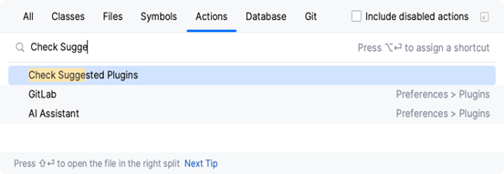
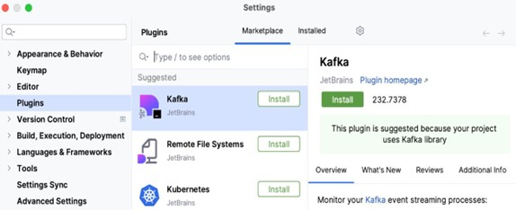
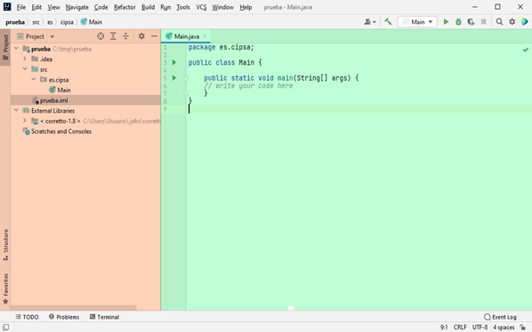

# UP02: Entornos de desarrollo integrados

## ÍNDICE

- [1. Entornos de desarrollo integrados](#1-entornos-de-desarrollo-integrados)
  - [Concepto de entorno de desarrollo integrado (IDE)](#concepto-de-entorno-de-desarrollo-integrado-ide)
  - [Componentes de los IDE](#componentes-de-los-ide)
- [2. ¿Es lo mismo un IDE que un framework?](#2-es-lo-mismo-un-ide-que-un-framework)
- [3. Entornos integrados de desarrollo comunes](#3-entornos-integrados-de-desarrollo-comunes)
  - [Visual Studio Code](#visual-studio-code)
  - [JetBrains IDEs (IntelliJ, PyCharm, PhpStorm, etc.)](#jetbrains-ides-intellij-pycharm-phpstorm-etc)
  - [Visual Studio](#visual-studio)
  - [Otros IDEs comunes](#otros-ides-comunes)
- [4. Entornos de desarrollo multiplataforma](#4-entornos-de-desarrollo-multiplataforma)
  - [Android Studio](#android-studio)
  - [XCode](#xcode)
  - [Unity](#unity)
  - [Godot](#godot)
- [5. Entornos de desarrollo Web](#5-entornos-de-desarrollo-web)
  - [Visual Studio Code](#visual-studio-code-1)
  - [PHP Storm](#php-storm)
  - [WebStorm](#webstorm-1)
- [6. Requisitos para programar en Java con un IDE común (JDK)](#6-requisitos-para-programar-en-java-con-un-ide-común-jdk)
  - [Descarga e Instalación de la SDK de Java](#descarga-e-instalación-de-la-sdk-de-java)
- [7. IDE IntelliJ IDEA](#7-ide-intellij-idea)
  - [Introducción a IntelliJ IDEA](#introducción-a-intellij-idea)
  - [Comparación entre IntelliJ Community Vs Ultimate Edition](#comparación-entre-intellij-community-vs-ultimate-edition)
  - [Características de IntelliJ IDEA](#características-de-intellij-idea)
  - [Instalación de IntelliJ IDEA](#instalación-de-intellij-idea)
  - [Configuración y personalización de IntelliJ IDEA](#configuración-y-personalización-de-intellij-idea)
  - [Gestión de plugins con IntelliJ IDEA](#gestión-de-plugins-con-intellij-idea)
  - [Uso básico de IntelliJ IDEA](#uso-básico-de-intellij-idea)

## 1. Entornos de desarrollo integrados

### Concepto de entorno de desarrollo integrado (IDE)

Un Entorno de Desarrollo Integrado, comúnmente abreviado como IDE por sus siglas en inglés (Integrated Development Environment), es una herramienta informática diseñada para facilitar y mejorar el proceso de desarrollo de software. Un IDE es una plataforma que combina diversas características y utilidades esenciales para programadores y desarrolladores en un solo entorno unificado.

Las principales características de un IDE incluyen un editor de código fuente que proporciona resaltado de sintaxis y otras funcionalidades para facilitar la escritura de código, un depurador que permite identificar y corregir errores en el programa, un compilador o intérprete para convertir el código en instrucciones ejecutables, y una interfaz de usuario que integra todas estas herramientas de manera coherente.

Además de estas características básicas, muchos IDEs ofrecen funcionalidades adicionales como autocompletado de código, gestión de proyectos, control de versiones, integración con sistemas de construcción y pruebas, y acceso a bibliotecas y frameworks comunes.

La ventaja principal de utilizar un IDE es que agiliza el proceso de desarrollo al proporcionar un ambiente de trabajo eficiente y unificado. Esto permite a los programadores concentrarse en la lógica de su código y la resolución de problemas en lugar de preocuparse por la configuración de herramientas y la gestión de archivos por separado. Los IDEs también suelen mejorar la productividad al ofrecer sugerencias de código, identificar errores de manera temprana y facilitar la colaboración en proyectos de desarrollo.

En resumen, un Entorno de Desarrollo Integrado es una herramienta esencial para programadores y desarrolladores que integra un conjunto de utilidades y características destinadas a simplificar y mejorar el proceso de desarrollo de software, lo que resulta en una mayor eficiencia y calidad en el desarrollo de aplicaciones y programas informáticos.

### Componentes de los IDE

Un entorno de Desarrollo Integrado (IDE) consta de varios componentes esenciales que trabajan en conjunto para facilitar el proceso de desarrollo de software. Estos componentes son:

1. **Editor de Código:** El núcleo de un IDE es su editor de código, donde los programadores escriben, editan y formatean el código fuente. Estos editores suelen ofrecer características como resaltado de sintaxis, autocompletado, búsqueda y reemplazo avanzados, y herramientas de refactorización para mejorar la legibilidad y eficiencia del código.
2. **Depurador:** El depurador es una herramienta crítica para identificar y solucionar errores en el código. Permite a los desarrolladores ejecutar el programa paso a paso, inspeccionar variables y detectar problemas como errores de lógica, excepciones y bloqueos.
3. **Compilador o Intérprete:** Dependiendo del lenguaje de programación, un IDE puede incluir un compilador o un intérprete que convierte el código fuente en instrucciones ejecutables. Esto permite a los programadores ejecutar y probar sus programas dentro del mismo entorno.
4. **Gestión de Proyectos:** Los IDEs suelen ofrecer herramientas para crear, organizar y gestionar proyectos de desarrollo. Esto incluye la capacidad de agregar, eliminar y modificar archivos, así como la gestión de dependencias y configuraciones de compilación.
5. **Navegador de Código:** Un componente importante es el navegador de código, que permite a los desarrolladores explorar fácilmente la estructura de su proyecto. Pueden navegar por clases, funciones y módulos, lo que facilita la búsqueda y la navegación dentro del código.
6. **Herramientas de Control de Versiones:** Muchos IDEs integran sistemas de control de versiones como Git, lo que permite a los desarrolladores llevar un registro de cambios en el código, colaborar con otros desarrolladores y revertir cambios si es necesario.
7. **Herramientas de Construcción y Pruebas:** Los IDEs a menudo proporcionan herramientas para compilar, construir y ejecutar pruebas en proyectos de desarrollo. Esto es fundamental para garantizar que el software funcione correctamente y cumpla con los requisitos.
8. **Integración de Bibliotecas y Frameworks:** Los IDEs suelen facilitar la integración de bibliotecas y frameworks externos, lo que simplifica el proceso de desarrollo al proporcionar acceso a funcionalidades predefinidas y componentes reutilizables.
9. **Extensiones y Plugins:** Muchos IDEs permiten la instalación de extensiones y plugins que amplían su funcionalidad. Esto permite a los desarrolladores personalizar su entorno según sus necesidades específicas.

## 2. ¿Es lo mismo un IDE que un framework?

Aunque la respuesta pueda parecer obvia, debido a la posible confusión entre ambos términos, es importante aclarar los dos conceptos.

Un **IDE** (Entorno de Desarrollo Integrado) es una aplicación de software que nos facilita el proceso de programación. Generalmente, un IDE está formado por un editor de texto, herramientas de desarrollo automático, un depurador y, dependiendo del lenguaje, un compilador. Es común que el IDE también incluya entornos de ejecución para probar el software. Por ejemplo, en Android Studio, podemos ejecutar nuestra app en un dispositivo virtual de Android.

Un **framework** es un marco de trabajo que nos proporciona un conjunto de herramientas, librerías y una estructura base que agiliza el desarrollo. Podríamos verlo como un esqueleto de código sobre el cual construimos un proyecto más complejo, aprovechando las herramientas que nos ofrece. Generalmente, un framework permite desarrollar software de forma más sencilla y con menos código. En el desarrollo web existen frameworks muy populares como Angular o Next.js. También para la parte del backend tenemos frameworks como Spring (Java) o Django (Python).

Por ejemplo, **Visual Studio Code** es un editor de código muy popular que, con las extensiones adecuadas, funciona como un potente IDE para desarrollar aplicaciones web. Con él podríamos crear una página web sencilla usando solo HTML, CSS y JavaScript. Por otro lado, **Next.js** es un framework construido sobre la librería React que nos da una estructura y herramientas para crear aplicaciones web complejas de forma más rápida y ordenada. Podríamos usar Visual Studio Code (o cualquier otro IDE) para desarrollar un proyecto con el framework Next.js. Del mismo modo, podríamos usar **IntelliJ IDEA** (IDE) para desarrollar una aplicación web usando el framework **Spring**.

---

## 3. Entornos integrados de desarrollo comunes

El panorama de los Entornos de Desarrollo Integrados (IDE) evoluciona constantemente, con nuevas herramientas y actualizaciones que surgen regularmente. Sin embargo, algunos IDEs han logrado consolidarse como opciones populares y ampliamente utilizadas en la comunidad de desarrollo de software. A continuación, se presentan algunos de los IDEs más comunes y reconocidos:

### Visual Studio Code

Más que un simple editor de texto, VS Code se ha consolidado como el estándar de facto para una gran parte de la comunidad de desarrolladores. Es un editor de código fuente ligero pero potente, desarrollado por Microsoft, y disponible para Windows, macOS y Linux.

Su popularidad masiva se debe a su rendimiento, su interfaz limpia, y sobre todo, a su **inmenso ecosistema de extensiones**. Permite desarrollar en prácticamente cualquier lenguaje (JavaScript/TypeScript, Python, Go, Rust, Java, C#) y para cualquier plataforma (web, móvil, escritorio, nube). Funcionalidades clave en 2025 incluyen:

- Integración nativa con Git: Control de versiones simplificado.
- IntelliSense: Autocompletado y análisis de código inteligente.
- Terminal integrada: Permite ejecutar comandos sin salir del editor.
- Asistentes de IA: Perfecta integración con herramientas como GitHub Copilot, que sugieren y completan código en tiempo real.
- Desarrollo remoto y en contenedores: Permite trabajar sobre servidores remotos o dentro de contenedores Docker de forma transparente.

### JetBrains IDEs (IntelliJ, PyCharm, PhpStorm, etc.)

JetBrains ofrece una suite de IDEs altamente especializados y reconocidos por su "inteligencia". Cada IDE está optimizado para un lenguaje o ecosistema específico, proporcionando una refactorización de código, análisis y herramientas de depuración sin igual. Todos comparten una interfaz unificada y una potente integración con bases de datos, Docker y sistemas de control de versiones.

#### IntelliJ IDEA

Considerado el IDE líder para el desarrollo en Java y otros lenguajes de la JVM (Kotlin, Scala). Es la base sobre la que se construye Android Studio. Se trata con más profundidad en la sección específica de esta unidad.

#### PyCharm

El IDE de referencia para el desarrollo profesional en Python. Ofrece soporte completo para frameworks web como Django y Flask, así como herramientas avanzadas para ciencia de datos y aprendizaje automático.

#### PhpStorm

Sigue siendo la herramienta más completa para desarrolladores de PHP, con un soporte excepcional para frameworks modernos como Laravel y Symfony.

#### WebStorm

Especializado en desarrollo web con soporte avanzado para JavaScript, TypeScript y frameworks como React, Angular y Vue.js.

### Visual Studio

El IDE insignia de Microsoft sigue siendo la herramienta predilecta para el desarrollo dentro del ecosistema de Windows y .NET. Es una solución completa y robusta para crear aplicaciones de alto rendimiento para escritorio (WPF, WinUI), web (ASP.NET), móviles (a través de .NET MAUI), servicios en la nube (Azure) y videojuegos (con su integración con Unity).

A diferencia de VS Code, es un IDE completo y más pesado, que incluye compiladores, depuradores avanzados, diseñadores de interfaces gráficas y herramientas de perfilado de rendimiento. Su versión Community es gratuita para estudiantes, proyectos de código abierto y pequeños equipos.

### Otros IDEs comunes

Estos IDEs han sido populares durante años y siguen siendo opciones viables para muchos desarrolladores, aunque su popularidad ha disminuido frente a las opciones más modernas.

- Netbeans: Muy usado en el desarrollo Java, especialmente en entornos educativos.
- Eclipse: Un IDE versátil y de código abierto que es popular para el desarrollo en Java, pero también admite otros lenguajes a través de complementos.
- Aptana Studio: Un IDE basado en Eclipse, enfocado en el desarrollo web con soporte para HTML, CSS, JavaScript y frameworks como AngularJS y Node.js.

---

## 4. Entornos de desarrollo multiplataforma

Los entornos de desarrollo multiplataforma son aquellos conocidos por ser específicos para aplicaciones de escritorio o de dispositivos móviles. Actualmente se están diferenciando de los entornos para web y mixtos, debido también a la evolución de las distintas líneas de mercado, que están llevando a los programadores y desarrolladores de software a ser más especializados y por tanto, requerir herramientas con este fin.

### Android Studio

Android Studio es el IDE desarrollado por Google para la implementación de aplicaciones para el SO Android. Algunas de las características más importantes son:

- Editor de código inteligente.
- Plantillas de código e integración GitHub.
- Desarrollo de aplicaciones multidispositivo (tablet, móvil, dispositivos wearables, etc..).
- Dispositivos virtuales para todos los tamaños y orientaciones.
- Sistema de generación de apk basado en Gradle.

### XCode

Xcode es un entorno de desarrollo integrado para macos que contiene las herramientas necesarias para desarrollar aplicaciones para las distintas plataformas de Apple. Con XCode podemos desarrollar aplicaciones para macOs, iOs, watchos y tvos. Xcode puede descargarse de forma gratuita desde la App Store, para ello tenemos que utilizar un sistema operativo macos.

### Unity

Unity es una herramienta que nos permite desarrollar videojuegos para diversas plataformas. Unity cuenta con su propio editor integrado que, junto con las librerías y API que proporciona el framework de Unity, nos permite desarrollar juegos para dispositivos móviles, videoconsolas y diversos sistemas informáticos. Desde la página oficial del proyecto Unity, [https://unity3d.com/es](https://unity3d.com/es) podemos descargar una versión gratuita para comenzar a desarrollar videojuegos. Dicha versión, entre otras, tiene la limitación no comercial. Es decir, con la licencia personal no podemos elaborar aplicaciones con fines comerciales.

### Godot

Godot es un motor de desarrollo de videojuegos de código abierto que permite crear juegos en 2D y 3D. Es conocido por su facilidad de uso y su lenguaje de scripting propio, GDScript, que es similar a Python. Godot proporciona un entorno de desarrollo completo con herramientas para la creación de escenas, animaciones y físicas, lo que lo convierte en una opción popular entre los desarrolladores indie. Además, Godot permite exportar juegos a múltiples plataformas, incluyendo Windows, macOS, Linux, Android e iOS.

---

## 5. Entornos de desarrollo Web

La programación y el desarrollo web en sus inicios, se basaba en un bloc de notas que a partir de código basado en etiquetas, generaba un archivo interpretado que los navegadores podían entender. La cantidad de lenguajes web actuales, así como la implantación total de la web hace necesario el apoyo en herramientas que permitan facilitar el desarrollo. Por este motivo existen multitud de entornos de desarrollo destinados al desarrollo web. A lo largo de este apartado vamos a hacer un recorrido por los IDE más utilizados en la actualidad.

### Visual Studio Code

Ya hemos hablado de Visual Studio Code en el apartado de IDEs comunes. En este caso, es importante destacar que es uno de los entornos más utilizados para el desarrollo web. Su gran cantidad de extensiones, así como su ligereza y rapidez lo hacen ideal para este tipo de desarrollo.

### PHP Storm

PHP Storm es un IDE comercial para PHP. Soporta la mayoría de framework basados en PHP, como Symfony, Drupal, Wordpress, Zend framework, Yii y CakePHP entre otros. Actualmente es uno de los IDE más completos para trabajar con PHP. A pesar de tratarse de software comercial, cuya licencia puede obtenerse desde 149 dolares al año, existe la posibilidad de obtener una licencia gratuita para miembros de la comunidad educativa. Soporta la mayoría de las tecnologías orientadas a la elaboración del front-end de las páginas web, como HTML5, CSS, TypeScript y JavaScript. Además, permite visualizar los cambios en tiempo real en un navegador, reformatear el código de forma automática, depurarlo y realizar test de pruebas.

### WebStorm

WebStorm es el IDE de JetBrains especializado en JavaScript y tecnologías relacionadas. Es considerado uno de los entornos más potentes e inteligentes para el desarrollo web moderno, especialmente para el front-end. Ofrece un soporte excepcional para los frameworks más populares del ecosistema JavaScript, como React, Angular, Vue.js y Node.js. Al igual que otros IDEs de JetBrains, destaca por su análisis de código en tiempo real, su potente autocompletado, sus herramientas de refactorización y su depurador integrado. Se trata de un IDE comercial, pero JetBrains ofrece licencias gratuitas para estudiantes y proyectos de código abierto.

---

## 6. Requisitos para programar en Java con un IDE común (JDK)

La SDK o Software Development Kit, es una colección esencial de herramientas y recursos que los desarrolladores utilizan para crear aplicaciones Java. Esta kit en el caso de Java es conocido como JDK y proporciona las bases necesarias para escribir, compilar, depurar y ejecutar programas en el lenguaje de programación Java.

La SDK de Java consta de varios componentes clave que facilitan el desarrollo de software en Java:

1. **Compilador de Java (javac):** El compilador de Java es una parte fundamental de la SDK. Se encarga de traducir el código fuente Java escrito por los programadores en archivos java en archivos.class, que contienen bytecode ejecutable por la máquina virtual Java (JVM).
2. **Máquina Virtual de Java (JVM):** La JVM es un componente crucial de la SDK. Es responsable de la ejecución de los programas Java compilados, interpretando el bytecode y gestionando la memoria y otros recursos necesarios para que las aplicaciones se ejecuten de manera eficiente y portátil en diferentes plataformas.
3. **Bibliotecas Estándar (API de Java):** La SDK incluye una amplia colección de bibliotecas estándar, conocidas como la API de Java. Estas bibliotecas contienen clases y métodos que simplifican muchas tareas comunes en el desarrollo de aplicaciones, como el manejo de cadenas, entrada/salida de datos, manipulación de archivos, programación en red, procesamiento de datos y más.
4. **Herramientas de Desarrollo:** La SDK de Java también incluye una variedad de herramientas de desarrollo, como el depurador (jdb), el generador de documentación (javadoc), y otras utilidades que ayudan a los programadores a diseñar, analizar y depurar sus aplicaciones de manera efectiva.

### Descarga e Instalación de la SDK de Java

La SDK de Java (Software Development Kit) es esencial para el desarrollo de aplicaciones Java. Para comenzar a programar en Java, sigue estos pasos para descargar e instalar la SDK en tu sistema:

- **Visita el sitio oficial de Oracle:** Accede al sitio web oficial de Oracle ([https://www.oracle.com/java/technologies/javase-downloads.html](https://www.oracle.com/java/technologies/javase-downloads.html)).
- **Acepta los términos de uso:** Asegúrate de revisar y aceptar los términos de uso y licencia de Oracle antes de continuar.
- **Selecciona la versión de la SDK:** Elige la versión de la SDK de Java que desees descargar. Por lo general, se recomienda la versión más reciente estable para obtener las últimas características y correcciones de seguridad.
- **Selecciona el paquete adecuado:** Dependiendo de tu sistema operativo (Windows, macOS o Linux), elige el paquete de instalación correspondiente.
- **Instala en tu Sistema la SDK descargada.**

---

## 7. IDE IntelliJ IDEA

### Introducción a IntelliJ IDEA

IntelliJ IDEA IDE es rico en características y permite un rápido desarrollo de software. Este IDE también mejora la calidad del código. En el sitio web oficial de IntelliJ IDEA IDE, puedes obtener dos ediciones diferentes:

- Edición community: código abierto (gratis)
- Ultimate edition: comercial

### Comparación entre IntelliJ Community Vs Ultimate Edition

| | Edición community | Ultimate edición |
| :--- | :--- | :--- |
| **Rendimiento** | Puede ser un cuello de botella cuando se trata de grandes proyectos. | Maneja proyectos grandes de manera eficiente y ábrelos más rápido. |
| **Licencia** | De código abierto, gratis. | Comercial con un período de prueba gratuito de 30 días. |
| **Soporte de tecnología y marco** | Android, Ant, JavaFX, Junit, TestingNG, Gradle. | Android, Ant, JavaFX, Junit, TestingNG, Gradle, EJB, Spring, Struts, Node.js, Django, OSGi, etc. |
| **Ayuda de idioma** | Java, Kotlin, Groovy, Perl, Python, XML, Go, Scala. | Java, Kotlin, Groovy, Perl, Python, XML, Go, Scala , HTML, XHTML, CSS, php, SQL, Ruby, JavaScript, etc. |
| **Despliegue** | Docker, Docker Compose (a través de un complemento). | Docker, Docker Compose (a través de un complemento), JBoss, WebLogic, Tomcat, Glassfish, Jetty, Virgo, etc. |
| **Control de versiones y revisión de software** | GitHub, Git, CVS. | GitHub, Git, CVS, ClearCase, Perforce. |
| **Herramientas de construcción** | Maven, Gradle, Ant, SBT, Bloop, Fury (a través del complemento Scala). | Npm, Webpack, Gulp, Grunt, Maven, Gradle, Ant, SBT, Bloop, Fury (a través del complemento Scala). |

### Características de IntelliJ IDEA

IntelliJ IDEA es único entre todos los demás IDE de Java con su conocimiento profundo del código y el contexto del codificador. Este IDE está diseñado en torno al principio de codificación de que los desarrolladores deberían poder codificar aplicaciones con la menor cantidad de distracciones posible. Por lo tanto, en el caso de IntelliJ IDEA, solo tiene el editor visible en la pantalla y para todas las demás funciones no relacionadas con la codificación, tendrá accesos directos dedicados.

Analicemos ahora algunas de las características importantes de IntelliJ IDEA.

1. **Finalización de código inteligente (code completion):** IntelliJ IDEA proporciona una lista de símbolos aplicables al código que son más relevantes en el contexto actual y admite la finalización de código basada en el contexto.
2. **Completar código de cadena:** Esta es otra característica avanzada. Los símbolos que proporcionan los métodos o captadores y los aplicables al contexto actual se enumeran mediante la función de finalización de código en cadena.
3. **Finalización del miembro estático:** Puede agregar métodos estáticos y constantes y IntelliJ IDEA IDE agregará automáticamente las declaraciones de importación requeridas al código para evitar un error de compilación.
4. **Detección de Duplicados:** Puede haber fragmentos de código duplicados en el código y esta función proporciona notificaciones o sugerencias al programador sobre ellos.
5. **Entorno centrado en el editor:** Mientras codifica, también obtiene ventanas emergentes rápidas que lo ayudan a verificar información adicional sin salir del contexto actual.
6. **Inspecciones y arreglos rápidos:** IntelliJ IDEA abre una pequeña bombilla en la línea de código donde ha detectado que está a punto de cometer un error. Cuando haga clic en esta bombilla, verá una lista de sugerencias de códigos.
7. **Atajos para todo:** Como se mencionó anteriormente, como los programadores tienen menos distracciones, IntelliJ IDEA proporciona teclas de acceso directo (atajos de teclado) para casi todo, incluidas acciones como selección rápida y cambio entre varias ventanas de herramientas y muchas otras operaciones.
8. **Depurador en línea:** Puede utilizar el depurador en línea para depurar su aplicación en el propio IDE, lo que hace que los procesos de desarrollo y depuración sean más eficientes.

### Instalación de IntelliJ IDEA

La primera etapa fundamental para comenzar a aprovechar las potentes capacidades de desarrollo de IntelliJ IDEA es la instalación adecuada de este entorno de desarrollo en tu sistema. IntelliJ IDEA es un IDE multiplataforma que proporciona una experiencia coherente en los sistemas operativos Windows, macOS y Linux. Para garantizar una instalación sin problemas, recurriremos a la guía instalación proporcionada por el fabricante.

### Configuración y personalización de IntelliJ IDEA

IntelliJ IDEA le permite configurar los ajustes en varios niveles: el nivel de módulo, el nivel de proyecto y globalmente.

La configuración global se aplica a todos los proyectos que se abren con una instalación o versión específica de IntelliJ IDEA. Dicha configuración incluye la apariencia del IDE (temas, esquemas de color, menús y barras de herramientas), la configuración de notificaciones, el conjunto de complementos instalados y habilitados, la configuración del depurador, la finalización del código, etc.

La configuración del proyecto solo se aplica al proyecto actual, a menos que la configure como configuración predeterminada para los nuevos proyectos. Dicha configuración incluye la configuración de VCS, las opciones de estilo de código, la lista de inspecciones de idioma, etc.

### Gestión de plugins con IntelliJ IDEA

Otro punto clave es la posibilidad de usar herramientas de terceros de manera integrada en nuestro IDE. Estos son conocidos como plugins o add-ons: extienden o amplían el entorno de desarrollo con nuevas funcionalidades, como por ejemplo integración con herramientas de control de versiones, de seguimiento de incidencias, asistentes de código, inspector de archivos, cambio de los estilos visuales del entorno de desarrollo, y un largo etcétera.

Estos plugins se pueden instalar bien manualmente, o bien a través de una herramienta tipo marketplace, la cual nos ofrece los plugins disponibles para el IDE de manera centralizada en un único sitio, y podremos instalarlos sin necesidad de ir a sitios de terceros.

#### Tipos de plugin

Existen una gran variedad de plugins, los cuales atienden a diferentes necesidades. Dichas necesidades pueden clasificarse y, por lo tanto, categorizarse. Según la documentación que nos ofrece JetBrains podemos ver los siguientes tipos de plugins:

- **Custom language support:** provee unas funcionalidades básicas para trabajar con un determinado lenguaje de programación, como por ejemplo formato de líneas de código, reconocimiento de tipo de archivo, análisis y auto completado de código, etc.
- **Framework integration:** consiste tanto en características de reconocimiento de código avanzadas como en opciones para un framework de programación específico, lo cual ayuda a tener ayudas dentro del IDE para dicho framework.
- **Tool integration:** posibilita la opción de integrar y manipular herramientas o componentes de terceros directamente desde el IDE sin la necesidad de cambiar de contexto.
- **User interface Add-ons:** son los encargados de modificar la interfaz básica del propio IDE. Pueden ser nuevos componentes interactivos que proporcionan algún tipo de nueva funcionalidad, o simplemente modificaciones visuales.
- **Themes:** estos plugins proporcionan a los diseñadores la posibilidad de personalizar la apariencia y el estilo de los propios componentes visuales del IDE.

#### Instalación de plugins

Pulsa `Ctrl+Alt+S` para abrir la configuración del IDE y, a continuación, seleccione **Plugins**.

- Utilice la pestaña **Marketplace** para buscar e instalar plugins desde JetBrains Marketplace o desde un repositorio de plugins personalizado.
- Utilice la pestaña **Instalado** para examinar los complementos incluidos e instalados, habilitarlos, deshabilitarlos, actualizarlos o eliminarlos.
- Deshabilitar complementos innecesarios puede aumentar el rendimiento.

De forma predeterminada, IntelliJ IDEA incluye varios complementos incluidos. Puede deshabilitar los complementos incluidos, pero no se pueden eliminar. Puede instalar complementos adicionales desde el repositorio de complementos o desde un archivo de almacenamiento local (ZIP o JAR).

##### Instalar plugin desde Marketplace

1. Pulsa `Ctrl+Alt+S` para abrir la configuración del IDE y, a continuación, seleccione **Plugins**.
2. Haga clic en la pestaña **Marketplace** y escriba el nombre del complemento en el campo de búsqueda.
3. Para instalar el complemento, haga clic en **Instalar** y reinicie IntelliJ IDEA.

Para instalar una versión específica, vaya a la página del plugin en JetBrains Marketplace, descárguelo e instálelo como se describe en Instalar plugin desde el disco. Por ejemplo, puede hacerlo si la versión más reciente del complemento está rota.

##### Instalar plugin desde disco

1. Descargue el archivo del plugin (ZIP o JAR).
2. Prensa `Ctrl+Alt+S` para abrir la configuración del IDE y, a continuación, seleccione **Plugins**.
3. En la página **Plugins**, haga clic en el icono de configuración (rueda dentada) y, a continuación, haga clic en **Instalar complemento desde disco...**.

4. Seleccione el archivo de almacenamiento del plugin y haga clic en **Aceptar**.
5. Haga clic en **Aceptar** para aplicar los cambios y reiniciar el IDE si se le solicita.

##### Eliminar plugin

1. Prensa `Ctrl+Alt+S` para abrir la configuración del IDE y, a continuación, seleccione **Plugins**.
2. Abra la pestaña **Instalado** y busque el complemento que desea eliminar.
3. Expanda la lista **Deshabilitar** y seleccione **Desinstalar**.

Si necesita eliminar un complemento sin iniciar IntelliJ IDEA, puede eliminarlo manualmente desde el directorio del complemento.

##### Desactivar plugin

Puede deshabilitar un complemento sin eliminarlo si no necesita la funcionalidad correspondiente.

1. Prensa `Ctrl+Alt+S` para abrir la configuración del IDE y, a continuación, seleccione **Plugins**.
2. Abra la pestaña **Instalado**, busque y seleccione el complemento que desea deshabilitar.
3. En el panel de descripción del plugin, haga clic en **Deshabilitar**.

Alternativamente, puede usar las casillas de verificación en la lista de complementos o los botones **Deshabilitar todos** para las categorías de complementos. Puede desactivar o habilitar todos los plugins instalados manualmente a la vez (no incluidos) en el menú de configuración.

#### Plugins requeridos

Un proyecto puede requerir complementos que proporcionen soporte para ciertas tecnologías o marcos. Puede agregar dichos complementos a la lista de complementos necesarios para el proyecto actual, de modo que IntelliJ IDEA verifique que los complementos estén instalados y habilitados. Le notificará si se olvida de algún complemento, o si alguien de su equipo no está al tanto de la dependencia mientras trabaja en el proyecto.

**Añade un plugin necesario para tu proyecto actual:**

1. Asegúrese de que el complemento requerido esté instalado.
2. Prensa `Ctrl+Alt+S` para abrir la configuración del IDE y, a continuación, seleccione **Compilación, Ejecución, Implementación | Plugins requeridos**.
3. En la página **Complementos requeridos**, haga clic en **+** y seleccione el complemento. Opcionalmente, especifique la versión mínima y máxima del complemento.

#### Plugins sugeridos

Al abrir un proyecto, IntelliJ IDEA puede sugerir la instalación y habilitación de complementos basados en bibliotecas y facetas utilizadas en su proyecto. No confunda los complementos **sugeridos** con los complementos **necesarios** que puede agregar manualmente a un proyecto para que sus compañeros de equipo también lo usen.

Si no necesita un complemento en particular, puede evitar que IntelliJ IDEA lo sugiera. También puede usar su configuración de notificaciones para deshabilitar o habilitar las notificaciones de todas las sugerencias de complementos y la forma en que se muestran.

**Desactivar sugerencias de un plugin:**

- Cuando aparezca una notificación de un plugin sugerido, haz clic en **No sugerir de nuevo**.

**Consulta un proyecto para ver los plugins sugeridos:**

1. Prensa `Ctrl+Shift+A` y comienza a escribir `Check Suggested Plugins`.
2. Seleccione la acción **Comprobar plugins sugeridos**.

Si IntelliJ IDEA tiene un complemento aplicable a su proyecto, verá el mensaje de notificación. Haga clic en el enlace en el mensaje de notificación para instalar o habilitar el complemento sugerido.

Como alternativa, puede abrir la configuración del IDE (`Ctrl+Alt+S`) y vaya a **Plugins | Marketplace**. Si hay plugins sugeridos para tu proyecto, se mostrarán en la parte superior de la lista de plugins, en la sección **Sugeridos**.

### Uso básico de IntelliJ IDEA

#### Interfaz de usuario de IntelliJ IDEA

El interfaz de usuario del IDE se divide básicamente en dos ventanas.

- **Ventana de proyecto:** Muestra la estructura del proyecto indicando la librería Java SDK que se emplea en “External Libraries”, y los paquetes y clases que componen el código fuente del proyecto en la carpeta “src”.
- **Ventana de edición:** Muestra el código de los ficheros que se están editando. Pueden editarse varios archivos al mismo tiempo que se muestran como pestañas en la parte superior. También es posible dividir la ventana para editar múltiples ficheros al mismo tiempo.

#### Creación de un proyecto Java con IntelliJ IDEA

A continuación, te guiaré a través de los pasos necesarios para crear un proyecto Java en IntelliJ IDEA:

1. **Paso 1: Iniciar IntelliJ IDEA:** Abre IntelliJ IDEA en tu sistema.
2. **Paso 2: Pantalla de Bienvenida:** Una vez que se inicie IntelliJ IDEA, llegarás a la pantalla de bienvenida. Desde aquí, puedes elegir entre abrir proyectos existentes o crear uno nuevo. Selecciona **"Crear Nuevo Proyecto"** o **"New Project"** para comenzar.
3. **Paso 3: Nuevo Proyecto:** En la ventana emergente "Nuevo Proyecto," en la parte izquierda tendremos varias opciones, seleccionaremos **“New Project”**.

- **Nombre y Ubicación:** Asigne un nombre al nuevo proyecto y cambie su ubicación si es necesario.
- **Git (opcional):** Seleccione la casilla `Crear repositorio de Git` para colocar el nuevo proyecto bajo control de versiones (lo veremos en la siguiente unidad).
- **Lenguaje:** En la lista `Lenguajes`, seleccione **Java**.
- **Sistema de compilación:** Seleccione el sistema de compilación que desea usar. Dejaremos el compilador nativo de **IntelliJ**.
- **JDK:** En la lista de `JDK`, seleccione el JDK que desea utilizar en el proyecto. Si no está definido en el IDE, seleccione `Agregar JDK` y especifique la ruta de acceso al directorio principal del JDK.
- **Código de ejemplo (opcional):** Habilite la opción `Agregar código de ejemplo` para crear una clase con una aplicación de ejemplo `HelloWorld`.

Esta sería la configuración básica para la creación de nuestro primer proyecto en Java:

**Nota**: En tu caso no necesariamente será JDK 11, dependerá de la versión que tengas instalada en tu sistema.

##### Creación de clase

Una vez creado un proyecto vacío, en entorno de desarrollo nos creará la siguiente estructura de nuestro proyecto.

Te recomiendo que visites la documentación del fabricante sobre la ventana de herramientas del proyecto.

Vamos ahora a crear nuestra primera clase de nuestro proyecto. Nos vamos a la carpeta `src`, botón derecho, nuevo **“Java Class”**. Vamos a crear un paquete `ejemplo` y dentro de él la clase `HolaMundo`.

Una vez creada la clase `HolaMundo`, necesitaremos un método `main`, que es el punto de entrada principal para ejecutar una aplicación. IntelliJ IDEA nos permite crear la estructura de dicho método fácilmente. Escribimos `main` en nuestra clase y pulsamos enter y nos autocompleta el código de dicho método.

Nos faltaría ahora darle funcionalidad al método `main` para que pueda escribir por pantalla un mensaje. Usaremos la funcionalidad de autocompletado del entorno de desarrollo. Te recomiendo que visites la documentación del fabricante sobre escribir y editar código fuente.

#### Generación de ejecutables

El proceso de compilación y generación de ejecutables de IntelliJ IDEA compila los archivos de código fuente y reúne bibliotecas externas, archivos de propiedades y configuraciones para producir una aplicación viva. IntelliJ IDEA utiliza un compilador que funciona de acuerdo con la especificación Java.

Al compilar el código fuente, IntelliJ IDEA crea automáticamente un directorio de salida (`out`) que contiene archivos `.class` compilados.

En la ventana de ejecución podemos ver el resultado de ejecutar la clase `main` de nuestro proyecto.

#### Empaquetar una aplicación en un archivo .jar

Cuando el código esté compilado y listo, puede empaquetar la aplicación en un archivo Java (JAR) para compartirla con otros desarrolladores. Un archivo Java construido se denomina **artefacto**.

**Creación de una configuración de artefacto para el JAR:**

1. Ir a **Archivo | Estructura del proyecto** y haga clic en **Artefactos**.
2. Haga clic en el botón `+` (Agregar), seleccione **JAR** y seleccione **De módulos con dependencias**.

3. A la derecha del campo **Clase principal**, haga clic en el botón `...` (Examinar) y seleccione la clase principal en el cuadro de diálogo que se abre (`HolaMundo` de `ejemplo`).

4. IntelliJ IDEA crea la configuración del artefacto y muestra su configuración en la parte derecha del cuadro de diálogo Estructura del proyecto.
5. Haga clic en **Aplicar** para guardar los cambios y cerrar el cuadro de diálogo.

**Compilar el artefacto JAR:**

1. Ir a **Build | Build artefactos**.
2. Se crea el archivo `.jar` en `out/artifacts`.

