<!-- markdownlint-disable MD033 MD036 -->
# UP03 · ACTIVIDAD: ¡A LA CAZA DEL BUG! 🐞

**Módulo:** 0487 Entornos de Desarrollo · **Unidad:** UP03 Depuración de código
**Criterios trabajados:** RA3.c, RA3.d y RA3.e: identificar las herramientas de depuración del entorno, usar puntos de ruptura y seguimiento, y examinar y modificar el comportamiento de un programa en tiempo de ejecución.
**Tiempo estimado:** entre 2 y 3 horas.

## ÍNDICE

- [De qué va esto](#de-qué-va-esto)
- [Qué tenéis que entregar](#qué-tenéis-que-entregar)
- [Atajos que vais a usar](#atajos-que-vais-a-usar)
- [Misión 0. Preparar el proyecto](#misión-0-preparar-el-proyecto)
- [Misión 1. Primera parada](#misión-1-primera-parada)
- [Misión 2. ¿Quién ha roto el programa?](#misión-2-quién-ha-roto-el-programa)
- [Misión 3. Rescatar la ejecución en caliente](#misión-3-rescatar-la-ejecución-en-caliente)
- [Misión 4. Parar en el momento justo](#misión-4-parar-en-el-momento-justo)
- [Misión 5. Espiar sin detener](#misión-5-espiar-sin-detener)
- [Misión 6. El misterio de las tutorías gratis](#misión-6-el-misterio-de-las-tutorías-gratis)
- [Misión 7 (opcional). Arreglarlo y comprobarlo](#misión-7-opcional-arreglarlo-y-comprobarlo)
- [Si algo no funciona](#si-algo-no-funciona)

## De qué va esto

La academia del curso tiene un programa que genera las reservas de tutoría de un mes y calcula cuánto factura cada alumno. Compila sin problemas, pero **falla**: a veces revienta y, cuando no revienta, los importes no cuadran.

En esta actividad **no se trata de arreglar el programa**. Para eso cualquiera puede pedir ayuda a una IA. Se trata de que aprendáis a **usar el depurador** de IntelliJ IDEA para ver qué hace el programa por dentro mientras se ejecuta: pararlo, avanzar paso a paso, mirar y cambiar variables, y averiguar en qué momento exacto algo va mal.

Los datos del programa se generan a partir de **vuestro NIA**. Cada uno tendrá reservas distintas y, por tanto, respuestas distintas. Las respuestas no se pueden deducir leyendo el código: hay que ejecutarlo y mirar.

> [!NOTE]
> Las misiones están guiadas paso a paso. No pasa nada por seguirlas al pie de la letra; lo importante es que, al terminar, sepáis hacerlo solos. En la UP03 tenéis la explicación de cada herramienta.
> Adicionalmente, aunque la guía se apoya en las *hotkeys* podéis usar los botones del depurador. Es importante que aprendáis, entre otras muchas cosas, las diferencias entre **Step Over**, **Step Into** y **Step Out**.

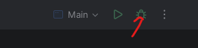

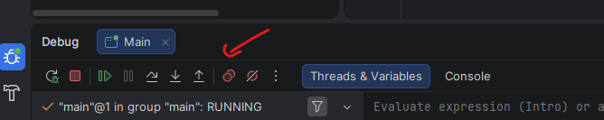

> [!NOTE]
> Es normal que en este punto, este código Java no lo entendáis del todo. Eso pertenece al dominio del módulo de programación. Aquí lo que importa es **aprender a depurar**, no tanto a programar.

## Qué tenéis que entregar

Un **único PDF** llamado `UP03_Depuracion_Apellidos_Nombre.pdf` con:

1. En la primera página, esta tabla rellena con **vuestros** valores:

| Misión | Pregunta | Respuesta |
|---|---|---|
| 0 | NIA usado como semilla | |
| 0 | Clase, método y línea donde se lanza la excepción | |
| 1 | Primera reserva: id, alumno, asignatura y minutos | |
| 1 | Valores de `precioHora` y `horas` para esa reserva | |
| 1 | 🥚 Código secreto | |
| 2 | Valor de `i` y reserva (id y alumno) que provoca la excepción | |
| 3 | Número de veces que se ha parado el breakpoint condicional | |
| 3 | TOTAL FACTURADO tras la corrección guiada | |
| 4 | Minutos de Laura cuando `i == 100` y al final del bucle | |
| 5 | Número de líneas que escribe el logpoint y las tres primeras | |
| 6 | Id de la reserva donde se para y resultado de las dos expresiones | |
| 6 | 🥚 Reserva de Grace Hopper: id, alumno y asignatura | |
| 7 | *(Opcional)* TOTAL FACTURADO tras corregir la división | |

2. Después, las **capturas** que pide cada misión (marcadas con 📸), numeradas y en orden. Cada captura debe mostrar la ventana de IntelliJ IDEA completa, de forma que se vea la línea `Semilla (NIA): ...` en la consola o el valor de `NIA` en el código.

**Calificación:** cada misión de la 0 a la 6 vale lo mismo. Si están todas hechas y trabajadas, es un 10. La misión 7 es opcional y ayuda a compensar si falla alguna otra.

## Atajos que vais a usar

Son los atajos del mapa de teclado por defecto de Windows y Linux. En macOS cambian; si no os funcionan, usad los botones de la barra del depurador, que hacen lo mismo.

| Acción | Atajo | Qué hace |
|---|---|---|
| Debug | `Shift+F9` | Lanza el programa en modo depuración. |
| Poner o quitar breakpoint | Clic en el margen o `Ctrl+F8` | Marca una línea donde la ejecución se detendrá. |
| Ver todos los breakpoints | `Ctrl+Shift+F8` | Abre el diálogo de breakpoints. |
| Step Over | `F8` | Ejecuta la línea actual sin entrar en los métodos que llama. |
| Step Into | `F7` | Entra dentro del método que se llama en la línea actual. |
| Step Out | `Shift+F8` | Termina el método actual y vuelve a quien lo llamó. |
| Resume | `F9` | Continúa hasta el siguiente breakpoint o hasta el final. |
| Run to Cursor | `Alt+F9` | Continúa hasta la línea donde está el cursor. |
| Evaluate Expression | `Alt+F8` | Calcula cualquier expresión con los valores actuales. |
| Set Value | `F2` sobre una variable | Cambia el valor de una variable sin parar el programa. |
| Stop | `Ctrl+F2` | Detiene el programa. |

## Misión 0. Preparar el proyecto

**Objetivo:** tener el proyecto en IntelliJ IDEA y saber leer el error que produce.

1. Abrid IntelliJ IDEA. En la pantalla de bienvenida pulsad **Clone Repository**. Si ya tenéis un proyecto abierto, usad **File | New | Project from Version Control...**

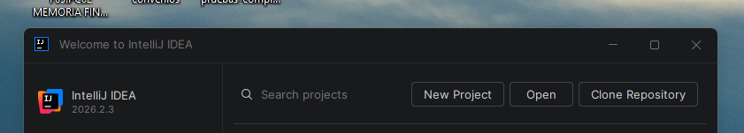

2. En **URL** pegad:

   ```text
   https://github.com/scontreraslopez/ede-up03-tutorias-debug.git
   ```

   Elegid como **Directory** una carpeta dentro de vuestra carpeta `EDE` (o la que estéis usando para este módulo) y pulsad **Clone**.

   > [!TIP]
   > Si IntelliJ avisa de que no encuentra Git, pulsad **Download and Install** en el mismo aviso. Si ya tenéis Git instalado y preferís la terminal, el comando equivalente es `git clone https://github.com/scontreraslopez/ede-up03-tutorias-debug.git`. Git lo veremos a fondo en la siguiente unidad.

3. Abrid el proyecto. Si aparece el aviso *Maven build scripts found*, pulsad **Load**. Esperad a que termine de indexar (barra inferior).
4. Abrid `src/main/java/es/severoochoa/ede/tutorias/Main.java`. Ejecutadlo con el triángulo verde que aparece junto a `public static void main`. El programa os pedirá el NIA.
5. Escribid **vuestro NIA** en la constante `NIA` (solo los números) y volved a ejecutar.

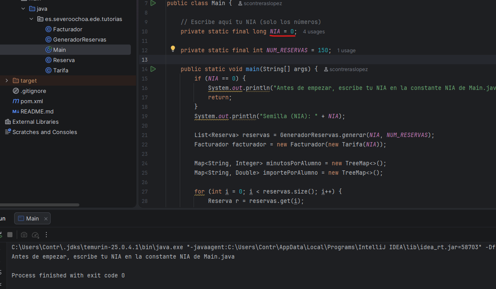

6. El programa revienta con un `NullPointerException`. La consola muestra la **traza de la excepción** (*stack trace*): cada línea `at ...` es un método que estaba en marcha, del más reciente (arriba) al más antiguo (abajo).

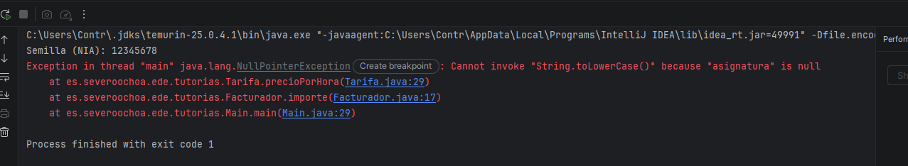

> [!NOTE]
> En algunos casos tenéis capturas de pantalla mías para que veáis cómo se hace, pero el objetivo es que **hagáis vuestras propias capturas** con vuestros datos. No copiéis las mías: no os servirán para rellenar la tabla de respuestas.

📸 **Captura 0:** la consola con la línea `Semilla (NIA): ...` y la traza completa.

**Responded en la tabla:** ¿en qué clase, método y línea se lanza la excepción? Fijaos en la primera línea `at`.

> [!NOTE]
> El mensaje de la excepción dice **qué** variable vale `null`, pero no **qué reserva** la ha provocado. Para eso necesitamos el depurador.

## Misión 1. Primera parada

**Objetivo:** poner un breakpoint, lanzar el depurador, conocer sus paneles y moverse paso a paso entrando y saliendo de los métodos.

1. En `Main.java`, haced clic en el margen izquierdo, junto al número de línea, de esta instrucción:

   ```java
   double importe = facturador.importe(r);
   ```

   Aparece un punto rojo: es un **breakpoint de línea**.

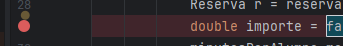

2. Lanzad el depurador: clic en el triángulo verde junto a `main` y elegid **Debug 'Main.main()'**. A partir de ahora también podéis usar `Shift+F9`.
3. La ejecución se detiene **antes** de ejecutar esa línea, que aparece resaltada. Abajo se abre la ventana **Debug**. Localizad en ella:
   - la **barra de botones** del depurador (Resume, Stop, Step Over, Step Into, Step Out...);
   - el panel **Frames**, con la lista de métodos en marcha;
   - el panel **Variables**, con las variables visibles en ese momento;
   - la pestaña **Console**.
4. En **Variables**, desplegad `r` con la flecha. Anotad el id, el alumno, la asignatura y los minutos de la primera reserva.
5. Pulsad `F7` (**Step Into**) para entrar en `Facturador.importe`. Pulsad `F7` otra vez para entrar en `Tarifa.precioPorHora`.

   > [!TIP]
   > Si una línea llama a varios métodos, IntelliJ puede resaltarlos para que elijáis: haced clic en `precioPorHora`. Si acabáis dentro de `getAsignatura()`, salid con `Shift+F8` y volved a pulsar `F7`.

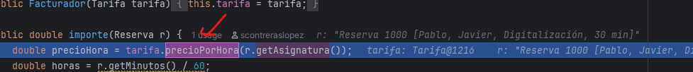

6. Ya estáis dentro de `Tarifa`. En **Variables**, desplegad `this`. Hay un campo que el programa nunca imprime... 🥚 Anotad el **código secreto**.

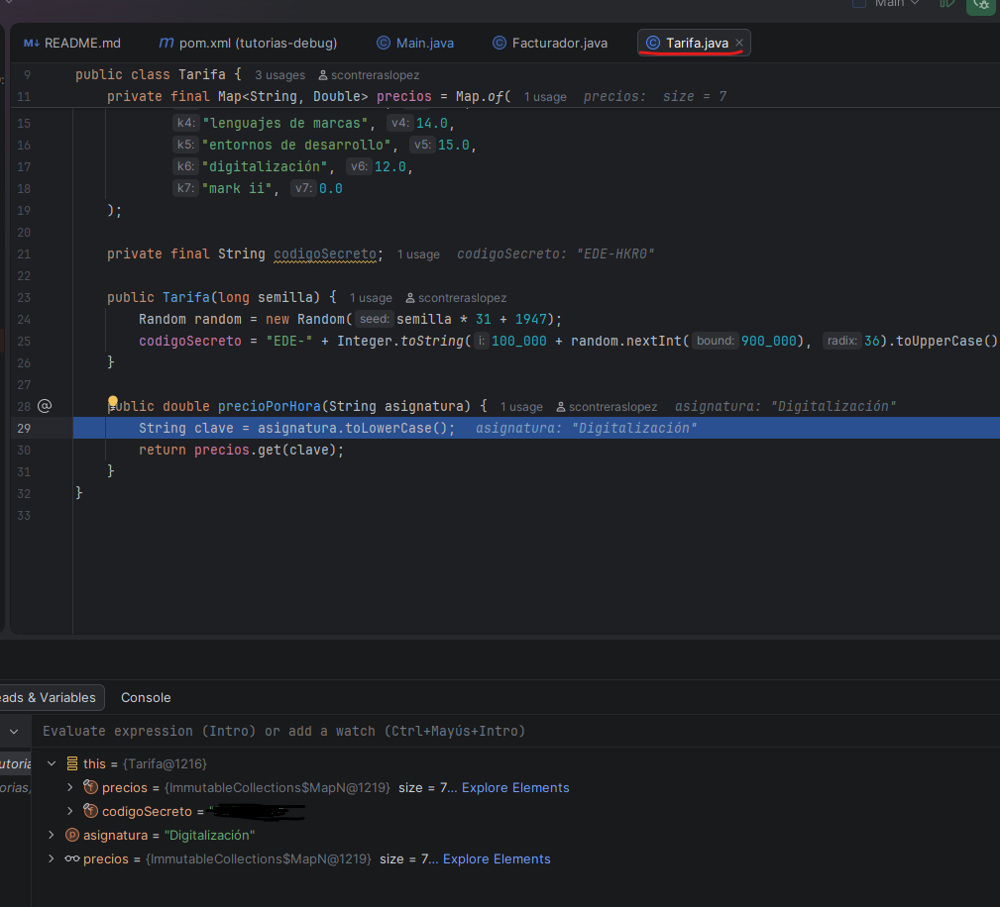

   📸 **Captura 1a:** la ejecución parada dentro de `precioPorHora`, con `this` desplegado.

7. Pulsad `Shift+F8` (**Step Out**): volvéis a `Facturador.importe`. Pulsad `F8` (**Step Over**) dos veces y observad cómo, tras moverse el cursor dos líneas, aparecen en **Variables** `precioHora` y `horas`. Anotad sus valores.

   📸 **Captura 1b:** la ejecución parada en `Facturador.importe` con `precioHora`, `horas` y `r` visibles.

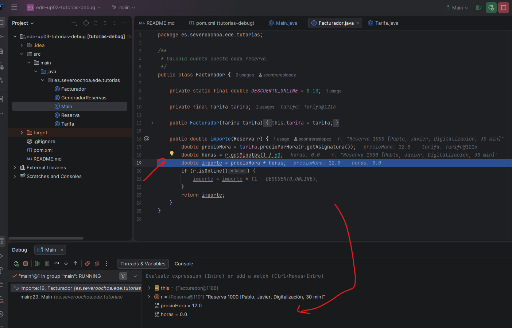

8. Pulsad `Ctrl+F2` (**Stop**) para terminar.

## Misión 2. ¿Quién ha roto el programa?

**Objetivo:** usar un **breakpoint de excepción** y el panel **Frames** para encontrar el origen de un error.

1. Quitad el breakpoint de la misión 1 haciendo clic sobre el punto rojo.
2. Abrid **Run | View Breakpoints...** (`Ctrl+Shift+F8`). Pulsad **+** y elegid **Java Exception Breakpoints**. Buscad `NullPointerException`, seleccionadlo y pulsad **OK** y después **Done**.

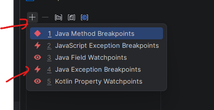

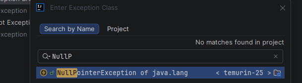

3. Lanzad el depurador (`Shift+F9`). La ejecución se detiene **justo cuando se va a lanzar la excepción**, en la línea de `Tarifa` que la provoca. En **Variables** veréis `asignatura = null`.
4. Mirad el panel **Frames**. Hay tres líneas: `precioPorHora`, `importe` y `main`. Es la misma pila que veíais en la traza de la misión 0, pero ahora **podéis viajar por ella**.
5. Haced clic en el frame `main`. El editor salta a la línea de `Main` que llamó a `importe` y **Variables** muestra las variables de `main` en ese momento: `i`, `r`, `reservas`...

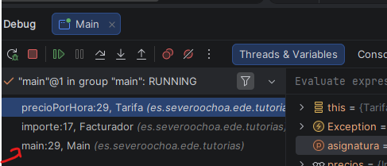

6. Desplegad `r`. Anotad el valor de `i` y el id y el alumno de la reserva culpable.

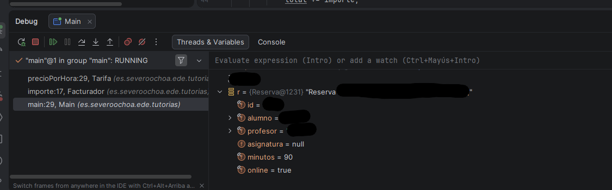

📸 **Captura 2:** el frame `main` seleccionado en **Frames**, con `i` y `r` desplegada en **Variables**.

7. Pulsad `Ctrl+F2` para **Detener** la ejecución del depurador. Volved a la pantalla de breakpoints (`Ctrl+Shift+F8`) y **desmarcad** el breakpoint de `NullPointerException` para que no moleste en las siguientes misiones (no hace falta borrarlo).

## Misión 3. Rescatar la ejecución en caliente

**Objetivo:** usar un **breakpoint condicional** y **modificar una variable** mientras el programa se ejecuta.

Las reservas sin asignatura están *pendientes de asignar*. Vamos a hacer que el programa termine **sin tocar el código**, dándoles una asignatura sobre la marcha.

1. En `Main.java`, poned de nuevo un breakpoint en `double importe = facturador.importe(r);`.
2. Haced **clic derecho** sobre el punto rojo. En el campo **Condition** escribid:

   ```java
   r.getAsignatura() == null
   ```

   Pulsad **Done**. El punto rojo muestra ahora un signo de interrogación: solo se detendrá cuando la condición sea cierta.

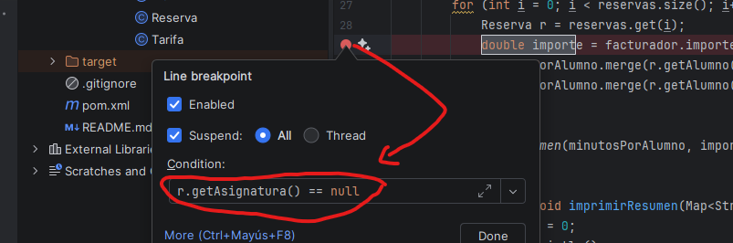


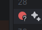
   📸 **Captura 3a:** la ventana del breakpoint con la condición escrita.

3. Lanzad el depurador. Se detiene directamente en la primera reserva pendiente, sin pasar por las anteriores.
4. En **Variables**, desplegad `r`, haced clic derecho sobre `asignatura` y elegid **Set Value** (`F2`). Escribid `"Programación"`, **con las comillas**, y pulsad `Intro`.

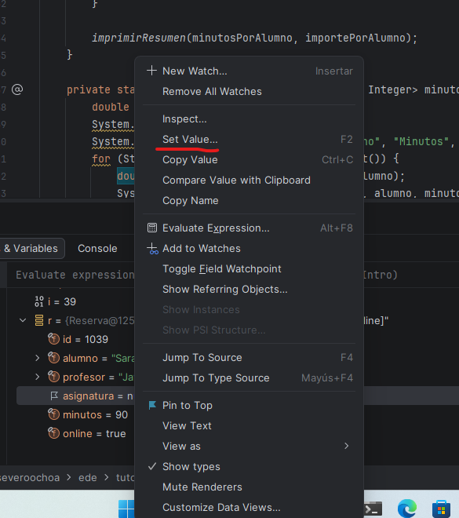

   📸 **Captura 3b:** la reserva con la asignatura ya cambiada.

5. Pulsad `F9` (**Resume**). Si se detiene otra vez, repetid el paso 4. **Contad cuántas veces se detiene.**
6. El programa termina y muestra el resumen. Lo habéis rescatado **sin cambiar una sola línea de código**: solo habéis cambiado datos en memoria mientras se ejecutaba.

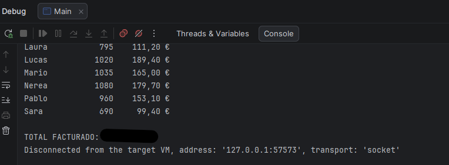

Ahora sí, corregid el código para que las reservas pendientes no se facturen. Abrid `Facturador.java` y añadid estas tres líneas **al principio** del método `importe`:

```java
if (r.getAsignatura() == null) {
    return 0.0;
}
```

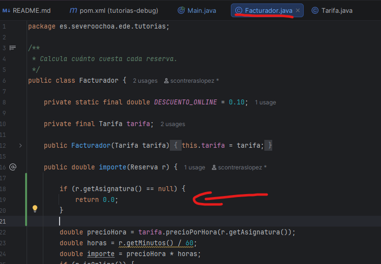

7. Quitad el breakpoint condicional y ejecutad el programa de forma normal (Run, no Debug). Ya no revienta. Anotad el **TOTAL FACTURADO**.

📸 **Captura 3c:** la consola con el resumen completo.

## Misión 4. Parar en el momento justo

**Objetivo:** combinar una **condición** con una **expresión vigilada** (*watch*) y usar **Run to Cursor**.

Queremos saber cuántos minutos de tutoría lleva acumulados **Laura** justo cuando el programa va a procesar la reserva número 100.

1. En `Main.java`, poned un breakpoint en la línea `Reserva r = reservas.get(i);` con la condición:

   ```java
   i == 100
   ```

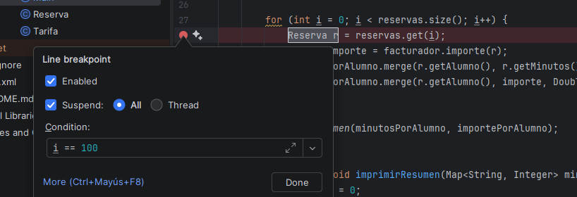

2. Lanzad el depurador. Comprobad en **Variables** que `i` vale 100.

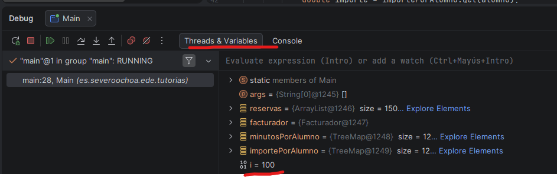

3. En la parte superior del panel **Variables** hay un campo que dice *Evaluate expression or add a watch*. Escribid:

   ```java
   minutosPorAlumno.get("Laura")
   ```

   y pulsad `Ctrl+Shift+Intro`. La expresión queda fijada en el panel con un icono de gafas: es un **watch**, y se recalcula cada vez que el programa se detiene. Anotad su valor. Alternativamente, podéis clicar el botón de **+** y añadir la expresión como watch. 

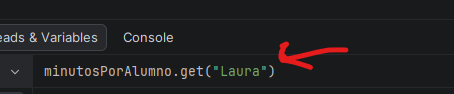

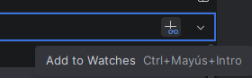

4. Haced clic en la línea `imprimirResumen(minutosPorAlumno, importePorAlumno);` para dejar el cursor en ella y pulsad `Alt+F9` (**Run to Cursor**). El programa avanza hasta esa línea, sin necesidad de poner otro breakpoint. Mirad cómo ha cambiado el watch y anotad el valor final. Alternativamente, puedes cilar el botón **Run to Cursor** de la barra del depurador, está escondido dentro de los tres puntitos.

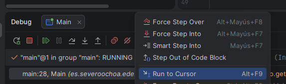

📸 **Captura 4:** la ejecución parada en `imprimirResumen` con el watch visible.

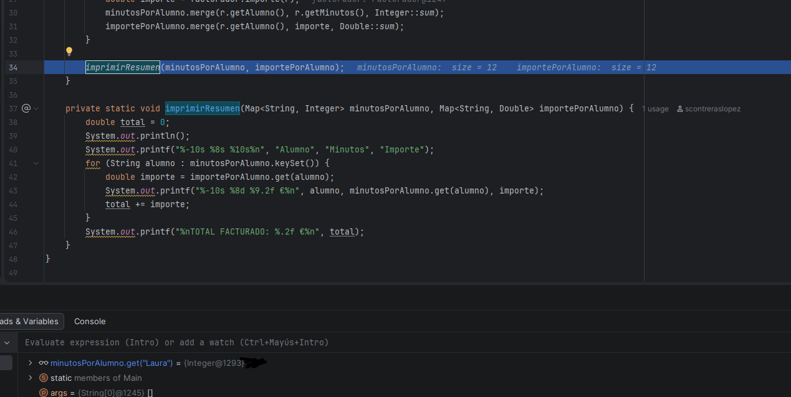

5. Pulsad `Ctrl+F2` y quitad el breakpoint.

## Misión 5. Espiar sin detener

**Objetivo:** usar un breakpoint **que no detiene la ejecución** y solo escribe en la consola (un *logpoint*). Es la alternativa limpia a llenar el código de `System.out.println` para luego tener que borrarlos.

Queremos ver el importe de cada reserva de la profesora **Marta** sin parar el programa ni modificar el código.

1. En `Facturador.java`, poned un breakpoint en la línea `return importe;`.
2. Clic derecho sobre el punto rojo y pulsad **More** (`Ctrl+Shift+F8`) para ver todas las opciones.
3. Configuradlo así:
   - **Desmarcad Suspend.** Así el programa no se detiene.
   - **Condition:** `r.getProfesor().equals("Marta")`
   - **Marcad Evaluate and log** y escribid:

     ```java
     "Reserva " + r.getId() + " (" + r.getMinutos() + " min): " + importe + " €"
     ```

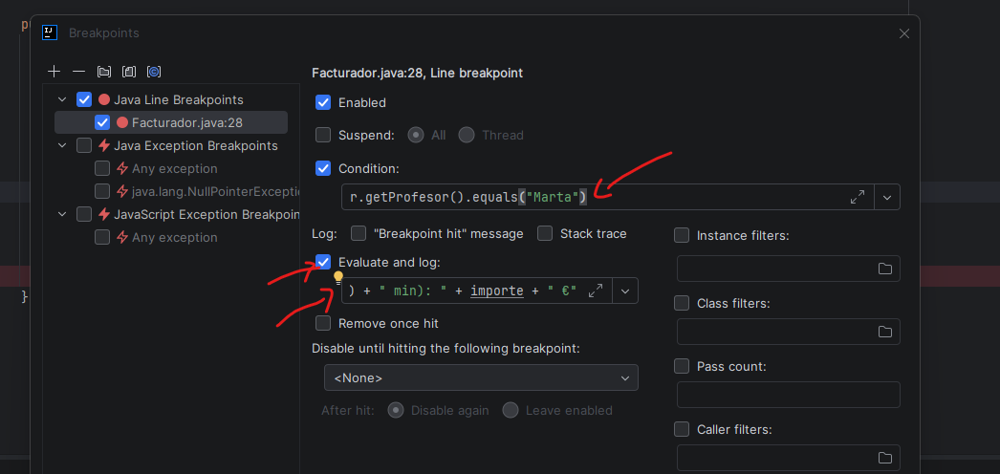

   Pulsad **Done**. El punto pasa a ser amarillo o naranja: no detiene la ejecución.

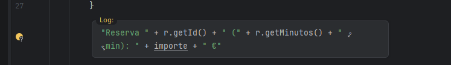

4. Lanzad el depurador. El programa llega al final sin pararse, y en la consola aparecen vuestras líneas mezcladas con la salida normal. Contad cuántas hay y anotad las tres primeras.

📸 **Captura 5:** la configuración del breakpoint y la consola con las líneas que escribe.

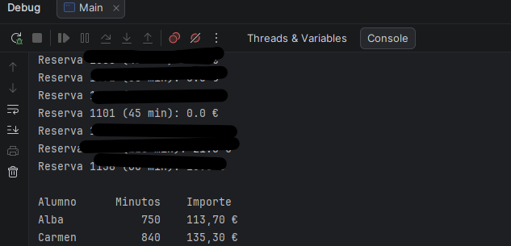

5. Quitad el breakpoint.

## Misión 6. El misterio de las tutorías gratis

**Objetivo:** usar **Evaluate Expression** para comprobar hipótesis y **cambiar de frame** para evaluar en otro contexto.

Fijaos en el resumen: hay alumnos con muchos minutos y un importe sospechosamente bajo. Algunas tutorías salen **gratis**. Vamos a mirar una de 45 minutos.

1. En `Facturador.java`, poned un breakpoint en la línea `double importe = precioHora * horas;` con la condición:

   ```java
   r.getMinutos() == 45
   ```

2. Lanzad el depurador. Anotad el id de la reserva donde se detiene y mirad el valor de `horas`. ¿Cuántas horas son 45 minutos?
3. Pulsad `Alt+F8` (**Evaluate Expression**), o usar el cajetín de evaluación. Evaluad estas dos expresiones, una después de otra, y anotad los resultados:

   ```java
   r.getMinutos() / 60
   ```

   ```java
   r.getMinutos() / 60.0
   ```

   📸 **Captura 6a:** la ventana *Evaluate* con uno de los dos resultados.

   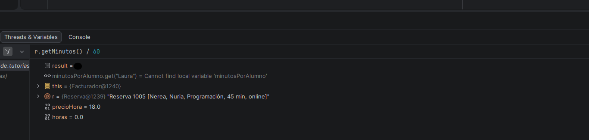

   Explicad en una frase qué diferencia veis. No hace falta que lo arregléis.

4. 🥚 Entre los profesores hay **alguien muy especial**. En **Frames**, haced clic en el frame `main`: así podéis evaluar expresiones con las variables de `main`, como la lista `reservas`. Abrid **Evaluate Expression** y escribid:

   ```java
   reservas.stream().filter(x -> "Grace Hopper".equals(x.getProfesor())).findFirst().get()
   ```

   Anotad el id, el alumno y la asignatura de esa reserva.

   📸 **Captura 6b:** el resultado de la expresión.

   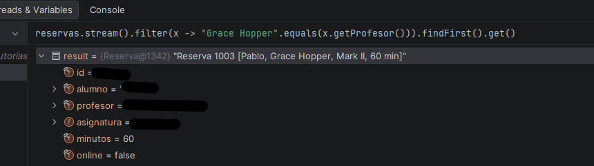

5. Pulsad `Ctrl+F2` y quitad el breakpoint.

> [!NOTE]
> **¿Por qué Grace Hopper?** En 1947, el equipo de Grace Hopper que trabajaba con el ordenador **Harvard Mark II** encontró una polilla atrapada en un relé que provocaba fallos. La pegaron en el cuaderno de registro con la nota *«First actual case of bug being found»*. La palabra *bug* ya se usaba antes para hablar de fallos, pero esta anécdota la hizo famosa. Hopper, además, fue pionera de los compiladores y de lenguajes como COBOL.

## Misión 7 (opcional). Arreglarlo y comprobarlo

1. Corregid el cálculo de `horas` en `Facturador.importe`. Podéis hacerlo solos o con ayuda de una IA; lo que cuenta aquí es que **comprobéis con el depurador** que la corrección funciona. Básicamente consiste en aplicar lo que hemos visto en la misión 6: dividir por `60.0` en lugar de `60`.
2. Repetid la misión 6 con la misma condición y comprobad que ahora `horas` vale `0.75`.
3. Ejecutad el programa y anotad el nuevo **TOTAL FACTURADO**.

📸 **Captura 7:** la ejecución parada con `horas = 0.75` y la consola con el nuevo total.

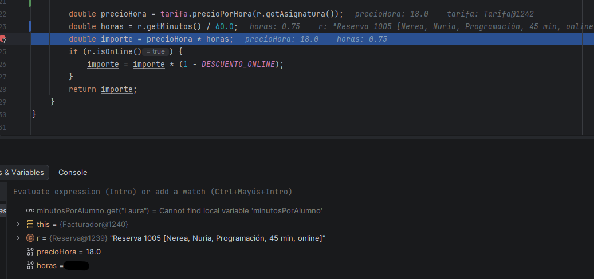

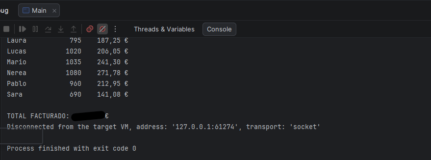

## Si algo no funciona

| Problema | Solución |
|---|---|
| No aparece el triángulo verde junto a `main` o el código sale en rojo | Falta el JDK. Abrid **File \| Project Structure \| Project** y elegid un **SDK** 21 o superior (UP02). |
| Aparece *Maven build scripts found* | Pulsad **Load**. |
| El programa no se detiene en el breakpoint | Comprobad que lo lanzáis con **Debug** y no con **Run**, que la condición está bien escrita y que los breakpoints no están silenciados (botón **Mute Breakpoints** de la barra del depurador). |
| El breakpoint de excepción se detiene en una clase que no es nuestra | Pulsad `F9` hasta que se detenga en `Tarifa`. |
| Al escribir el NIA, el código sale en rojo | Escribid solo los dígitos, sin letras ni espacios. Si empieza por cero, quitad el cero inicial. Si tiene más de 9 cifras, añadid una `L` al final (`12345678901L`). |
| Las respuestas no coinciden con las de un compañero | Es lo esperado: cada NIA genera datos distintos. |

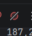
