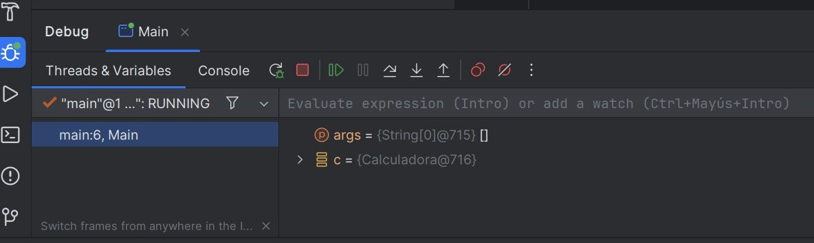
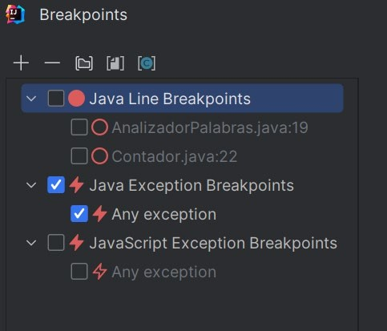
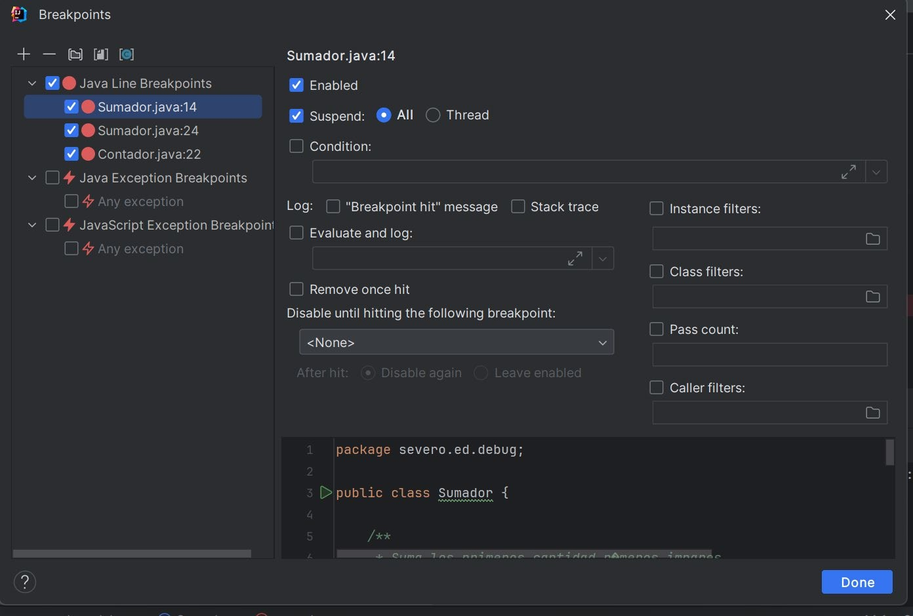
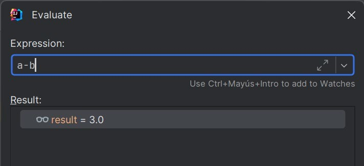

# UP03: DEPURACIÓN DE CÓDIGO

## ÍNDICE

- [OBJETIVOS](#objetivos)
- [CÓMO TRABAJAR ESTA UNIDAD](#cómo-trabajar-esta-unidad)
- [0. ANTES DE EMPEZAR](#0-antes-de-empezar)
- [1. ERRORES Y BUGS](#1-errores-y-bugs)
  - [1.1. Tres tipos de error](#11-tres-tipos-de-error)
  - [1.2. Probar y depurar no son lo mismo](#12-probar-y-depurar-no-son-lo-mismo)
- [2. LEER UNA TRAZA DE EXCEPCIÓN](#2-leer-una-traza-de-excepción)
- [3. EL DEPURADOR](#3-el-depurador)
  - [3.1. Qué es un depurador](#31-qué-es-un-depurador)
  - [3.2. Run y Debug](#32-run-y-debug)
  - [3.3. La ventana Debug](#33-la-ventana-debug)
- [4. BREAKPOINTS](#4-breakpoints)
  - [4.1. Breakpoint de línea](#41-breakpoint-de-línea)
  - [4.2. Breakpoint condicional](#42-breakpoint-condicional)
  - [4.3. Breakpoint de excepción](#43-breakpoint-de-excepción)
  - [4.4. Breakpoint que no se detiene (logpoint)](#44-breakpoint-que-no-se-detiene-logpoint)
  - [4.5. Gestionar los breakpoints](#45-gestionar-los-breakpoints)
- [5. CONTROLAR LA EJECUCIÓN](#5-controlar-la-ejecución)
- [6. EXAMINAR Y MODIFICAR EL ESTADO](#6-examinar-y-modificar-el-estado)
  - [6.1. Variables y valores en línea](#61-variables-y-valores-en-línea)
  - [6.2. Frames: viajar por la pila de llamadas](#62-frames-viajar-por-la-pila-de-llamadas)
  - [6.3. Watches](#63-watches)
  - [6.4. Evaluate Expression](#64-evaluate-expression)
  - [6.5. Set Value](#65-set-value)
- [7. UN MÉTODO PARA DEPURAR](#7-un-método-para-depurar)
  - [7.1. Los pasos](#71-los-pasos)
  - [7.2. Un ejemplo completo](#72-un-ejemplo-completo)
  - [7.3. Depurador, println e IA](#73-depurador-println-e-ia)
- [8. DOCUMENTAR UNA INCIDENCIA](#8-documentar-una-incidencia)
- [9. ERRORES FRECUENTES](#9-errores-frecuentes)
- [10. COMPRUEBA LO APRENDIDO](#10-comprueba-lo-aprendido)
- [REFERENCIAS](#referencias)

## OBJETIVOS

Al terminar esta unidad deberíais poder:

- Distinguir **errores de compilación, de ejecución y lógicos**, y saber qué herramienta ayuda con cada uno.
- **Leer una traza de excepción** y localizar con ella dónde ha fallado un programa.
- Identificar las **herramientas de depuración** que ofrece el entorno de desarrollo.
- Usar **breakpoints** de línea, condicionales, de excepción y de registro, y **controlar la ejecución** paso a paso.
- **Examinar y modificar** el estado de un programa mientras se ejecuta: variables, pila de llamadas, expresiones y valores.
- Seguir un **método ordenado** para localizar la causa de un fallo.
- **Documentar una incidencia** de forma que otra persona pueda reproducirla.

## CÓMO TRABAJAR ESTA UNIDAD

En la UP02 aprendisteis a crear y ejecutar proyectos en IntelliJ IDEA. Ahora vamos a ver qué hacer cuando el programa **compila pero no funciona**.

Toda la unidad gira alrededor de un mismo programa: **Tutorías Debug**. Genera las reservas de tutoría de una academia y calcula lo que factura cada alumno. Tiene fallos puestos a propósito. Los ejemplos de los apuntes y la [actividad de la unidad](UP03-actividad.md) usan ese mismo proyecto, así que lo que leáis aquí lo vais a practicar allí.

> [!NOTE]
> Los nombres de menús y opciones aparecen **en inglés**, tal y como los veréis en IntelliJ IDEA. Los atajos son los del mapa de teclado por defecto en Windows y Linux; en macOS cambian, pero los botones de la barra del depurador son los mismos.

<!-- En la [ampliación](UP03-ampliacion.md) tenéis breakpoints avanzados, recarga de código en caliente, depuración en VS Code y Kotlin, depuración remota y el registro de eventos (*logging*). TODO: PENDIENTE REVISIÓN -->

## 0. ANTES DE EMPEZAR

Necesitáis IntelliJ IDEA y un JDK 21 o superior, como en la UP02. Comprobad:

- [ ] IntelliJ IDEA abre un proyecto Java y lo ejecuta con el triángulo verde.
- [ ] Habéis clonado el proyecto **Tutorías Debug** siguiendo la [misión 0 de la actividad](UP03-actividad.md#misión-0-preparar-el-proyecto).
- [ ] Habéis escrito vuestro NIA en la constante `NIA` de `Main.java`.

El proyecto tiene cinco clases:

| Clase | Responsabilidad |
|---|---|
| `Main` | Recorre las reservas, acumula minutos e importes por alumno e imprime el resumen. |
| `GeneradorReservas` | Genera 150 reservas a partir de una semilla (vuestro NIA). |
| `Reserva` | Una reserva: id, alumno, profesor, asignatura, minutos y si es online. |
| `Facturador` | Calcula el importe de una reserva. |
| `Tarifa` | Devuelve el precio por hora de cada asignatura. |

## 1. ERRORES Y BUGS

### 1.1. Tres tipos de error

No todos los errores aparecen en el mismo momento ni se buscan igual:

| Tipo | Cuándo aparece | Quién lo detecta | Ejemplo |
|---|---|---|---|
| **De compilación** | Al compilar, antes de ejecutar nada. | El compilador. El IDE lo subraya en rojo mientras escribís. | Falta un `;`, una variable no declarada, un `String` donde se espera un `int`. |
| **De ejecución** | Mientras se ejecuta. El programa se interrumpe. | La máquina virtual, que lanza una **excepción**. | Dividir un entero entre cero, acceder a la posición 10 de un array de 3, usar una referencia `null`. |
| **Lógico** | Mientras se ejecuta, pero **sin avisar**. | Nadie, salvo que alguien compare el resultado con lo esperado. | Un descuento que se aplica al revés, un bucle que se salta el último elemento. |

Los errores de compilación son los más fáciles: el IDE dice dónde están y casi siempre propone cómo arreglarlos. Un programa con errores de compilación **no se puede ejecutar** y, por tanto, tampoco depurar.

Los otros dos tipos son lo que llamamos **bugs**. Tutorías Debug tiene uno de cada:

- Con algunos NIA revienta con un `NullPointerException`: es un **error de ejecución**.
- Cuando no revienta, hay tutorías que salen gratis: es un **error lógico**. Es el más peligroso, porque el programa parece funcionar.

### 1.2. Probar y depurar no son lo mismo

- **Probar** (*testing*) es comprobar si el programa hace lo que debe. Sirve para **descubrir** que hay un fallo. Lo veremos en las unidades de programación dedicadas al testing.
- **Depurar** (*debugging*) es averiguar **por qué** falla y **dónde** está la causa. Empieza cuando ya sabéis que algo va mal.

Una prueba os dice «el total de la factura debería ser 2385,13 € y sale 1628,50 €». La depuración os lleva hasta la línea exacta que produce la diferencia.

## 2. LEER UNA TRAZA DE EXCEPCIÓN

Cuando un programa Java lanza una excepción que nadie captura, la máquina virtual lo detiene e imprime una **traza** (*stack trace*). Es la primera pista que tenéis y muchas veces basta con ella. Esta es la de Tutorías Debug:

```text
Exception in thread "main" java.lang.NullPointerException: Cannot invoke "String.toLowerCase()" because "asignatura" is null
	at es.severoochoa.ede.tutorias.Tarifa.precioPorHora(Tarifa.java:29)
	at es.severoochoa.ede.tutorias.Facturador.importe(Facturador.java:17)
	at es.severoochoa.ede.tutorias.Main.main(Main.java:29)
```

Se lee así:

1. **Primera línea:** el **tipo** de excepción (`NullPointerException`) y un **mensaje**. Desde Java 14 el mensaje de un `NullPointerException` dice exactamente qué valía `null`: aquí, la variable `asignatura`.
2. **Líneas `at`:** la **pila de llamadas** en el momento del fallo. Cada línea es un método que estaba en marcha, con su clase, su archivo y su número de línea. Se leen **de arriba abajo, de lo más reciente a lo más antiguo**:

```text
Main.main (línea 29)                  llamó a…
  └─ Facturador.importe (línea 17)    que llamó a…
       └─ Tarifa.precioPorHora (línea 29)   ← aquí se lanzó la excepción
```

3. **Dónde mirar primero:** la primera línea `at` que pertenezca a **vuestro código**. En programas grandes, las primeras líneas pueden ser de librerías o del propio Java; buscad la primera con vuestro paquete.

En la consola de IntelliJ IDEA, los nombres de archivo de la traza son **enlaces**: un clic os lleva a esa línea.

> [!TIP]
> Si una traza incluye una o varias líneas `Caused by:`, la excepción original es la del **último** `Caused by`. Las de encima son excepciones que la envolvieron después.

La traza dice **dónde** ha fallado y **qué** valía `null`, pero no dice **qué reserva** tenía la asignatura vacía ni **por qué**. Para eso hay que ver el programa por dentro mientras se ejecuta.

## 3. EL DEPURADOR

### 3.1. Qué es un depurador

Un **depurador** (*debugger*) es una herramienta que ejecuta vuestro programa bajo control. Permite:

- **detener** la ejecución en un punto concreto;
- **avanzar** instrucción a instrucción, entrando o no en los métodos;
- **consultar** el valor de cualquier variable y la pila de llamadas en ese momento;
- **evaluar** expresiones con esos valores;
- **modificar** variables para ver cómo reacciona el programa.

En Java, el IDE no ejecuta el programa por sí mismo. Lanza la máquina virtual en un modo especial y se comunica con ella mediante un protocolo de depuración. Por eso el depurador funciona igual en IntelliJ IDEA, en VS Code o en Eclipse: cambian los botones, no lo que se puede hacer.

### 3.2. Run y Debug

Junto a `public static void main` hay un triángulo verde. Al hacer clic aparecen dos opciones:

- **Run** (`Shift+F10`): ejecuta el programa normalmente. **Ignora los breakpoints.**
- **Debug** (`Shift+F9`): ejecuta el programa con el depurador conectado. Se detiene en los breakpoints.

La barra superior de IntelliJ IDEA tiene los mismos dos botones: el triángulo (Run) y el bicho (Debug).

> [!IMPORTANT]
> El fallo más frecuente al empezar: poner un breakpoint, pulsar **Run** y preguntarse por qué no se detiene.

### 3.3. La ventana Debug

Cuando el programa se detiene, se abre la ventana **Debug** en la parte inferior:



<!-- CAPTURA PENDIENTE: sustituir por la ventana Debug detenida en Main.java de Tutorías Debug, con r desplegada -->

| Zona | Para qué sirve |
|---|---|
| **Barra de botones** | Continuar, detener, avanzar paso a paso, silenciar breakpoints... (apartado 5). |
| **Threads & Variables** | Pestaña principal. A la izquierda, los **frames**; a la derecha, las **variables**. |
| **Frames** | La pila de llamadas: qué métodos están en marcha y desde dónde se llamó a cada uno (apartado 6.2). |
| **Variables** | Las variables visibles en el frame seleccionado y sus valores. Encima hay un campo para evaluar expresiones y añadir *watches*. |
| **Console** | La salida del programa, como al ejecutar con Run. |

Además, el editor resalta en azul la línea donde está detenida la ejecución y muestra junto a cada línea el valor de sus variables en gris (*inline values*).

## 4. BREAKPOINTS

Un **breakpoint** (punto de ruptura) marca un lugar donde el depurador debe detener el programa. La ejecución se detiene **antes** de ejecutar esa línea.

### 4.1. Breakpoint de línea

Es el básico. Se pone y se quita con **un clic en el margen izquierdo**, junto al número de línea, o con `Ctrl+F8` sobre la línea. Aparece un punto rojo.

En Tutorías Debug, un breakpoint en esta línea de `Main` detiene el programa al procesar **cada** reserva:

```java
double importe = facturador.importe(r);   // ● breakpoint
```

Con 150 reservas son 150 paradas. Casi nunca queréis eso: para eso existen los condicionales.

### 4.2. Breakpoint condicional

Se detiene solo si una **condición** es cierta. Clic derecho sobre el punto rojo y escribid en **Condition** cualquier expresión Java de tipo `boolean` que use las variables visibles en esa línea:

```java
r.getAsignatura() == null
```

Ahora el programa pasa sin detenerse por todas las reservas con asignatura y se para justo en la primera que no la tiene. El punto rojo muestra un signo de interrogación.

Otras condiciones útiles: `i == 100` (detenerse en una iteración concreta), `r.getAlumno().equals("Laura")` (detenerse con un dato concreto), `importe < 0` (detenerse solo si algo es imposible).

### 4.3. Breakpoint de excepción

No se pone en una línea, sino en un **tipo de excepción**: el programa se detiene en el momento en que se lanza, esté donde esté.

1. Abrid **Run | View Breakpoints...** (`Ctrl+Shift+F8`).
2. Pulsad **+** y elegid **Java Exception Breakpoints**.
3. Buscad la excepción (por ejemplo, `NullPointerException`) y aceptad.



La diferencia con leer la traza es que ahora el programa **sigue vivo** en el instante del fallo: podéis mirar todas las variables, de ese método y de los que lo llamaron.

> [!TIP]
> **Any exception** detiene el programa con cualquier excepción, incluidas las que Java lanza y captura internamente. Suele ser demasiado: mejor indicar la excepción concreta.

### 4.4. Breakpoint que no se detiene (logpoint)

Un breakpoint puede **escribir un mensaje en la consola y seguir** sin detenerse. Es la alternativa limpia a llenar el código de `System.out.println`: no modifica el código fuente y se borra con un clic.

1. Clic derecho sobre el punto rojo y pulsad **More** (`Ctrl+Shift+F8`).
2. **Desmarcad Suspend.**
3. Marcad **Evaluate and log** y escribid la expresión que queréis ver, por ejemplo:

   ```java
   "Reserva " + r.getId() + ": " + importe + " €"
   ```

Se puede combinar con una condición. El punto pasa a ser amarillo o naranja. Un atajo: `Shift+clic` en el margen crea directamente un breakpoint que no se detiene.

### 4.5. Gestionar los breakpoints

El diálogo **Run | View Breakpoints...** (`Ctrl+Shift+F8`) reúne todos los breakpoints del proyecto. Desde él podéis activarlos y desactivarlos con la casilla, borrarlos o configurarlos:



| Opción | Qué hace |
|---|---|
| **Enabled** | Desactiva el breakpoint sin borrarlo (el punto queda hueco). |
| **Suspend** | Si se desmarca, el breakpoint no detiene la ejecución. |
| **Condition** | Solo actúa si la expresión es cierta. |
| **Evaluate and log** | Escribe el resultado de una expresión en la consola. |
| **Remove once hit** | Se borra solo la primera vez que se detiene. |
| **Pass count** | Solo se detiene la n-ésima vez que se alcanza. |

Durante una sesión de depuración, el botón **Mute Breakpoints** (un círculo rojo tachado) de la barra del depurador los silencia todos de golpe sin desactivarlos uno a uno.

## 5. CONTROLAR LA EJECUCIÓN

Con el programa detenido, la barra del depurador decide cómo seguir:

| Acción | Atajo | Qué hace |
|---|---|---|
| **Step Over** | `F8` | Ejecuta la línea actual **entera**, incluidos los métodos que llama, y se detiene en la siguiente. |
| **Step Into** | `F7` | Si la línea llama a un método vuestro, **entra** en él y se detiene en su primera línea. |
| **Smart Step Into** | `Shift+F7` | Si la línea llama a varios métodos, os deja **elegir** en cuál entrar. |
| **Step Out** | `Shift+F8` | Termina el método actual y vuelve a la línea que lo llamó. |
| **Run to Cursor** | `Alt+F9` | Continúa hasta la línea donde está el cursor, sin poner un breakpoint. |
| **Resume** | `F9` | Continúa hasta el siguiente breakpoint o hasta el final. |
| **Stop** | `Ctrl+F2` | Detiene el programa. |
| **Rerun** | `Ctrl+F5` | Detiene el programa y lo vuelve a lanzar en modo Debug. |

La diferencia entre las tres primeras se ve mejor con un dibujo. Supongamos que estáis detenidos en `Main`, en la línea que llama a `facturador.importe(r)`:

```text
Main.main                         Facturador.importe                 Tarifa.precioPorHora
─────────                         ──────────────────                 ────────────────────
▶ importe = facturador.importe(r) ─F7─▶ ▶ precioHora = tarifa.…(…)  ─F7─▶ ▶ clave = …
  minutosPorAlumno.merge(…)             horas = …                          return …
       ▲                                return importe;  ─Shift+F8─────────────┘
       └── F8: ejecuta importe() entero y se detiene aquí
```

- Con `F8` os quedáis en `Main`: `importe()` se ejecuta, pero no veis lo que pasa dentro.
- Con `F7` entráis en `importe()`; otro `F7` en la línea adecuada os mete en `precioPorHora()`.
- Con `Shift+F8` salís del método actual hacia quien lo llamó.

> [!TIP]
> Step Into no entra en los métodos de la librería de Java (`String`, `ArrayList`...): sería entrar en código que no vais a cambiar. Si alguna vez lo necesitáis, existe **Force Step Into** (`Alt+Shift+F7`).

## 6. EXAMINAR Y MODIFICAR EL ESTADO

### 6.1. Variables y valores en línea

El panel **Variables** muestra las variables del método donde está detenido el programa: los parámetros, las variables locales que ya tienen valor y `this` si es un método de instancia. Los objetos se despliegan con la flecha para ver sus atributos, y así sucesivamente.

Cada objeto aparece con un identificador, por ejemplo `{Reserva@812}`. Si dos variables muestran el mismo identificador, apuntan al **mismo objeto**.

El editor muestra además los valores **en línea**, en gris, al final de cada línea ya ejecutada. Pasando el ratón por encima de una variable en el código también veis su valor.

> [!NOTE]
> Una variable local aparece en **Variables** solo cuando ya se ha ejecutado la línea que la declara. Si estáis detenidos en `double horas = ...`, todavía no veréis `horas`: pulsad `F8` y aparecerá.

### 6.2. Frames: viajar por la pila de llamadas

El panel **Frames** muestra la misma pila de llamadas que la traza de una excepción, pero **en vivo**:

```text
precioPorHora:29, Tarifa        ← método actual (seleccionado)
importe:17, Facturador
main:29, Main
```

Al hacer clic en otro frame, el editor salta a la línea correspondiente y **Variables** muestra las variables **de ese método** en el momento en que hizo la llamada. Es la herramienta clave cuando el error se manifiesta en un método, pero la causa está en quien lo llamó.

En Tutorías Debug, la excepción se lanza en `Tarifa`, que solo recibe un `String`. Para saber **qué reserva** y **en qué iteración** del bucle ocurrió, hay que subir hasta el frame `main` y mirar `r` e `i`.

> [!IMPORTANT]
> Cambiar de frame **no** hace retroceder el programa. Solo cambia qué variables estáis mirando. La ejecución sigue detenida donde estaba.

### 6.3. Watches

Un **watch** es una expresión que el depurador recalcula y muestra **cada vez** que el programa se detiene. Sirve para seguir la evolución de algo que no es una simple variable:

1. En el campo de la parte superior del panel **Variables** (*Evaluate expression or add a watch*), escribid la expresión, por ejemplo `minutosPorAlumno.get("Laura")`.
2. Pulsad `Ctrl+Shift+Intro`.

El watch queda fijado en el panel con un icono de gafas. Se puede borrar con clic derecho.

### 6.4. Evaluate Expression

**Evaluate Expression** (`Alt+F8`) calcula **una vez** cualquier expresión Java con los valores actuales: operaciones, llamadas a métodos, incluso *streams* y lambdas.



Es la forma más rápida de **comprobar una hipótesis** sin tocar el código. Por ejemplo, detenidos en `Facturador.importe` con una reserva de 45 minutos:

| Expresión | Resultado |
|---|---|
| `r.getMinutos() / 60` | `0` |
| `r.getMinutos() / 60.0` | `0.75` |

> [!WARNING]
> Evaluate Expression ejecuta código de verdad. Si evaluáis algo que modifica el estado, como `reservas.clear()`, el programa queda modificado.

### 6.5. Set Value

**Set Value** cambia el valor de una variable o de un atributo mientras el programa está detenido: clic derecho sobre la variable en **Variables** y **Set Value** (`F2`). Escribid el nuevo valor como lo escribiríais en Java: `"Programación"` con comillas para un `String`, `45` para un `int`, `null`...

Sirve para:

- **comprobar una hipótesis**: «si esta variable valiera X, ¿funcionaría?»;
- **forzar un caso difícil de reproducir**: un valor límite, una rama del `if` que casi nunca se ejecuta;
- **sortear un fallo** y seguir depurando lo que viene después, sin recompilar.

El cambio solo existe **en memoria y en esa ejecución**. El código fuente no cambia.

## 7. UN MÉTODO PARA DEPURAR

### 7.1. Los pasos

Depurar sin método es poner breakpoints al azar y pulsar `F8` hasta que algo llame la atención. Funciona con programas pequeños y se vuelve imposible con programas reales. Un método sencillo:

1. **Reproducir.** Conseguid que el fallo ocurra siempre de la misma forma. Anotad los datos de entrada y el resultado obtenido frente al esperado.
2. **Acotar.** Usad la traza, el resultado erróneo y el conocimiento del código para decidir **en qué zona** puede estar la causa.
3. **Formular una hipótesis.** Una frase concreta: «creo que `horas` vale 0 cuando la reserva dura menos de una hora».
4. **Comprobarla con el depurador.** Poned un breakpoint, mejor condicional, donde se pueda confirmar o descartar. Mirad variables, evaluad expresiones.
5. **Corregir** la causa, no el síntoma.
6. **Verificar.** Repetid el caso del paso 1 y comprobad que el resultado es el esperado y que no habéis roto otra cosa.

### 7.2. Un ejemplo completo

**1. Reproducir.** Ejecutamos Tutorías Debug con un NIA, ya sin el `NullPointerException`. En el resumen hay alumnos con muchos minutos y un importe muy bajo. Lo esperado: una tutoría de 45 minutos de Programación (18 €/h) debería costar 13,50 €.

**2. Acotar.** El importe se calcula en `Facturador.importe`. Si el precio por hora fuera incorrecto, fallarían todas las reservas, no solo algunas. Sospechamos de las que duran menos de una hora.

**3. Hipótesis.** «Las reservas de menos de 60 minutos salen gratis porque `horas` vale 0».

**4. Comprobar.** Breakpoint en `double importe = precioHora * horas;` con la condición `r.getMinutos() == 45`. Lanzamos Debug y se detiene. En **Variables**: `precioHora = 18.0`, `horas = 0.0`. Hipótesis confirmada. Evaluamos `r.getMinutos() / 60` y obtenemos `0`: es una **división entera**. Al dividir dos `int`, Java descarta los decimales, y el resultado se convierte en `double` cuando ya es tarde.

**5. Corregir.** Basta con que uno de los operandos sea decimal: `r.getMinutos() / 60.0`.

**6. Verificar.** Con el mismo breakpoint, `horas` vale ahora `0.75`. Ejecutamos y el total facturado sube. Comprobamos que las reservas de 60 y 120 minutos siguen dando lo mismo que antes.

Fijaos en que encontrar la línea fue lo de menos. El depurador sirvió para **confirmar** la hipótesis con datos reales en lugar de suponerla.

### 7.3. Depurador, println e IA

**`System.out.println`.** Imprimir valores es la técnica de depuración más antigua y sigue siendo útil para una comprobación rápida. Sus problemas: hay que modificar el código, recompilar, decidir de antemano qué imprimir y acordarse de borrarlo todo después. El depurador permite decidir **qué mirar mientras el programa está detenido**, y los breakpoints que no se detienen (apartado 4.4) dan la misma información que un `println` sin tocar el código.

**Asistentes de IA.** Pegar una traza en un asistente de IA suele dar una explicación razonable del error y una propuesta de corrección. Usadlo, pero tened en cuenta que:

- la IA **no ve el estado** de vuestro programa: deduce a partir del texto que le dais, y con datos concretos (como los generados con vuestro NIA) puede equivocarse con total seguridad;
- una corrección que hace desaparecer el síntoma no siempre corrige la causa;
- en programas grandes, el trabajo difícil es **reproducir y acotar**, y eso sigue siendo cosa vuestra.

El depurador y la IA se complementan: la IA propone hipótesis y el depurador las confirma o las descarta.

## 8. DOCUMENTAR UNA INCIDENCIA

No siempre sois vosotros quienes corrigen el fallo que encontráis. A menudo hay que **comunicarlo** a otra persona del equipo, en un gestor de incidencias como GitHub Issues (UP05) o Jira. Una buena incidencia permite reproducir el fallo **sin preguntaros nada**:

| Campo | Contenido |
|---|---|
| **Título** | Qué falla y dónde, en una línea. |
| **Entorno** | Versión del programa, sistema operativo, versión de Java. |
| **Pasos para reproducir** | Numerados y exactos, incluidos los datos de entrada. |
| **Resultado esperado** | Qué debería pasar. |
| **Resultado obtenido** | Qué pasa realmente. Si hay excepción, la traza completa. |
| **Análisis** | Lo que habéis averiguado con el depurador: dónde se origina y por qué. |
| **Gravedad** | Bloqueante, alta, media o baja. |

Ejemplo con el fallo de Tutorías Debug:

```markdown
**Título:** NullPointerException en Tarifa.precioPorHora con reservas sin asignatura

**Entorno:** tutorias-debug 1.0, Windows 11, Temurin 21

**Pasos para reproducir:**
1. Poner NIA = 12345678 en Main.java.
2. Ejecutar Main.

**Resultado esperado:** se imprime el resumen de facturación.

**Resultado obtenido:** el programa termina con
`NullPointerException: Cannot invoke "String.toLowerCase()" because "asignatura" is null`
en Tarifa.java:29 (traza completa adjunta).

**Análisis:** con un breakpoint de excepción y el frame `main`, la reserva que lo provoca
es la 1039 (i = 39), que tiene `asignatura = null`. GeneradorReservas crea reservas
pendientes de asignar y ni Facturador ni Tarifa contemplan ese caso.

**Gravedad:** alta (impide obtener la facturación).
```

## 9. ERRORES FRECUENTES

| Problema | Causa habitual | Solución |
|---|---|---|
| El programa no se detiene en el breakpoint. | Se lanzó con **Run**. | Lanzadlo con **Debug** (`Shift+F9`). |
| Sigue sin detenerse. | Los breakpoints están silenciados o desactivados, o la condición nunca es cierta. | Revisad **Mute Breakpoints** y el diálogo `Ctrl+Shift+F8`. |
| El breakpoint aparece con un aspa o una advertencia. | La línea no tiene código ejecutable (comentario, línea en blanco, llave). | Ponedlo en una línea con una instrucción. |
| La variable no aparece en **Variables**. | Su línea aún no se ha ejecutado, o pertenece a otro frame. | Avanzad con `F8` o seleccionad el frame adecuado. |
| `F7` entra en un getter en lugar del método que interesa. | La línea llama a varios métodos. | Usad **Smart Step Into** (`Shift+F7`) o salid con `Shift+F8`. |
| El breakpoint de excepción se detiene en clases de Java. | Se eligió **Any exception**. | Indicad la excepción concreta. |
| El programa va muy lento en modo Debug. | Breakpoints con condiciones costosas o de método (ampliación). | Quitad los que no uséis. |
| Cambié una variable con Set Value y el fallo sigue al ejecutar de nuevo. | Set Value no modifica el código. | Corregid el código fuente. |

## 10. COMPRUEBA LO APRENDIDO

1. Un programa compila, se ejecuta sin excepciones y muestra un total de 0 €. ¿Qué tipo de error es y por qué es el más peligroso?

<details>
<summary>Respuesta</summary>

Es un **error lógico**: el programa no avisa de nada y el resultado parece válido. Solo se detecta si alguien compara el resultado con el esperado, por eso son los que más tiempo sobreviven.

</details>

2. En una traza de excepción con diez líneas `at`, ¿por cuál empezáis a mirar?

<details>
<summary>Respuesta</summary>

Por la primera línea `at` que pertenezca a vuestro código, leyendo de arriba abajo. Las anteriores, si las hay, son de librerías o de Java. Si hay `Caused by:`, por la excepción del último `Caused by`.

</details>

3. Estáis detenidos en una línea que llama a `calcular()`. ¿Qué diferencia hay entre pulsar `F7` y `F8`?

<details>
<summary>Respuesta</summary>

`F8` (Step Over) ejecuta `calcular()` entero y se detiene en la siguiente línea del método actual. `F7` (Step Into) entra en `calcular()` y se detiene en su primera línea.

</details>

4. Un bucle recorre 10 000 elementos y el fallo aparece solo con el elemento cuyo id es 7342. ¿Cómo os detenéis justo ahí?

<details>
<summary>Respuesta</summary>

Con un **breakpoint condicional** dentro del bucle con la condición `elemento.getId() == 7342`.

</details>

5. Una excepción se lanza en un método que solo recibe un parámetro, y necesitáis saber qué estaba haciendo el método que lo llamó. ¿Qué panel usáis?

<details>
<summary>Respuesta</summary>

**Frames**. Al seleccionar el frame del método que hizo la llamada, **Variables** muestra sus variables en ese momento.

</details>

6. ¿Qué diferencia hay entre un *watch* y Evaluate Expression?

<details>
<summary>Respuesta</summary>

Evaluate Expression calcula la expresión **una vez**. Un watch queda fijado y se **recalcula cada vez** que el programa se detiene, así que sirve para seguir cómo cambia un valor.

</details>

7. Queréis saber qué valores toma una variable en cada iteración de un bucle sin modificar el código ni detener el programa. ¿Qué usáis?

<details>
<summary>Respuesta</summary>

Un breakpoint con **Suspend** desmarcado y **Evaluate and log** con la expresión que queréis ver.

</details>

8. Habéis usado Set Value para dar una asignatura a una reserva y el programa ha terminado bien. ¿Está corregido el fallo?

<details>
<summary>Respuesta</summary>

No. Set Value solo cambia el valor en memoria durante esa ejecución. Sirve para comprobar que, con ese dato, el programa funcionaría; la corrección hay que hacerla en el código.

</details>

## REFERENCIAS

- JetBrains. [Debug code](https://www.jetbrains.com/help/idea/debugging-code.html). Documentación de IntelliJ IDEA.
- JetBrains. [Breakpoints](https://www.jetbrains.com/help/idea/using-breakpoints.html). Documentación de IntelliJ IDEA.
- JetBrains. [Examine suspended program](https://www.jetbrains.com/help/idea/examining-suspended-program.html). Documentación de IntelliJ IDEA.
- OpenJDK. [JEP 358: Helpful NullPointerExceptions](https://openjdk.org/jeps/358).
