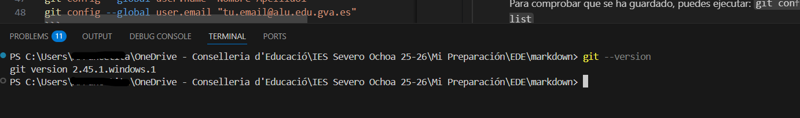
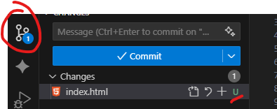
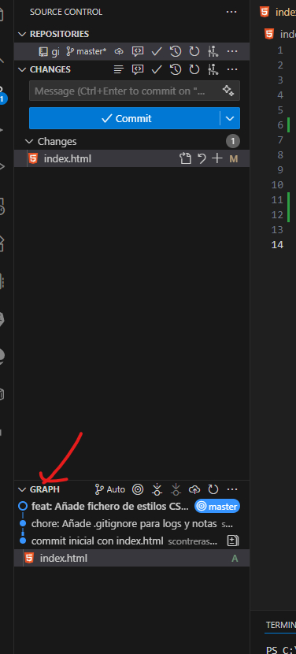
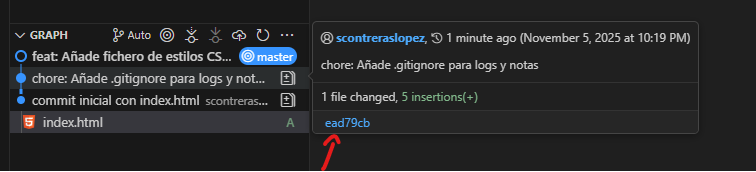

<!-- markdownlint-disable MD029 MD033 MD036-->
# Práctica Formativa EDE 01: Iniciación al Control de Versiones (Git y VSCode)

**Módulo Profesional:** 0487 - Entornos de Desarrollo
**Ciclos Formativos:** DAM / DAW

**Objetivos de la Práctica:**

* Instalar y configurar las herramientas básicas de un entorno de desarrollo (Git y VSCode).
* Iniciar un repositorio local de Git para un proyecto.
* Entender el flujo de trabajo básico: *working directory*, *staging area* y *repository*.
* Aprender a seleccionar qué cambios incluir en un *commit*.
* Crear y gestionar un fichero `.gitignore` para excluir archivos.
* Revisar los cambios realizados y deshacerlos antes de confirmarlos.
* Consultar el historial y moverse entre diferentes versiones del proyecto.

**Entregable:**
Deberás entregar un único documento (PDF o Markdown) llamado `Practica_Git_TuNombre_Apellido.pdf` que contenga:

1. **Capturas de pantalla** de todos los pasos clave señalados.
2. Un **breve comentario** en cada captura explicando qué estás haciendo o qué se observa en la imagen.

-----

## Bloque 1: Configuración del Entorno (El "Setup")

Antes de poder "guardar" las versiones de nuestro código, necesitamos las herramientas para hacerlo. Vamos a instalar y configurar Git (el sistema de control de versiones) y Visual Studio Code (nuestro editor de código o IDE).

### 1.1. Instalación de Herramientas

1. **Instala Git:** Ve a [https://git-scm.com/downloads](https://git-scm.com/downloads) y descarga el instalador para tu sistema operativo. Sigue el asistente. Para la mayoría de las opciones, puedes dejar las que vienen por defecto.
2. **Verificación:** Abre VSCode. Ve al menú `Terminal` -> `Nuevo terminal`. Escribe el siguiente comando para verificar que todo se ha instalado correctamente:

```bash
git --version
```

**Entregable**: 📸 **Captura 01:** Muestra la terminal **de VSCode** con la salida del comando anterior.

Podemos abrir una nueva terminal en VSCode yendo a `Terminal` -> `New Terminal`



### 1.2. Configuración Inicial de Git

Git necesita saber "quién" eres para firmar cada cambio que hagas. Vamos a decírselo. (¡Usa tus datos reales!).
En la misma terminal de VSCode, ejecuta:

```bash
git config --global user.name "Nombre Apellido1"
git config --global user.email "tu.email@alu.edu.gva.es"
```

> [!NOTE]
> Si eres un usuario avanzado de git y trabajas con varios perfiles, puedes omitir el `--global` y configurar estos datos por proyecto. También me sirve.

Aprovecha también para que tus repositorios nuevos usen `main` como nombre de la rama principal (en el tema, sección 3.1, se explica por qué):

```bash
git config --global init.defaultBranch main
```

Para comprobar que se ha guardado, puedes ejecutar:
`git config --global --list`

**Entregable**: 📸 **Captura 02:** Muestra la terminal con los cuatro comandos ejecutados (los tres `config` y el `list`).

### 1.3. Creación del Proyecto

1. Crea una carpeta en tu ordenador llamada `mi-proyecto-git`.
2. En VSCode, ve a `Archivo` > `Abrir carpeta...` y abre `mi-proyecto-git`.
3. Ahora, vamos a "activar" Git en esta carpeta. En la terminal de VSCode, ejecuta:

```bash
git init
```

Verás que aparece un mensaje "Initialized empty Git repository...". ¡Ya tenemos nuestro repositorio! Fíjate también en el icono de "Control de código fuente" (Source Control) en la barra lateral de VSCode, ahora debería tener una insignia.

> 📸 **Captura 03:** Muestra la terminal tras el `git init` y la interfaz de VSCode (señalando el icono de Control de código fuente).

-----

## Bloque 2: El Flujo de Trabajo de Git

Vamos a simular el desarrollo de un pequeño proyecto. Aquí es donde veremos la magia de "seleccionar" qué guardar y cuándo.

### 2.1. El Primer Commit (La Foto Inicial)

1. Crea un nuevo fichero llamado `index.html`.
2. Escribe en él un HTML básico **con tu nombre**:

    ```html
    <!DOCTYPE html>
    <html lang="es">
    <head>
        <meta charset="UTF-8">
        <title>Práctica Git</title>
    </head>
    <body>
        <h1>Hola, soy [Tu Nombre Completo]</h1>
        <p>Este es mi primer commit.</p>
    </body>
    </html>
    ```

3. **Guarda** el fichero.
4. Ve a la pestaña "Control de código fuente" (el icono de las tres ramas) en VSCode. Verás que `index.html` aparece en "Cambios" con una `U` (Untracked).

    

5. **Staging (Preparar):** Queremos preparar este fichero para "la foto" (el commit). Tienes dos formas:
    * **Con la UI:** Pulsa el icono `+` que aparece al lado de `index.html`. El fichero pasará a la sección "Cambios preparados para confirmar" (Staged Changes).
    * **Con la terminal:** `git add index.html`

    En cualquier caso verás cómo la **U** (Untracked) se transforma en una **A** (Added).

6. **Commit (Confirmar):** Ahora que está "preparado", vamos a confirmar el cambio.
    * En el cuadro de texto de arriba, donde pone **Message**, escribe un mensaje descriptivo: `feat: Commit inicial con index.html`
    * 📸 **Captura 04:** Muestra la interfaz de VSCode justo *antes* de hacer commit: con el fichero `index.html` en "Staged Changes" y el mensaje del commit escrito.
    * Pulsa el botón "Confirmar" (el tick ✔️) o `Ctrl+Enter`.
    * *Alternativamente* podríamos hacerlo con la terminal, para ello escribiríamos `git commit -m "feat: Commit inicial con index.html"`

¡Listo! Tu primer commit está hecho. El panel de cambios se vaciará. El archivo `index.html` ahora está bajo control de versiones en estado "committed"/"unmodified".

> [!NOTE]
> ¿Y ese `feat:` del principio del mensaje? Es un prefijo de **commits semánticos**: `feat:` indica una funcionalidad nueva, `fix:` una corrección y `chore:` una tarea de mantenimiento (como añadir el `.gitignore`). Lo veremos con detalle en la UP05; de momento, copia los mensajes tal cual.

### 2.2. El Fichero `.gitignore` (Lo que NO queremos guardar)

No todos los ficheros deben estar en el repositorio (por ejemplo, contraseñas, ficheros temporales, logs...).

1. Crea un fichero llamado `notas_privadas.txt` y escribe "Mis secretos de la práctica" o cualquier otra cosa similar.
2. Crea un fichero llamado `.log` y rellénalo con algún texto.

Si no te encuentras inspirado, puedes coger este texto:

```text
2025-11-05T09:12:47.123Z INFO  [auth-service] Request authenticated userId=4a3f2b session=af12c3 requestId=8f1e7d duration=34ms
2025-11-05T09:12:47.457Z DEBUG [cache] Miss key=product:421 ttl=0 fallback=database requestId=8f1e7d
2025-11-05T09:12:48.012Z WARN  [db] Connection slow host=db01.local latency=274ms poolInUse=18/50 requestId=8f1e7d
2025-11-05T09:12:48.214Z INFO  [pricing] Calculated price productId=421 base=19.99 tax=1.60 discounts=0.00 requestId=8f1e7d
2025-11-05T09:12:48.999Z ERROR [payment] Charge failed transactionId=tx_9c2a4 code=402 message="Card declined" requestId=3b2d11
2025-11-05T09:12:49.105Z DEBUG [retry] Retrying jobId=job_77 attempts=2 nextAttemptIn=1500ms requestId=3b2d11
2025-11-05T09:12:49.321Z INFO  [worker] Job completed jobId=job_77 duration=231ms status=success requestId=3b2d11
2025-11-05T09:12:50.004Z TRACE [http] Incoming GET /api/v1/products?limit=10 remote=10.0.2.15 userAgent="curl/7.68.0"
2025-11-05T09:12:50.207Z WARN  [rate-limiter] Rate limit exceeded key=ip:10.0.2.15 count=101 limit=100 window=60s
2025-11-05T09:12:50.512Z INFO  [metrics] Emitted metrics cpu=12.4% mem=142MB goroutines=32
```

3. Ve al panel de "Control de código fuente". Verás que Git ha detectado ambos ficheros. ¡No queremos trackear sus cambios!
4. Crea un fichero nuevo llamado exactamente `.gitignore` (empieza por un punto).
5. Escribe dentro de `.gitignore` los patrones de los ficheros a ignorar:

```gitignore
# Ignorar ficheros de notas
*.txt

# Ignorar logs
*.log
```

6. Guarda `.gitignore`. Ahora mira el panel de "Control de código fuente" / "Source Control". `notas_privadas.txt` y `.log` han desaparecido de la lista, pero `.gitignore` ha aparecido. ¡Perfecto!

> 📸 **Captura 05:** Muestra el contenido del fichero `.gitignore` y el panel de "Control de código fuente" donde *solo* se ve el `.gitignore` listo para hacer commit.

7. Haz "stage" (con el `+`) y "commit" del fichero `.gitignore`. Usa el mensaje: `chore: Añade .gitignore para logs y notas`

### 2.3. Commits Parciales (El "Staging" Selectivo)

Vamos a hacer dos cambios, pero a guardarlos en dos commits separados.

1. **Cambio 1 (HTML):** Modifica tu `index.html`. Añade un nuevo párrafo:

    ```html
    ...
    <p>Este es mi primer commit.</p>
    <p>Ahora estoy aprendiendo a hacer staging selectivo.</p>
    ...
    ```

    Añade también dentro del `<head>` el enlace al fichero `style.css`: `<link rel="stylesheet" href="style.css">`

2. **Cambio 2 (CSS):** Crea un fichero nuevo `style.css` y añade una regla:

    ```css
    body {
        background-color: #f0f0f0;
        font-family: Arial, sans-serif;
    }
    ```

3. Guarda ambos ficheros. Ve al panel de "Control de código fuente". Verás `index.html` (**M** Modificado) y `style.css` (**U** Untracked) en la lista de "Cambios".

    Antes de seguir, **mira qué has cambiado**: haz clic sobre `index.html` en la lista de "Cambios". Se abrirá el editor de diferencias, con la versión del último commit a la izquierda y la actual a la derecha; las dos líneas nuevas aparecen resaltadas en verde. (En la terminal, lo equivalente es `git diff`; compara los dos y verás por qué en el tema recomendamos el IDE para esto).

4. **Tarea:** Vamos a hacer un commit **solo con el fichero CSS**.

    * En la lista de "Cambios", pulsa el `+` **solo** al lado de `style.css`.
    * `style.css` se moverá a "Staged Changes", pero `index.html` se quedará abajo. Esto es útil cuando todavía tenemos trabajo pendiente en un fichero, pero queremos guardar otro, por ejemplo para corregir un error urgente.
    * 📸 **Captura 06:** Muestra el panel de "Control de código fuente" en el momento clave: `style.css` está en "Staged Changes", `index.html` está en "Changes", y el mensaje del commit del CSS está listo.
    * Escribe el mensaje de commit: `feat: Añade fichero de estilos CSS`
    * Pulsa "Confirmar".

5. Ahora el panel de "Control de código fuente" solo muestra el `index.html` modificado.
6. Haz "stage" (con el `+`) y "commit" de `index.html` con el mensaje: `feat: Añade párrafo informativo al index`

### 2.4. Deshacer Cambios (`git restore`)

Todos metemos la pata. Vamos a estropear algo a propósito y a arreglarlo con Git (en el tema, sección 4.2.F).

1. **Estropea el fichero:** Abre `index.html`, borra la línea del `<h1>` con tu nombre y escribe en su lugar `ESTO NO DEBERÍA ESTAR AQUÍ`. Guarda. En "Control de código fuente" aparecerá `index.html` como **M** (Modificado).

2. **Mete la pata otra vez:** Imagina que, sin darte cuenta, lo preparas para el commit. Pulsa el `+` al lado de `index.html` (o `git add index.html`). Ahora está en "Staged Changes".

3. **Sácalo del staging:** En "Staged Changes", pulsa el icono `−` (*Unstage Changes*) al lado de `index.html`. Con la terminal sería:

    ```bash
    git restore --staged index.html
    ```

    El fichero vuelve a "Changes". Ábrelo: tu "estropicio" sigue ahí. Sacar algo del staging **no** borra tus cambios, solo los saca de la "sala de espera".

4. **Mira lo que vas a perder:** Haz clic sobre `index.html` en "Changes" para abrir el editor de diferencias. Verás en rojo la línea del `<h1>` que borraste y en verde la línea nueva.

> 📸 **Captura 07:** Muestra el editor de diferencias de `index.html` con la línea del `<h1>` en rojo y `ESTO NO DEBERÍA ESTAR AQUÍ` en verde, y el panel de "Control de código fuente" con `index.html` en "Changes".

5. **Descarta los cambios:** Pulsa el icono de la flecha curva (*Discard Changes*) al lado de `index.html` y confirma. Con la terminal sería:

    ```bash
    git restore index.html
    ```

    El fichero vuelve a estar como en el último commit y el panel de cambios se queda vacío.

> [!WARNING]
> Descartar cambios **no se puede deshacer**: como esos cambios nunca llegaron a un commit, Git no los tiene guardados. Por eso VSCode te pide confirmación, y por eso el paso 4 (mirar el diff antes) es una buena costumbre.

### 2.5. Viajando en el Tiempo (Moverse entre Commits)

Git guarda un historial. Vamos a verlo y a "visitar" el pasado.

1. Dentro de la vista "Control de código fuente" de VSCode, deberías ver abajo una sección **Graph** con el historial.

    

    Alternativamente, si prefieres la terminal, puedes ver el historial con:

    ```bash
    git log --oneline --graph --decorate
    ```

    Cada bola (o cada línea, en la terminal) representa un commit. Si has instalado la extensión **Git Graph** (sección 4.4.E del tema), también puedes usarla.

2. Busca el *hash* (el código de 7 caracteres) de tu **primer commit** (el de "feat: Commit inicial con index.html"). Si usas la interfaz gráfica, aparecerá en el tooltip al pasar el ratón por encima del commit en cuestión.

    

3. Ahora, "viaja" a ese punto.

    ```bash
    git checkout [EL_HASH_DE_TU_PRIMER_COMMIT]
    ```

    También podemos hacer el checkout pulsando con el botón derecho sobre el commit en el gráfico y eligiendo **Checkout (Detached)**.

4. VSCode te avisará de que estás en modo "Detached HEAD". No te preocupes, es normal: `HEAD` apunta directamente a un commit en lugar de a una rama (lo tienes explicado en la sección 4.4.C del tema).

5. **Observa:** Mira tu explorador de ficheros de VSCode. ¿Qué ha pasado?

    * El fichero `style.css` ha desaparecido.
    * El fichero `.gitignore` ha desaparecido.
    * Si abres `index.html`, ¡el párrafo "Ahora estoy aprendiendo..." tampoco está!
    * En cambio, `notas_privadas.txt` y `.log` siguen ahí, y además **vuelven a aparecer** en el panel de "Control de código fuente". ¿Por qué? Pista: Git nunca los ha rastreado, así que no los toca al viajar; y en este commit no existe el fichero que le decía que los ignorara.

    Acabas de viajar al pasado, a cómo estaba tu proyecto en el primer commit.

    > [!TIP]
    > Si ahora ejecutas `git log --oneline --graph --decorate`, solo verás el primer commit: los "del futuro" no aparecen. No se han perdido; añade `--all` para verlos todos.

> 📸 **Captura 08:** Muestra la terminal con la salida de `git checkout [HASH]` y una vista del explorador de ficheros de VSCode donde se vea que `style.css` y `.gitignore` no están.

6. **Volver al presente:** Para volver al estado actual de tu trabajo, simplemente ejecuta en la terminal (esto sí que es más sencillo así):

    ```bash
    git switch main
    ```

    > [!NOTE]
    > Como se explica en el tema, `git checkout main` sería equivalente en este caso a `git switch main`.

    Si configuraste `init.defaultBranch` en el paso 1.2, tu rama se llamará `main`. Si te aparece `master` (fíjate en el log del paso 1 o en la primera línea de `git status`), usa `git switch master`.

Todo vuelve a estar en su sitio.

> 📸 **Captura 09:** Muestra la terminal con la salida de `git switch main` (o `git switch master`) y una vista del explorador de ficheros de VSCode donde se vea que todo vuelve a estar en su sitio.

-----

**Fin de la Práctica**

Asegúrate de que tu "memoria" (el documento entregable) contiene todas las capturas solicitadas, cada una con su breve explicación, una línea de texto para cada captura es suficiente. Este documento es la prueba de tu trabajo. ¡Buen trabajo!

**Resultados de Aprendizaje (RA) y Criterios de Evaluación (CE) asociados:**

* **RA2: Evalúa entornos integrados de desarrollo...**
  * CE2.a) Se han instalado entornos de desarrollo, propietarios y libres.
  * CE2.c) Se ha personalizado y automatizado el entorno de desarrollo.
* **RA4: Optimiza código empleando las herramientas disponibles...**
  * CE4.f) Se ha realizado el control de versiones integrado en el entorno de desarrollo.

En esta práctica hemos cubierto los fundamentos de git, pero el mundo de git y las plataformas de colaboración (GitHub, GitLab, Bitbucket...) es mucho más amplio. Aquí tienes una lista de conceptos avanzados que puedes investigar por tu cuenta para seguir aprendiendo, aunque algunos los trabajaremos en futuras prácticas:

* Branching, merge (and conflict resolution), rebase, reset, github (remote, push, pull, clone), stash, squash, cherry pick, tags.
* gh cli para fork, pull request, issues y create repository desde terminal.
