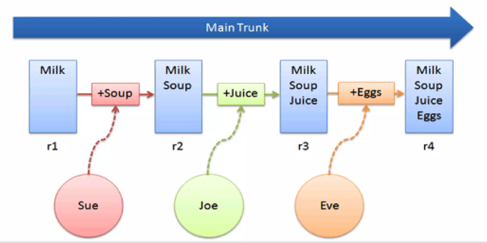
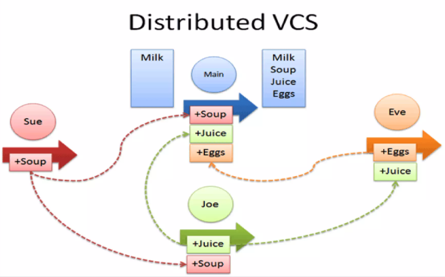

<!-- markdownlint-disable MD029-->
# UP04: Control de Versiones

## Índice

- [1. ¿Qué es un Sistema de Control de Versiones (VCS)?](#1-qué-es-un-sistema-de-control-de-versiones-vcs)
  - [1.1. El problema: Gestionar cambios en el tiempo](#11-el-problema-gestionar-cambios-en-el-tiempo)
  - [1.2. ¿Qué es un VCS y por qué es fundamental?](#12-qué-es-un-vcs-y-por-qué-es-fundamental)
  - [1.3. Funcionalidades clave](#13-funcionalidades-clave)
  - [1.4. Usos principales de un VCS](#14-usos-principales-de-un-vcs)
- [2. Arquitecturas de VCS: Centralizado vs. Distribuido](#2-arquitecturas-de-vcs-centralizado-vs-distribuido)
  - [2.1. Modelo Centralizado (CVCS)](#21-modelo-centralizado-cvcs)
  - [2.2. Modelo Distribuido (DVCS)](#22-modelo-distribuido-dvcs)
  - [2.3. Git: El estándar de facto (DVCS)](#23-git-el-estándar-de-facto-dvcs)
- [3. Fundamentos de Git: El Repositorio Local](#3-fundamentos-de-git-el-repositorio-local)
  - [3.1. Instalación y Configuración inicial](#31-instalación-y-configuración-inicial)
  - [3.2. Las "Tres Zonas" de Git (Three Trees / Three Areas)](#32-las-tres-zonas-de-git-three-trees--three-areas)
  - [3.3. Los Estados de los Archivos](#33-los-estados-de-los-archivos)
- [4. Flujo de Trabajo Básico en Git - Sandboxing](#4-flujo-de-trabajo-básico-en-git---sandboxing)
  - [4.1. Creación de un Repositorio: `git init`](#41-creación-de-un-repositorio-git-init)
  - [4.2. El Ciclo de Vida de un Cambio](#42-el-ciclo-de-vida-de-un-cambio)
  - [4.3. El arte de un buen mensaje de `commit`](#43-el-arte-de-un-buen-mensaje-de-commit)
  - [4.4. Viajar en el tiempo: `git log` y `git checkout`](#44-viajar-en-el-tiempo-git-log-y-git-checkout)
- [5. Avance: ¿Y ahora cómo colaboro? (Conexión UP05) 🚀](#5-avance-y-ahora-cómo-colaboro-conexión-up05-)
  - [5.1. ¿Qué es un Repositorio Remoto?](#51-qué-es-un-repositorio-remoto)
  - [5.2. Plataformas de Alojamiento: GitHub](#52-plataformas-de-alojamiento-github)
  - [5.3. Próximos Pasos: La Siguiente Unidad](#53-próximos-pasos-la-siguiente-unidad)

## 1. ¿Qué es un Sistema de Control de Versiones (VCS)?

### 1.1. El problema: Gestionar cambios en el tiempo

En el desarrollo de software, y en casi cualquier proyecto digital, es esencial gestionar y rastrear los cambios realizados a lo largo del tiempo.

Seguramente te suene esta situación: estás haciendo un trabajo importante y, por miedo a perder algo, empiezas a guardar copias:

- `proyecto_final_v1.docx`
- `proyecto_final_v2_con_graficos.docx`
- `proyecto_final_v3_revisado_profe.docx`
- `proyecto_final_FINAL.docx`
- `proyecto_final_FINAL_ESTE_SI.docx`

Este sistema rudimentario es un intento de "control de versiones". El problema se agrava cuando varias personas trabajan en el mismo proyecto. Cada una crea sus propias versiones, llevando a una confusión total sobre cuál es la versión correcta o más actualizada.

Imagina esto en un gran proyecto de software, con decenas de desarrolladores y cientos de archivos. Sería un verdadero caos.

### 1.2. ¿Qué es un VCS y por qué es fundamental?

Fruto de esta necesidad nacen las herramientas de control de versiones o **VCS (Version Control System)**.

Un VCS es una herramienta de software que administra y rastrea los cambios en el código fuente (y en cualquier tipo de archivo) de un proyecto. Permite a los equipos trabajar de forma coordinada y, lo más importante, mantiene un registro completo de quién cambió qué, cuándo lo cambió y por qué.

### 1.3. Funcionalidades clave

La funcionalidad de un VCS se puede resumir en tres aspectos fundamentales:

- **Almacena un histórico de los cambios**: El VCS registra meticulosamente cada modificación, adición o eliminación. Cada vez que un desarrollador guarda un conjunto de cambios (lo que llamaremos un *commit*), el VCS lo captura y almacena de forma organizada.
- **Permite recuperar versiones específicas**: Uno de los mayores beneficios es poder "viajar en el tiempo". Los desarrolladores pueden acceder a cualquier versión anterior del proyecto en cualquier momento. Esto es vital para corregir errores o comparar estados del código.
- **Gestiona los conflictos**: En proyectos colaborativos, es común que varias personas modifiquen el mismo archivo. El VCS es esencial para gestionar y ayudar a resolver los conflictos que surgen cuando dos personas intentan modificar la misma parte del código, garantizando que el resultado sea coherente.

### 1.4. Usos principales de un VCS

Más allá de "guardar versiones", un VCS es la columna vertebral del desarrollo de software moderno y se usa para:

- **Distribución de tareas e integración**: Permite que cada miembro del equipo trabaje en una parte específica y luego integre (fusione) su código de forma ordenada.
- **Revisión de código**: Facilita que los compañeros revisen los cambios de otros antes de que se integren en la versión principal, mejorando la calidad del código.
- **Sistema de integración continua (CI)**: Juega un papel central al permitir la automatización de pruebas y construcciones cada vez que se realiza un cambio, asegurando que el software esté siempre en un estado funcional.
- **Mantenimiento de distintas versiones**: Permite mantener múltiples versiones del producto en paralelo (ej. una versión estable para usuarios y una de desarrollo para nuevas características).

En resumen, un VCS es indispensable para mantener la integridad del proyecto, fomentar la colaboración y mejorar la calidad del software resultante.

---

## 2. Arquitecturas de VCS: Centralizado vs. Distribuido

Existen dos modelos principales para gestionar cómo se almacenan y se comparten esos historiales de versiones: el centralizado y el distribuido.

### 2.1. Modelo Centralizado (CVCS)

En un Sistema de Control de Versiones Centralizado (CVCS), se utiliza un **único repositorio central** (un servidor) que almacena toda la información y el historial del proyecto.

- **Funcionamiento**: Los desarrolladores no tienen el historial completo en sus máquinas. Tienen una "copia de trabajo" (*Working copy*) con la versión más reciente (o la que hayan descargado).
- **Flujo**:
    1. Para obtener los últimos cambios, hacen un `update` (actualizar) desde el servidor.
    2. Para guardar sus cambios, hacen un `commit` (confirmar) directamente contra el servidor central.
- **Desventaja**: Su gran debilidad es ese servidor central. Si el servidor falla o se pierde la conexión, nadie puede colaborar, confirmar cambios o ver el historial.
- **Ejemplos**: Los sistemas clásicos como **Subversion (SVN)**, **CVS** o **SourceSafe** usan esta arquitectura.



### 2.2. Modelo Distribuido (DVCS)

En un Sistema de Control de Versiones Distribuido (DVCS), el concepto es radicalmente diferente. En lugar de un solo repositorio central, **cada cliente tiene una réplica completa del repositorio** en su máquina local, incluyendo todo el historial de cambios.

- **Funcionamiento**: Tu repositorio local en tu PC es tan completo como el del servidor.
- **Flujo**:
    1. Tus `commit` (confirmaciones) se hacen contra tu **repositorio local**. No necesitas conexión a internet para trabajar, ver el historial o guardar cambios.
    2. Cuando quieres compartir tus cambios con el equipo, los "empujas" (`push`) a un repositorio remoto (que actúa como punto de encuentro).
    3. Para obtener los cambios de otros, los "traes" (`pull`) de ese repositorio remoto a tu repositorio local.
- **Ventaja**: Ofrece una flexibilidad enorme. Permite el trabajo *offline* y es mucho más robusto (si un servidor remoto falla, cualquier copia de un desarrollador sirve como respaldo completo).



### 2.3. Git: El estándar de facto (DVCS)

**Git es un Sistema de Control de Versiones Distribuido (DVCS)**. Además, es de código abierto y gratuito, lo que ha contribuido a su enorme popularidad. Enlace a su página oficial: [https://git-scm.com/](https://git-scm.com/).

Fue creado por Linus Torvalds (el creador de Linux) con objetivos claros: ser **rápido**, tener un **diseño simple** y ser capaz de manejar proyectos gigantescos (como el kernel de Linux) con miles de ramas simultáneas de forma eficiente.

Precisamente por ser distribuido, Git es la herramienta que permite los flujos de trabajo colaborativos modernos que veremos en la siguiente unidad, usando plataformas como GitHub o GitLab.

[](https://www.youtube.com/watch?v=2mxh3tgx71c)

---

## 3. Fundamentos de Git: El Repositorio Local

Ahora que sabemos qué es un VCS Distribuido, vamos a "abrir el capó" de Git. Antes de usar un solo comando, necesitas entender su arquitectura interna. Si entiendes esto, entenderás Git.

### 3.1. Instalación y Configuración inicial

Lo primero es tener la herramienta.

- **Instalación**: Puedes descargar Git desde su [página web oficial](https://git-scm.com/downloads). Hay versiones para Windows, macOS y Linux. Sigue las instrucciones específicas para tu sistema operativo.
- **Configuración (¡Obligatorio!)**: Justo después de instalar, Git necesita saber quién eres. Tienes que configurar tu identidad (nombre y email). Git grabará esta información en CADA *commit* que hagas, para saber quién fue el autor.

> [!NOTE]
> En el caso de que tuvieras varias cuentas, por ejemplo profesional y personal, puede que no sea tan buena idea usar la configuración global. En ese caso, puedes configurar el nombre y email por cada repositorio (sin el flag `--global`), o utilizar configuraciones condicionales más avanzadas (fuera del alcance de esta unidad).

Abre una terminal y ejecuta estos dos comandos:

```bash
git config --global user.name "Tu Nombre Completo"
git config --global user.email "tu.email@ejemplo.com"
```

> [!NOTE]
> Usa el flag `--global` para que esta configuración se aplique a todos los proyectos de tu máquina. Solo necesitas hacerlo una vez.

En honor a la verdad la configuración de Git está partida en 3 niveles: sistema, global y local (por repositorio). El nivel local (sin el flag `--global`) tiene prioridad sobre el global, y este sobre el de sistema. Pero para empezar, con el global es suficiente.

Ya que estás, configura también el nombre de la rama principal:

```bash
git config --global init.defaultBranch main
```

> [!NOTE]
> Históricamente, Git llama **master** a la rama principal. Este nombre está siendo desplazado por **main** en muchos proyectos por razones de inclusión, y GitHub ya usa **main** por defecto. Git, sin embargo, sigue usando **master** si no le dices lo contrario. Con este comando, todos los repositorios que crees a partir de ahora empezarán con **main**, y te ahorrarás líos al conectarlos con GitHub en la UP05. Si al instalar Git en Windows marcaste la opción *Override the default branch name for new repositories* con `main`, ya lo tienes hecho.

### 3.2. Las "Tres Zonas" de Git (Three Trees / Three Areas)

Aquí está el concepto clave que diferencia a Git. Git no solo tiene "tu carpeta" y "el repositorio". Tiene tres "zonas" o "áreas" donde viven tus archivos.

1. **Directorio de Trabajo (Working Directory)**:
   - Es la carpeta de tu proyecto, la que tú ves y donde editas tus archivos (`index.html`, `main.py`, etc.). Son tus archivos "en sucio".

2. **Área de Preparación (Staging Area)**:
   - Es una "sala de espera" o una "cesta de la compra". Es un espacio intermedio donde **preparas** los cambios que quieres guardar en el próximo *commit* (confirmación).
   - **¿Por qué existe?** Porque a lo mejor has modificado 10 archivos, pero solo quieres confirmar los 3 que solucionan un *bug* concreto. El *Staging Area* te permite construir tu *commit* pieza a pieza.

3. **Repositorio Local (.git Directory)**:
   - Es la base de datos de Git, oculta en la carpeta `.git` dentro de tu proyecto. Aquí es donde Git guarda de forma permanente todo el historial de *commits* (versiones).
   - Los archivos aquí están "a salvo", forman parte del historial.


El flujo de trabajo siempre será:

1. Modificas archivos en tu **Directorio de Trabajo**.
2. Seleccionas los cambios que te interesan y los añades al **Staging Area**.
3. Haces un *commit* (confirmas) esos cambios, que pasan del Staging Area a guardarse permanentemente en el **Repositorio Local**.

### 3.3. Los Estados de los Archivos

Derivado de las "Tres Zonas", cada archivo de tu proyecto estará en uno de estos estados. `git status` (un comando que veremos pronto) te dirá exactamente esto.

Primero, un archivo puede estar:

- **Untracked (Sin seguimiento)**:
  - Son archivos nuevos que acabas de crear. Están en tu *Directorio de Trabajo*, pero Git no sabe nada de ellos, los ignora por completo. Tendrás que decirle a Git si quieres empezar a rastrearlos.

O puede estar:

- **Tracked (Bajo seguimiento)**:
  - Son archivos que Git ya conoce y sobre los que vigila sus cambios. Un archivo rastreado puede estar en uno de estos tres sub-estados:
    1. **Unmodified (Sin modificar)**: El archivo está en tu *Directorio de Trabajo*, pero **no lo has tocado** desde el último *commit*. Su versión es idéntica a la que está guardada en el *Repositorio Local*.
    2. **Modified (Modificado)**: Has cambiado el archivo en tu *Directorio de Trabajo*, pero **aún no lo has preparado** (no lo has añadido al Staging Area).
    3. **Staged (Preparado)**: Has cogido un archivo (ya sea *Untracked* o *Modified*) y le has dicho a Git "¡prepáramelo!". Ahora está en el *Staging Area*, listo para ser incluido en el próximo *commit*.


---

## 4. Flujo de Trabajo Básico en Git - Sandboxing

¡Manos al teclado! ⌨️ Vamos a aplicar los conceptos de las "Tres Zonas" usando los comandos fundamentales de Git. Este es el ciclo de trabajo que realizarás constantemente en tu máquina. **Nota**: Es preciso tener Git instalado y configurado (ver sección 3.1).

### 4.1. Creación de un Repositorio: `git init`

Para empezar a usar Git en un proyecto, tienes que "inicializarlo". Este comando le dice a Git: "Oye, quiero que empieces a rastrear esta carpeta".

1. Abre tu terminal.
2. Crea una carpeta para tu proyecto y entra en ella (ej. `mkdir mi_proyecto_git` y `cd mi_proyecto_git`).
3. Ejecuta el comando:

```bash
git init
```

¡Ya está! Git ha creado la subcarpeta oculta `.git`. En esa carpeta es donde Git guarda *toda* su magia: la base de datos, el historial y todo lo demás. No la borres ni la modifiques manualmente.

### 4.2. El Ciclo de Vida de un Cambio

Este es el bucle fundamental de trabajo en Git.

#### A. Comprobar el estado: `git status`

Este es un comando **muy importante** de Git. Úsalo constantemente. Es tu "salpicadero" o tu "mapa". Te dice exactamente en qué estado está tu proyecto.

Ahora mismo, si creas un archivo (ej. `touch README.md`) y ejecutas `git status`, verás algo como:

```text
On branch main
No commits yet
Untracked files:
  (use "git add <file>..." to include in what will be committed)
        README.md

nothing added to commit but untracked files present (use "git add" to track)
```

Fíjate, te lo dice todo:

- "On branch main": Estás en la rama principal, `main`. Si a ti te pone `master`, es que no configuraste `init.defaultBranch` (sección 3.1). No pasa nada: funciona exactamente igual.
- "No commits yet": El repositorio está vacío.
- "Untracked files": Hay un archivo "sin seguimiento".
- `README.md`: Es el archivo que Git ha detectado pero no está rastreando.

#### B. Ignorar archivos: El `.gitignore`

Muchas veces, tu `git status` se llenará de archivos que *nunca* quieres guardar:

- Archivos de log (`.log`).
- Dependencias (`node_modules/`, `vendor/`).
- Archivos compilados (`.class`, `.exe`).

Para esto existe el archivo `.gitignore`. Es un simple archivo de texto, llamado `.gitignore`, donde escribes patrones de los archivos y carpetas que Git debe **ignorar** por completo.

**Acción:**

1. Crea un archivo llamado `.gitignore` en la raíz de tu proyecto.
2. Abre el archivo y escribe dentro, por ejemplo, `*.log`.
3. Si ahora creas un archivo `error.log`, verás que `git status` ¡ya no te avisa sobre él!
4. El propio archivo `.gitignore` **sí** debe ser guardado en el repositorio.

> **Trucazo 🤙**: No tienes que inventar este archivo. GitHub mantiene una [colección de plantillas .gitignore](https://github.com/github/gitignore) para casi cualquier lenguaje o framework.

Este paso del `.gitignore` es crítico en el desarrollo web con frameworks modernos (Node.js, Python, Ruby, etc.), donde las dependencias y archivos temporales son omnipresentes. En particular, nunca debes subir las dependencias al repositorio (como `node_modules/`), solo el archivo que las define (como `package.json`), si no tu repositorio colapsará bajo su propio peso.


Otros archivos con los que hay que tener cuidado son los que contienen información sensible (contraseñas, claves API, etc.). Estos **nunca** deben subirse a un repositorio público. También se desaconseja subir archivos binarios (imágenes, vídeos, PDFs) que cambian con frecuencia, ya que inflan el tamaño del repositorio y dificultan el seguimiento de cambios (para estos casos, existen soluciones especializadas como **Git LFS**, fuera del alcance de esta unidad).

#### C. Preparar cambios: `git add`

Una vez has modificado un archivo (o creado uno nuevo, como `README.md` y `.gitignore`), tienes que moverlo del *Directorio de Trabajo* al *Staging Area* (la "sala de espera").

Este es el paso que le dice a Git: "Este cambio que he hecho me gusta y quiero incluirlo en mi próximo *commit* (guardado)".

- Para añadir un archivo específico: `git add README.md`
- Para añadir todos los cambios (nuevos y modificados): `git add .`

**Acción:**

1. Ejecuta `git add .`
2. Vuelve a ejecutar tu comando favorito: `git status`.

Verás que ahora los archivos han cambiado de sección. Ya no están en "Untracked", sino en **"Changes to be committed"** (Cambios listos para confirmar). ¡Están en el *Staging Area*!

#### D. Confirmar cambios: `git commit`

Este es el "punto de guardado" oficial. Este comando coge todo lo que tengas en el *Staging Area* y lo empaqueta en una "instantánea" permanente (un *commit*) que se guarda en tu **Repositorio Local**.

El comando siempre debe ir acompañado de un mensaje (`-m`) que describa **qué** has hecho.

```bash
git commit -m "Initial commit: Add README and .gitignore"
```

**Acción:**

1. Ejecuta el `git commit` anterior.
2. Ejecuta `git status` por última vez.

El resultado será: `nothing to commit, working tree clean`. Has completado el ciclo. Tus cambios están a salvo en el repositorio.

#### E. Ver qué has cambiado: `git diff`

Ya tienes tu primer *commit*. Vamos a dar una segunda vuelta al ciclo, ahora con un archivo que Git ya rastrea. Abre `README.md`, escribe estas dos líneas y guarda:

```text
# Mi proyecto Git
Aprendiendo a usar el control de versiones.
```

`git status` te dirá que `README.md` está **modified**, pero no *qué* ha cambiado. Para eso está `git diff`.

**Desde la consola:**

```bash
git diff
```

```diff
diff --git a/README.md b/README.md
index e69de29..5c8b4a1 100644
--- a/README.md
+++ b/README.md
@@ -0,0 +1,2 @@
+# Mi proyecto Git
+Aprendiendo a usar el control de versiones.
```

Cómo leerlo:

- `--- a/README.md` es la versión anterior y `+++ b/README.md` la nueva.
- `@@ -0,0 +1,2 @@` indica qué líneas están afectadas: en la versión anterior no había nada y en la nueva son las líneas 1 y 2.
- Las líneas que empiezan por `+` (en verde) se han añadido y las que empiezan por `-` (en rojo) se han eliminado. Las que no llevan signo son contexto: no han cambiado.

Fíjate bien en qué compara cada variante:

| Comando | Compara | Responde a la pregunta |
| --- | --- | --- |
| `git diff` | Directorio de Trabajo ↔ Staging Area | ¿Qué he cambiado que aún no he preparado? |
| `git diff --staged` | Staging Area ↔ último *commit* | ¿Qué va a entrar en el próximo *commit*? |

> [!TIP]
> Si haces `git add` y después `git diff` no muestra nada, no has perdido tus cambios: ya están en el *Staging Area*. Usa `git diff --staged`. Revisarlo antes de cada *commit* es una costumbre excelente.

**Desde VS Code:**

Seamos sinceros: en cuanto hay varios archivos y muchos cambios, el `git diff` de consola se vuelve ilegible. Aquí el IDE gana por goleada.

- En la vista **Source Control** (`Ctrl+Shift+G`), haz clic en cualquier archivo de **Changes** o de **Staged Changes**. Se abre el editor de diferencias, con la versión anterior a la izquierda, la actual a la derecha y los cambios resaltados en rojo y verde.
- En el propio editor, el margen izquierdo marca las líneas tocadas: barra **verde** para las añadidas, **azul** para las modificadas y un triángulo **rojo** donde se han eliminado líneas. Haz clic en la marca para ver ese cambio en el sitio.

#### F. Deshacer cambios: `git restore`

Hay dos situaciones que te vas a encontrar enseguida.

**1. Has añadido al *Staging Area* algo que no querías.** Sácalo de ahí. El archivo vuelve a estar *modified* y no pierdes nada:

```bash
git restore --staged README.md
```

**2. Has estropeado un archivo y quieres descartar los cambios.** El archivo vuelve a la versión del último *commit* (o a la del *Staging Area*, si lo habías preparado antes de estropearlo):

```bash
git restore README.md
```

> [!WARNING]
> `git restore <archivo>` **borra tus cambios del Directorio de Trabajo y no hay vuelta atrás**: como nunca llegaron a un *commit*, Git no los tiene guardados. Antes de usarlo, mira con `git diff` lo que vas a perder.

No hace falta memorizarlos: el propio `git status` te los sugiere (`use "git restore --staged <file>..." to unstage`). En tutoriales antiguos, y en el diagrama de estados de la sección 3.3, verás `git reset HEAD <archivo>` para lo primero y `git checkout -- <archivo>` para lo segundo; hacen lo mismo, pero `git restore` es la forma moderna y más clara.

**Desde VS Code:**

- En **Staged Changes**, el icono `−` (*Unstage Changes*) junto a un archivo equivale a `git restore --staged`.
- En **Changes**, el icono de la flecha curva (*Discard Changes*) equivale a `git restore`. VS Code te pide confirmación, precisamente porque no se puede deshacer.
- Si solo quieres descartar un trozo del archivo, haz clic en la marca de color del margen: en la vista que se abre tienes el botón *Revert Change* para ese bloque concreto.

Cuando `README.md` esté como quieres, cierra la vuelta al ciclo:

```bash
git add README.md
git commit -m "Add project description to README"
```

### 4.3. El arte de un buen mensaje de `commit`

Tu *yo* del futuro y tus compañeros de equipo te lo agradecerán. Un historial de *commits* con mensajes como "stuff", "cambios", "fix" es inútil.

Esto es todo un arte, pero a priori, un buen *commit* debe ser:

- **Una unidad lógica**: Guarda cambios que tengan que ver entre sí. No mezcles un *bugfix* con añadir una nueva imagen.
- **Funcional (sobre todo lo que compartes)**: En tu repositorio local puedes hacer *commits* de trabajo a medias para no perder nada. Pero lo que integras en la rama principal o compartes con el equipo debe funcionar y no romper el proyecto.
- **Descriptivo**: El mensaje debe ser claro. (Ej. "Fix: Corrige el cálculo de IVA en la factura", no "arreglos").

> [!TIP]
> Git se puede usar desde la mayoría de los IDE modernos (VS Code, IntelliJ IDEA...). Aunque es muy recomendable dominar la línea de comandos, aquí el IDE tiene un buen punto a su favor: puede proponerte un mensaje de *commit* generado con IA a partir de los cambios del *Staging Area* (en VS Code, con GitHub Copilot activado, es el icono de destellos de la caja del mensaje). Úsalo como borrador: revísalo y corrígelo, porque quien sabe *por qué* hiciste el cambio eres tú.

### 4.4. Viajar en el tiempo: `git log` y `git checkout`

Perfecto, has guardado tu cambio. ¿Y ahora cómo lo ves? ¿Y cómo vuelves a una versión anterior?

#### A. Revisar el historial: `git log`

El comando `git log` te muestra el historial de todos los *commits* que has hecho.
Verás el **hash** (un ID único para cada commit), el **autor**, la **fecha** y el **mensaje**.

El `git log` por defecto es muy verboso. Aquí tienes algunos *flags* (opciones) que usarás sin parar:

- `git log --oneline`: Muestra cada *commit* en una sola línea, de forma compacta.
- `git log --graph`: Dibuja el historial con líneas, muy útil cuando empecemos con ramas (UP05).
- `git log --decorate`: Muestra junto a cada *commit* las etiquetas que apuntan a él, como el nombre de la rama (`main`) o `HEAD` (enseguida vemos qué es). En las versiones recientes de Git ya viene activado por defecto en la terminal, pero no está de más ponerlo.
- `git log --oneline --graph --decorate`: Todo junto, maravilloso. No necesitas añadir `--abbrev-commit`: `--oneline` ya muestra los *hashes* abreviados.

Con tres *commits*, la salida sería algo así:

```text
* a1b2c3d (HEAD -> main) Add style.css
* 9f8e7d6 Add project description to README
* e5c0f12 Initial commit: Add README and .gitignore
```

El *commit* más reciente aparece arriba. Ese código de 7 caracteres del principio es el *hash* abreviado: es lo que usarás para referirte a un *commit* concreto.

#### B. ¿Dónde estoy? `HEAD`

`HEAD` es un puntero que indica **en qué *commit* estás ahora mismo**, es decir, qué versión del proyecto tienes en tu *Directorio de Trabajo*.

Normalmente `HEAD` no apunta directamente a un *commit*, sino a una rama (`main`), y es la rama la que apunta al último *commit*. Por eso en el log ves `HEAD -> main`: "estoy en la rama `main`, que está en el *commit* `a1b2c3d`". Cada vez que haces un *commit*, la rama avanza al nuevo *commit* y `HEAD` avanza con ella.

#### C. Visitar un *commit* antiguo: `git checkout <hash>`

Para "viajar" a un *commit* anterior, copia su *hash* del `git log` y ejecuta:

```bash
git checkout e5c0f12
```

Tu *Directorio de Trabajo* cambia al instante al estado que tenía en ese *commit*: los archivos creados después desaparecen y los modificados vuelven a su contenido de entonces. No te asustes: no se ha borrado nada, todo sigue guardado en el repositorio.

Git te avisará de que estás en estado **detached HEAD** (*HEAD* desacoplado): `HEAD` ya no apunta a una rama, sino directamente a un *commit*. Si miras el log lo verás claro:

```text
* a1b2c3d (main) Add style.css
* 9f8e7d6 Add project description to README
* e5c0f12 (HEAD) Initial commit: Add README and .gitignore
```

> [!TIP]
> Estando en *detached HEAD*, `git log` solo muestra el historial hasta el *commit* en el que estás: los *commits* "del futuro" no aparecen. Añade `--all` (`git log --oneline --graph --decorate --all`) para verlos todos, como en el ejemplo de arriba.

Este modo es para **mirar**: puedes explorar los archivos, compilar o ejecutar el proyecto tal y como estaba. Lo que no es buena idea es hacer *commits* aquí, porque no pertenecen a ninguna rama y es muy fácil perderlos al volver.

#### D. Volver al presente: `git switch main`

Para volver, cambia de nuevo a tu rama:

```bash
git switch main
```

(O `master`, según cómo se llame tu rama principal: `git status` te lo dice en la primera línea).

> [!NOTE]
> `git checkout` es un comando "navaja suiza": sirve para visitar *commits*, cambiar de rama, restaurar archivos... Por eso, desde Git 2.23, existe `git switch`, un comando específico para cambiar de rama. En este curso usaremos `git switch` para movernos entre ramas y `git checkout <hash>` para visitar *commits* concretos. Verás que `git checkout main` también funciona para volver, y que `git switch --detach <hash>` equivale a `git checkout <hash>`.

#### E. Ver la historia desde VS Code

VS Code trae de serie una vista **Graph** dentro de *Source Control* con el historial de *commits*. Para ir más allá, te recomiendo dos extensiones gratuitas que son la caña:

- **[Git Graph](https://marketplace.visualstudio.com/items?itemName=mhutchie.git-graph)**: dibuja el grafo de *commits* y ramas, lo mismo que `git log --graph` pero clicable. Haz clic en un *commit* para ver qué archivos cambió y su *diff*; con el botón derecho puedes hacer *checkout* de ese *commit*, crear una rama a partir de él, etc.
- **[Git History](https://marketplace.visualstudio.com/items?itemName=donjayamanne.githistory)**: muestra el historial de un archivo concreto (o incluso de una línea): quién lo cambió, cuándo y en qué *commit*, y te permite comparar versiones entre sí.

Puedes instalarlas desde la vista *Extensions* (`Ctrl+Shift+X`) o desde la terminal, como vimos en la UP02:

```bash
code --install-extension mhutchie.git-graph
code --install-extension donjayamanne.githistory
```

---

¡Y eso es todo! Este es el 90% del trabajo diario con Git en local.

**El ciclo es: Modificar archivos -> `git add` -> `git commit`**. Y usar `git status` y `git log` para ver dónde estás y de dónde vienes.

---

## 5. Avance: ¿Y ahora cómo colaboro? (Conexión UP05) 🚀

Hasta ahora, todo lo que hemos hecho (`init`, `add`, `commit`, `log`) ha ocurrido **exclusivamente en tu máquina**, dentro de la carpeta `.git` de tu proyecto. Tu repositorio local es tu "caja de arena" personal.

Esto es fantástico para llevar tu propio control de versiones, pero el desarrollo de software es casi siempre un **deporte de equipo**.

### 5.1. ¿Qué es un Repositorio Remoto?

El problema es evidente: ¿cómo compartes tus *commits* con un compañero? ¿Y cómo recibes tú los suyos?

Aquí es donde entra el concepto de **Repositorio Remoto**.

Un repositorio remoto no es más que una **copia de tu repositorio** alojada en un servidor accesible por internet. Actúa como el "punto de encuentro" centralizado donde todos los miembros del equipo sincronizan su trabajo.

- Cuando quieres compartir tus cambios, los "empujas" (`push`) de tu repositorio local al remoto.
- Cuando quieres recibir los cambios de tus compañeros, los "traes" (`pull`) del repositorio remoto a tu repositorio local.

### 5.2. Plataformas de Alojamiento: GitHub

Aunque podrías configurar tu propio servidor para alojar un repositorio Git, no es lo habitual. Existen plataformas especializadas que te dan este servicio (y mucho más).

La plataforma más utilizada y conocida es **GitHub**. GitHub es un servicio de alojamiento para repositorios Git, pero es mucho más que un simple "disco duro en la nube": ofrece una suite completa de herramientas para la colaboración:

- Gestión de incidencias (*Issues*).
- Revisión de código (*Pull Requests*).
- Wikis de documentación.
- Integración continua (*GitHub Actions*).
- Una enorme comunidad de desarrolladores.

### 5.3. Próximos Pasos: La Siguiente Unidad

En esta unidad te has convertido en un maestro de tu repositorio local. En la **UP05**, nos pondremos el "mono de trabajo" profesional y aprenderemos a colaborar usando **GitHub**.

¡Prepárate porque ahí es donde empezará la verdadera acción! Aprenderemos a:

- Conectar tu repositorio local con uno remoto en GitHub (`push`, `pull`, `clone`).
- Trabajar en paralelo sin molestar: **Ramas** (`branch`).
- Integrar trabajo: **Fusiones** (`merge`) y **Resolución de Conflictos**.
- Proponer cambios formalmente: **Pull Requests**.
- Deshacer cambios de forma segura: `git reset` y `revert`.
- Auditar el código: `git blame`.
- Y usar la línea de comandos de GitHub: `gh cli`.
- Mover commits atómicos entre ramas: `git cherry-pick`

---

**Material complementario:** Se recomienda revisar los siguientes recursos para profundizar en el concepto de Sistemas de Control de Versiones. En la playlist no es preciso ver todos los vídeos, pero sí al menos el primero para entender el contexto.

- [Vídeo: La historia del control de versiones en el código](https://www.youtube.com/watch?v=KiZRXFJbG98)
- [Playlist: Sistemas de control de versiones](https://www.youtube.com/watch?v=nMz081gNPqQ&list=PLbjT3niCSv2c5SVqbb9PFv18dG4qPOqdT)

Otros recursos interesantes sobre Git y GitHub.

- [Curso de Git y Github de Midudev](https://www.youtube.com/watch?v=niPExbK8lSw)
- [Curso de Git y Github de ThePrimeagen (inglés)](https://www.youtube.com/watch?v=rH3zE7VlIMs)
- [Curso de Git y Github de FreeCodeCamp](https://www.freecodecamp.org/espanol/news/aprende-git-y-github-curso-desde-cero/)

---
