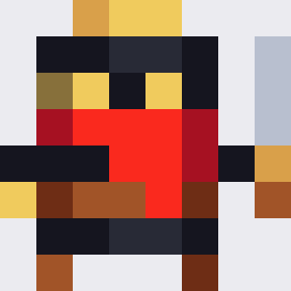

<!-- markdownlint-disable MD033 MD036 -->
# UP05 · ACTIVIDAD: PIXEL WAR EDE

**Módulo:** 0487 Entornos de Desarrollo · **Unidad:** UP05 GitHub. Desarrollo colaborativo e integración con el IDE
**Criterio trabajado:** RA4, CE4.f: se ha realizado el control de versiones integrado en el entorno de desarrollo.
**Tiempo estimado:** alrededor de 1 hora de trabajo, repartida en **al menos 3 días** (entre vuestras dos celdas tienen que pasar 48 horas).

## ÍNDICE

- [Antes de empezar: una actividad un poco distinta](#antes-de-empezar-una-actividad-un-poco-distinta)
- [De qué va esto](#de-qué-va-esto)
- [Por qué esta actividad: lo que casi nadie os cuenta de Git](#por-qué-esta-actividad-lo-que-casi-nadie-os-cuenta-de-git)
- [Qué tenéis que entregar y cómo se califica](#qué-tenéis-que-entregar-y-cómo-se-califica)
- [Las reglas del juego](#las-reglas-del-juego)
- [Misión 0. Preparar el fork](#misión-0-preparar-el-fork)
- [Misión 1. Elegir celda](#misión-1-elegir-celda)
- [Misión 2. Primera celda: rama, commit y pull request](#misión-2-primera-celda-rama-commit-y-pull-request)
- [Misión 3. Seguir vuestra PR hasta que esté pintada](#misión-3-seguir-vuestra-pr-hasta-que-esté-pintada)
- [Misión 4. Segunda celda: sincronizar con upstream](#misión-4-segunda-celda-sincronizar-con-upstream)
- [Misión 5. El saboteador ataca: resolver el conflicto](#misión-5-el-saboteador-ataca-resolver-el-conflicto)
- [Si algo no funciona](#si-algo-no-funciona)

## Antes de empezar: una actividad un poco distinta

Os aviso de entrada: esta actividad es un poco **más exótica** que las que estáis acostumbrados a hacer. No se hace en una tarde con el ordenador, a solas: se hace **entre toda la clase**, a lo largo de varios días, con un bot de por medio y con el repositorio cambiando mientras trabajáis. Puede que al principio os resulte **complicada**, pero **no es larga**: en total son dos celdas y un conflicto. Y, a mi juicio, didácticamente es **muy completa**: en una sola actividad pasáis por casi todo lo que hemos visto en la unidad, y además en un escenario real.

Es la **primera versión** del juego. Montar esto (el bot, las reglas, el saboteador, la página) me ha costado mucho trabajo, y está hecho con el mejor de los fines: que aprendáis Git de verdad y que os lo paséis bien haciéndolo. Así que, si algo sale un poco así asá (el bot tarda, una etiqueta no cambia, un mensaje no se entiende...), **tened paciencia y escribidme**. No os frustréis: si es culpa del bot, lo arreglo yo y no os perjudica.

## De qué va esto

Entre toda la clase vamos a pintar un dibujo celda a celda usando Git y GitHub. Cada celda es una ***pull request***.

El dibujo es un sprite de *Realm of the Mad God*, un MMO gratuito de disparos tipo *bullet hell* que salió en 2010. Es famoso por sus gráficos *pixel art*: personajes y enemigos dibujados en cuadrículas diminutas de 8 × 8 píxeles. Nuestro objetivo es un **bandido**, ampliado al doble: cada píxel del original son 2 × 2 celdas, así que el lienzo tiene **16 × 16 = 256 celdas**, y de ellas **172** hay que pintarlas.



- **Repositorio:** <https://github.com/scontreraslopez/pixel-war-ede-2026>
- **El dibujo en directo:** <https://scontreraslopez.github.io/pixel-war-ede-2026/>

Nadie acepta vuestras PR a mano: un **bot** (una GitHub Action) las revisa, las fusiona si son correctas y os deja un comentario si no lo son. Es exactamente el flujo de la sección [11. Forking y Pull Requests](UP05.md#11-forking-y-pull-requests) de la unidad, pero esta vez con toda la clase tocando **el mismo archivo** a la vez. Por eso vais a encontraros con lo que pasa en un proyecto real: el original avanza mientras trabajáis, hay que **sincronizarse con `upstream`** y aparecen **conflictos** que tendréis que resolver vosotros.

> [!IMPORTANT]
> Hay un **saboteador** suelto: de vez en cuando, el bot pinta una celda de un color que no toca. Y en vuestra **segunda** celda va a ir a por vosotros: os pintará justo esa celda antes de fusionar vuestra PR, así que **vais a tener un conflicto seguro**. Resolverlo es la parte más importante de la actividad.

## Por qué esta actividad: lo que casi nadie os cuenta de Git

Casi todos los tutoriales de Git os enseñan a trabajar **solos**: `add`, `commit`, `push`, y como mucho una rama. En ese mundo, vuestro repositorio solo cambia cuando vosotros lo cambiáis.

En el trabajo real **no es así**. En cuanto clonáis un proyecto en el que trabaja más gente, vuestra copia **empieza a quedarse vieja**: mientras hacéis lo vuestro, los demás siguen integrando cambios en `main`. Lo que de verdad hacéis a diario en un equipo no es tanto escribir *commits* como **mantener vuestro trabajo al día con el de los demás**:

- traer los cambios del original (`git pull upstream main`) **antes** de empezar algo nuevo;
- integrar `main` en vuestra rama (`git merge main`) cuando se ha movido mientras trabajabais;
- **resolver los conflictos** cuando otra persona ha tocado lo mismo que vosotros, sin cargaros su trabajo;
- y no dar vuestra tarea por terminada al abrir la PR, sino cuando **está integrada**.

Esto es **súper core**: es lo que separa a alguien que "sabe Git" de alguien que puede trabajar en un equipo. Y, sin embargo, se explica poquísimo, porque es difícil de practicar solo: para tener un conflicto de verdad necesitáis a alguien que toque el mismo código que vosotros, a la vez. Aquí ese alguien son vuestros 59 compañeros... y un saboteador. 😈

## Qué tenéis que entregar y cómo se califica

Todo lo que hacéis queda registrado en GitHub (las PR, su autor, sus *commits*, el *merge commit* con el que resolvéis el conflicto), y yo califico directamente a partir del historial de PR del repositorio. Lo único que necesito es saber **quién es quién**. En la tarea de Aules, escribid:

1. **Obligatorio:** vuestro **nombre de usuario de GitHub**, el de la cuenta con la que habéis hecho las PR.
2. **Muy recomendable:** los **enlaces a vuestras 2 PR** (por ejemplo, `https://github.com/scontreraslopez/pixel-war-ede-2026/pull/42`).
3. **Opcional:** vuestro *feedback* sobre la actividad: qué os ha parecido, qué os ha costado, qué mejoraríais. Como es la primera versión, me viene muy bien.

Para superar la actividad tenéis que conseguir **dos PR fusionadas con la etiqueta `pintado`**, y vuestras dos celdas tienen que **aparecer en el dibujo**.

> [!WARNING]
> **Crear la PR no basta.** Una PR abierta, en espera, con conflicto o no válida **no cuenta**: para la actividad es como si no existiera. Es responsabilidad vuestra seguirla hasta el final y aseguraros de que acaba **fusionada**, con la etiqueta **`pintado`**, y de que vuestra celda se ve en [el dibujo](https://scontreraslopez.github.io/pixel-war-ede-2026/).

## Las reglas del juego

1. Cada PR cambia **una sola celda**: **una línea** de `index.html` y nada más.
2. La celda tiene que quedar **como en el dibujo objetivo**.
3. Cada uno pinta **2 celdas**, con **al menos 48 horas** entre una y otra, contadas desde que se fusiona la primera.
4. Si vuestra PR tiene **conflictos**, los resolvéis vosotros.
5. Arreglar una celda saboteada (las **rayadas** en la página) también cuenta como una de vuestras celdas.

El [README del repositorio](https://github.com/scontreraslopez/pixel-war-ede-2026#readme) tiene las mismas reglas y la tabla de etiquetas del bot. Tenedlo a mano.

## Misión 0. Preparar el fork

**Objetivo:** tener vuestra copia del repositorio en GitHub (*fork*), clonada en local y con el remoto `upstream` apuntando al original.

1. Comprobad que `gh` tiene vuestra cuenta iniciada (lo hicimos en la sección [3.1](UP05.md#31-la-solución-recomendada-github-cli)):

    ```bash
    gh auth status
    ```

2. Desde la carpeta donde guardáis los proyectos del módulo, haced el fork y clonadlo en un solo paso:

    ```bash
    gh repo fork scontreraslopez/pixel-war-ede-2026 --clone
    cd pixel-war-ede-2026
    ```

3. Comprobad los remotos:

    ```bash
    git remote -v
    ```

    Tienen que salir **dos**: `origin`, que es **vuestro** fork (`VUESTRO-USUARIO/pixel-war-ede-2026`), y `upstream`, que es **el original** (`scontreraslopez/pixel-war-ede-2026`). `gh repo fork --clone` crea `upstream` automáticamente.

> [!TIP]
> Si habéis hecho el fork desde la web y clonado con `git clone`, no tendréis `upstream`. Añadidlo a mano:
> `git remote add upstream https://github.com/scontreraslopez/pixel-war-ede-2026.git`

4. Abrid la carpeta en **VS Code**. El repositorio trae su configuración (`.vscode/settings.json`) con el **formateo automático desactivado**. Esto es importante: si el editor reformatea `index.html` al guardar, vuestra PR cambiará cientos de líneas y el bot la rechazará.

> [!WARNING]
> Si preferís IntelliJ IDEA, no uséis **Reformat Code** (`Ctrl+Alt+L`) sobre `index.html` ni tengáis activado el reformateo en *Settings | Tools | Actions on Save*.

## Misión 1. Elegir celda

**Objetivo:** saber qué celda vais a pintar y de qué color.

1. Abrid [la página del dibujo](https://scontreraslopez.github.io/pixel-war-ede-2026/). Pasad el ratón por el lienzo: para cada celda veréis su **fila**, su **columna** y el **color** que le toca.
2. Elegid una celda que esté **vacía** y que forme parte del dibujo. También podéis elegir una celda **rayada** (saboteada) para arreglarla:
    - Si es del dibujo, se cambia el color por el correcto: `class="cell verde"` → `class="cell rojo"`.
    - Si es de fondo, se le quita el color: `class="cell verde"` → `class="cell"`.
3. Anotad la fila, la columna y el color.

> [!NOTE]
> Si elegís una celda pegada a la de otra persona (en la misma fila), es posible que os salga un conflicto también en la primera PR. No pasa nada: se resuelve igual que en la misión 5.

## Misión 2. Primera celda: rama, commit y pull request

**Objetivo:** hacer el ciclo completo de una contribución: rama, cambio, *commit* semántico, *push* a vuestro fork y *pull request* al original.

En los ejemplos se usa la celda **(5, 7)** de **rojo**. Es inventada: cambiad la fila, la columna y el color por los vuestros.

1. Cread una rama para vuestra celda:

    ```bash
    git switch -c celda-5-7
    ```

2. Abrid `index.html` y buscad (`Ctrl+F`) el `id` de vuestra celda: `id="c-5-7"`. Añadid el color **dentro de la clase**, sin tocar nada más de la línea:

    ```html
    <div class="cell" id="c-5-7" title="Fila 5, Columna 7"></div>        ← antes
    <div class="cell rojo" id="c-5-7" title="Fila 5, Columna 7"></div>   ← después
    ```

3. Guardad y comprobad el cambio **antes** de hacer *commit*:

    ```bash
    git diff
    ```

    Tiene que salir **una línea en rojo** (`-`, la que quitáis) y **una en verde** (`+`, la que ponéis). Si sale más, deshacedlo con `git restore index.html` y volved a empezar.

4. *Commit* con un mensaje semántico (repasad el [Anexo I](UP05.md#anexo-i-commits-semánticos)) y *push* a **vuestro fork**:

    ```bash
    git add index.html
    git commit -m "feat: pinta la celda (5, 7) de rojo"
    git push -u origin celda-5-7
    ```

    El `-u` deja la rama enlazada con `origin`. Así, más adelante, os bastará con `git push`.

5. Abrid la *pull request* hacia el repositorio original. Con `gh`:

    ```bash
    gh pr create --repo scontreraslopez/pixel-war-ede-2026 --title "Celda (5, 7) de rojo" --body "Pinta la celda (5, 7) de rojo"
    ```

    O desde la web: entrad en vuestro fork y pulsad **Compare & pull request**. Comprobad que la PR va **de** `VUESTRO-USUARIO:celda-5-7` **a** `scontreraslopez:main`.

## Misión 3. Seguir vuestra PR hasta que esté pintada

**Objetivo:** entender que abrir una PR no es el final: hay que seguirla hasta que se integra.

En un par de minutos, el bot revisará vuestra PR y os dejará un **comentario** y una **etiqueta**:

| Etiqueta | Qué significa | Qué tenéis que hacer |
| --- | --- | --- |
| `pintado` | ¡Fusionada! La celda ya está en el dibujo. | Nada. Recargad la página y buscadla. |
| `en-espera` | Es válida, pero aún no os toca (no han pasado 48 h desde vuestra celda anterior). | Nada: se fusionará sola cuando os toque. |
| `conflicto` | Alguien ha cambiado vuestra celda o la de al lado. | Resolverlo como en la misión 5. |
| `no-valida` | No cumple las reglas. El comentario dice por qué. | Corregirlo en la **misma rama** y hacer `git push`. **No abráis otra PR**: la que ya tenéis se actualiza sola con el nuevo *commit*. |

Cada vez que el bot comenta, GitHub os avisa por la campana 🔔 de notificaciones y por correo. Mientras la PR siga abierta, **puede cambiar de estado**: si alguien pinta la celda de al lado antes de que se fusione la vuestra, os aparecerá un conflicto.

> [!NOTE]
> El bot revisa vuestra PR **al momento** cuando la abrís o hacéis `push`. Las PR que se quedan esperando se repasan de forma automática cada cierto tiempo, y **ese repaso puede tardar varias horas**. Si pasan **30 minutos** desde que abristeis la PR (o desde vuestro último `push`) y el bot no ha comentado **nada**, avisadme.
>
> Esta es la **primera versión** del juego y el bot puede fallar. Si algo se queda atascado, revisaré a mano las PR afectadas. Vosotros aseguraos de haber hecho bien vuestra parte.

## Misión 4. Segunda celda: sincronizar con upstream

**Objetivo:** traer a vuestro repositorio local lo que han hecho los demás antes de empezar un trabajo nuevo.

Cuando hayan pasado **48 horas** desde que se fusionó vuestra primera celda (podéis abrir la PR antes: se quedará `en-espera`), elegid otra celda como en la misión 1.

Mientras tanto, el original ha avanzado: vuestros compañeros han pintado celdas y el saboteador ha hecho de las suyas. Vuestro `main` local no sabe nada de eso. **Antes de crear la rama nueva**, actualizadlo desde `upstream`:

```bash
git switch main
git pull upstream main
git switch -c celda-OTRA
```

Después, repetid los pasos 2 a 5 de la misión 2 con la nueva celda.

> [!TIP]
> Si os saltáis el `git pull upstream main`, vuestra rama saldrá de un `main` viejo. Seguramente funcione igual, pero tendréis más papeletas para un conflicto, y es justo el mal hábito que esta actividad quiere quitaros.

## Misión 5. El saboteador ataca: resolver el conflicto

**Objetivo:** resolver en local un conflicto real entre vuestra rama y el original.

Cuando vuestra segunda PR esté lista para fusionarse, el bot hará esto:

1. Pintará **vuestra celda** en el `main` del original de un color incorrecto.
2. Pondrá la etiqueta `conflicto` en vuestra PR y os dejará un comentario: *"🤖 ¡Sabotaje! Acabo de pintar tu celda..."*.

Ahora la misma línea de `index.html` ha cambiado en dos sitios a la vez: en vuestra rama (vuestro color) y en `main` (el color del saboteador). Git no puede decidir cuál vale, así que os toca a vosotros, como en la sección [6](UP05.md#6-git-merge-y-resolución-de-conflictos) de la unidad.

1. Traed el `main` del original y fusionadlo en vuestra rama:

    ```bash
    git switch main
    git pull upstream main          # trae el sabotaje
    git switch celda-OTRA
    git merge main                  # aquí aparece el conflicto
    ```

    La terminal dirá `CONFLICT (content): Merge conflict in index.html`.

2. Abrid `index.html` en VS Code. Veréis algo así (con vuestra celda y vuestros colores):

    ```html
    <<<<<<< HEAD
    <div class="cell rojo" id="c-5-7" title="Fila 5, Columna 7"></div>
    =======
    <div class="cell blanco" id="c-5-7" title="Fila 5, Columna 7"></div>
    >>>>>>> main
    ```

    - Entre `<<<<<<< HEAD` y `=======` está **lo vuestro** (`HEAD` es la rama en la que estáis, `celda-OTRA`).
    - Entre `=======` y `>>>>>>> main` está **lo que viene de `main`**: el sabotaje.

3. Resolvedlo dejando **vuestra línea** y borrando las tres marcas. En VS Code basta con pulsar **Accept Current Change** encima de `<<<<<<< HEAD`. Ojo: en la unidad, *current* era `main` porque estábamos en `main`. Aquí estáis en **vuestra rama**, así que *current* es lo vuestro.

> [!WARNING]
> Tocad **solo vuestra celda**. Si al resolver os encontráis con otras celdas en conflicto o con colores incorrectos, dejadlas **exactamente como estén en `main`**, aunque estén mal. Arreglarlas sería otra PR. Si cambiáis otra línea, el bot rechazará la PR por cambiar más de una celda.

4. Comprobad que solo queda vuestro cambio respecto a `main`:

    ```bash
    git diff main
    ```

    Tiene que salir **una sola línea cambiada**: el color del saboteador (`-`) por el vuestro (`+`).

5. Cerrad la fusión y subidla a **la misma rama**:

    ```bash
    git add index.html
    git commit --no-edit            # acepta el mensaje "Merge branch 'main' into celda-OTRA"
    git push
    ```

6. **No abráis otra PR.** La que ya tenéis se actualiza sola con el *merge commit*, y el bot vuelve a comprobar si ya se puede fusionar. Normalmente la fusiona al momento. Si no, la recogerá en el siguiente repaso automático, que puede tardar unas horas: mientras tanto puede seguir con la etiqueta `conflicto` aunque ya lo hayáis resuelto.

Cuando tenga la etiqueta **`pintado`** y veáis vuestras dos celdas en [el dibujo](https://scontreraslopez.github.io/pixel-war-ede-2026/), habéis terminado. 🎉

## Si algo no funciona

| Problema | Solución |
| --- | --- |
| `git pull upstream main` dice que `upstream` no existe | Añadidlo: `git remote add upstream https://github.com/scontreraslopez/pixel-war-ede-2026.git` (misión 0). |
| `no-valida`: *la PR tiene que cambiar exactamente una línea* | El editor ha reformateado el archivo, o al resolver un conflicto habéis tocado otra celda. Comparad con `git diff main`, dejad solo vuestra línea, *commit* y `git push`. |
| `no-valida`: *tiene que ser `X`, no `Y`* | Os habéis equivocado de color. Cambiadlo en la misma rama, *commit* y `git push`. |
| `no-valida`: *alguien se te ha adelantado* | Otra persona ya ha dejado esa celda bien. Actualizad `main` desde `upstream` y elegid otra celda en una rama nueva. Esta PR la podéis cerrar. |
| `gh pr create` pregunta *Where should we push the branch?* | La rama no está enlazada con vuestro fork. Elegid **vuestro fork** (`VUESTRO-USUARIO/pixel-war-ede-2026`). La próxima vez usad `git push -u origin RAMA`. |
| `git commit` abre un editor y la terminal se queda esperando | Es el mensaje del *merge commit*. Guardad y cerrad la pestaña. Para evitarlo, usad `git commit --no-edit`. |
| Ya he resuelto el conflicto, pero la PR sigue con `conflicto` | Comprobad en la PR que vuestro último *commit* aparece. Si aparece, es el retraso del repaso automático: esperad unas horas. |
| La PR está en `en-espera` y ya han pasado las 48 h | El repaso automático puede tardar unas horas en fusionarla. Si pasa un día entero, avisadme. |
| 30 minutos sin ningún comentario del bot | Comprobad que la PR va a `scontreraslopez/pixel-war-ede-2026`, a la rama `main`, y que no está como borrador (*draft*). Si todo está bien, avisadme. |
