# UP05: GitHub. Integración con el IDE

**Índice:**

- [1. Introducción](#1-introducción)
- [2. Crear una cuenta en GitHub](#2-crear-una-cuenta-en-github)
  - [Beneficios para Estudiantes (Student Developer Pack)](#beneficios-para-estudiantes-student-developer-pack)
  - [Configuración de Seguridad Obligatoria: MFA](#configuración-de-seguridad-obligatoria-mfa)
- [3. Integrar GitHub con tu IDE](#3-integrar-github-con-tu-ide)
  - [3.1. La Solución Recomendada: GitHub CLI](#31-la-solución-recomendada-github-cli)
  - [3.2. La Alternativa: Personal Access Token (PAT)](#32-la-alternativa-personal-access-token-pat)
  - [3.3. Tres ajustes de Git antes de colaborar](#33-tres-ajustes-de-git-antes-de-colaborar)
- [4. Interacción Básica con GitHub desde el IDE](#4-interacción-básica-con-github-desde-el-ide)
  - [4.1. Clonar un Repositorio Existente](#41-clonar-un-repositorio-existente)
  - [4.2. Crear un Nuevo Repositorio](#42-crear-un-nuevo-repositorio)
  - [4.3. Antes del primer push: revisa qué vas a subir](#43-antes-del-primer-push-revisa-qué-vas-a-subir)
- [5. Branches](#5-branches)
- [6. Git Merge y Resolución de Conflictos](#6-git-merge-y-resolución-de-conflictos)
- [7. Sincronizar con el remoto: fetch, pull y push](#7-sincronizar-con-el-remoto-fetch-pull-y-push)
- [8. Git Blame](#8-git-blame)
- [9. Deshacer cambios: amend, revert y reset](#9-deshacer-cambios-amend-revert-y-reset)
- [10. Llevar un commit a otra rama: cherry-pick](#10-llevar-un-commit-a-otra-rama-cherry-pick)
- [11. Forking y Pull Requests](#11-forking-y-pull-requests)
- [12. Otros temas avanzados muy interesantes](#12-otros-temas-avanzados-muy-interesantes)
- [Bibliografía](#bibliografía)
- [Anexo I: Commits Semánticos](#anexo-i-commits-semánticos)
  - [Formato](#formato)
  - [Ejemplo](#ejemplo)
  - [Tipos de Commit más Comunes](#tipos-de-commit-más-comunes)
- [Anexo II: Git Flow](#anexo-ii-git-flow)

## 1. Introducción

Ya hemos visto los fundamentos de Git y cómo utilizarlo desde la línea de comandos y desde un IDE. A estas alturas, debería estar clara la diferencia entre **Git** (el sistema de control de versiones *distribuido*) y **GitHub** (la plataforma de *alojamiento* de repositorios que usa Git). Ambos trabajan juntos para facilitar el control de versiones y la **colaboración** en proyectos de software.

En este punto lo más importante es que creemos una cuenta en GitHub (si no la tenemos ya) y que integremos nuestro IDE favorito con GitHub. El objetivo es claro: necesitamos un repositorio **remoto** para compartir nuestro trabajo y colaborar con otros desarrolladores.

De poco nos sirve tener un repositorio Git solo en nuestro equipo si:

- No podemos **compartir los cambios** con otros desarrolladores.
- No podemos acceder a nuestro código desde **otros equipos**.
- Quedamos a merced de un **fallo en nuestro disco duro** que nos haga perder todo el trabajo.

Primero crearemos una cuenta en GitHub. Os recomiendo usar vuestra cuenta de correo institucional (`@alu.edu.gva.es`). Si ya tenéis una cuenta personal y preferís usarla, tampoco hay problema, pero tened en cuenta que en un futuro profesional quizás prefiráis separar ambos ámbitos.

---

## 2. Crear una cuenta en GitHub

El proceso es sencillo: simplemente hay que ir a [github.com](https://github.com) y seguir el proceso de registro. Aseguraos de verificar vuestro correo electrónico para activar la cuenta. GitHub tiene planes gratuitos y de pago, pero para la mayoría de los proyectos personales y educativos, el **plan gratuito** es más que suficiente.

### Beneficios para Estudiantes (Student Developer Pack)

Además, podéis verificar vuestro estatus de estudiante para obtener beneficios adicionales, agrupados en el **"GitHub Student Developer Pack"**. El beneficio estrella es el acceso a **GitHub Copilot Pro** de forma gratuita.

> [!WARNING]
> Aviso a navegantes: **el proceso de verificación funciona regular**. En la práctica, lo más fiable es usar el carnet de estudiante (si lo tenéis) o el certificado de matrícula. A veces, con el correo institucional es suficiente, pero otras veces da problemas. Parece que esté hecho para que desistas, ¡ten paciencia!

### Configuración de Seguridad Obligatoria: MFA

Tened en cuenta que GitHub requiere **MFA (Autenticación Multifactor)** para aumentar la seguridad de vuestra cuenta. Es un paso **obligatorio**.

Aseguraos de configurar esto durante el proceso de registro o justo después.

- Podéis usar una **aplicación de autenticación** (TOTP) como Google Authenticator, Microsoft Authenticator o Authy.
- También podéis instalar la propia **app de GitHub** en vuestro móvil, que gestiona las peticiones de *login*.

---

## 3. Integrar GitHub con tu IDE

La mayoría de los IDEs modernos (como VS Code, IntelliJ IDEA, Eclipse...) tienen soporte integrado para Git y GitHub. Sin embargo, el proceso de **autenticación** puede ser un poco confuso.

Antiguamente, usábamos nuestro usuario y contraseña de GitHub, pero eso **ya no está permitido por seguridad**. Ahora tenemos principalmente dos métodos:

1. Usar un **Token de Acceso Personal (PAT)**.
2. Autenticarse usando la **CLI de GitHub (`gh cli`)**.

En mi experiencia, lo que mejor funciona y menos problemas da es utilizar `gh cli` para gestionar la autenticación a nivel de sistema, y luego dejar que el IDE (y el propio `git` de consola) utilicen esa autenticación.

### 3.1. La Solución Recomendada: GitHub CLI

GitHub CLI es la herramienta de línea de comandos oficial de GitHub (distinta de `git`). Se puede descargar desde su web [https://cli.github.com/](https://cli.github.com/). Está disponible para Windows, macOS y Linux.

> [!NOTE]
> CLI significa "Command Line Interface" (Interfaz de Línea de Comandos).

Una vez instalada, solo necesitáis ejecutar un comando en vuestra terminal; podéis hacerlo desde el propio terminal integrado de vuestro IDE:

```bash
gh auth login
```

Este comando te guiará paso a paso:

1. Os preguntará si queréis autenticaros en GitHub.com o en una instancia Enterprise (elegimos la primera).
2. Os preguntará qué protocolo preferís (**HTTPS** o **SSH**). Recomiendo **HTTPS** para empezar, es más sencillo.
3. Os preguntará si queréis autenticaros con el navegador (elegid **Sí**).
4. Os dará un código de un solo uso y abrirá vuestro navegador.
5. **Iniciáis** sesión en GitHub en el navegador, introducís el código y autorizáis a la CLI.

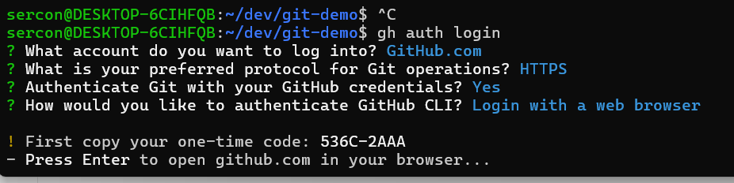

¡Y ya está! `gh cli` guardará tus credenciales de forma segura en el gestor de credenciales de tu sistema operativo. A partir de ahora, cuando `git` (o tu IDE) intenten conectar con GitHub, usarán automáticamente esta credencial.

> [!NOTE]
> Si después del proceso `git` os siguiera pidiendo usuario y contraseña, probad a ejecutar `gh auth setup-git` para configurar `git` para que use **GitHub CLI** (`gh`) como helper de credenciales.

### 3.2. La Alternativa: Personal Access Token (PAT)

Si el método anterior falla o vuestro IDE no lo soporta bien, podéis usar un **Token de Acceso Personal (PAT)**. Es una especie de **"contraseña" específica** para una aplicación.

Se generan desde vuestro perfil de GitHub: **Settings -> Developer settings -> Personal access tokens**.

Al crear un PAT, debéis:

1. Darle un nombre descriptivo (ej. "Token para VS Code").
2. Establecer una **fecha de caducidad** (¡importante!).
3. Asignarle **"scopes"** o permisos. Para usarlo con Git, necesitarás marcar al menos el *scope* de **`repo`**.

Luego, cuando vuestro IDE os pida *login* y *password* de GitHub, usaréis vuestro usuario de GitHub y el **PAT** (el token que acabáis de generar) como contraseña.

Los PATs deberéis guardarlos en un lugar seguro, ya que no podréis verlos de nuevo en GitHub una vez creados. El leak de un PAT puede comprometer la seguridad de vuestra cuenta.

### 3.3. Tres ajustes de Git antes de colaborar

En la UP04 configurasteis vuestro nombre, vuestro email y `init.defaultBranch main`. Antes de empezar a trabajar con otras personas conviene añadir dos ajustes más y entender un aviso que vais a ver mucho en Windows.

**1. VS Code como editor de Git.** Cuando Git necesita que escribas un mensaje y no se lo has dado con `-m` (por ejemplo, al cerrar un *merge*, como veremos en la sección 6), abre un editor de texto. En Git for Windows el editor por defecto es **Vim**, y si no lo conocéis os vais a quedar atrapados dentro (esto es literalmente un chiste informático). Si queréis evitar esto, podéis decirle a Git que use VS Code con la siguiente instrucción, o aprender a usar Vim (que no es tan difícil, pero sí es un poco raro al principio):

```bash
git config --global core.editor "code --wait"
```

Con esto, cuando Git necesite un mensaje se abrirá una pestaña en VS Code con un texto propuesto. Escribes (o aceptas) el mensaje, **guardas y cierras la pestaña**, y Git continúa. El `--wait` es lo que hace que Git espere a que cierres la pestaña. Si al instalar Git en Windows elegisteis VS Code como editor, ya lo tenéis hecho.

> [!TIP]
> Si aun así os pilla Vim (en otro ordenador, por ejemplo), la salida es: pulsa `Esc`, escribe `:wq` y pulsa `Enter`. Eso guarda el mensaje y sale. Con `:q!` sales sin guardar, y Git cancela la operación. También puede ser que en el PC, por ejemplo en el Aula de Informática, se abra **Nano**, en este caso: escribes el mensaje, pulsas `Ctrl+O` para guardar y `Ctrl+X` para salir.

**2. Qué hace `git pull` cuando tu rama y la remota han divergido.** Lo veremos en la sección 7. Por ahora, configuradlo para que fusione (*merge*), que es lo que vamos a usar en todo el curso:

```bash
git config --global pull.rebase false
```

Sin este ajuste, las versiones recientes de Git se niegan a hacer el `pull` en ese caso y os piden que decidáis (`fatal: Need to specify how to reconcile divergent branches`).

**3. El aviso de los saltos de línea (CRLF/LF).** En Windows veréis mensajes como este al hacer `git add`:

```text
warning: in the working copy of 'index.html', LF will be replaced by CRLF the next time Git touches it
```

No es un error. Windows marca el final de cada línea con dos caracteres (CRLF) y Linux y macOS con uno (LF). Git for Windows convierte automáticamente entre ambos para que el repositorio no se llene de cambios fantasma, y os avisa cuando lo hace. Algunos proyectos fijan estas reglas en un archivo **`.gitattributes`** en la raíz del repositorio: si un proyecto lo trae (como el de la actividad de esta unidad), no lo borréis ni lo modifiquéis.

> [!NOTE]
> Si os saltasteis el `git config --global init.defaultBranch main` de la UP04, hacedlo ahora.

---

## 4. Interacción Básica con GitHub desde el IDE

En el tema anterior hablamos de que muchas veces hay un nodo especial en Git que utilizaremos todo el equipo para compartir y sincronizar nuestro trabajo. Aunque se trate de un sistema distribuido, esta es, después de todo, una necesidad práctica para poder colaborar. Este **nodo central** es como el compañero que se encarga de repartir las tareas y juntar el trabajo de todos.

Teóricamente podríamos sincronizarnos con cualquier nodo (en jerga git **remote**), y olvidarnos de un nodo central, pero podrás imaginar que no parece una buena idea. También podríamos usar un equipo cualquiera como ese nodo central, pero en la práctica casi siempre usaremos un servicio de alojamiento de repositorios como GitHub, GitLab o Bitbucket. Estos servicios nos proporcionan una plataforma accesible desde cualquier lugar, con herramientas adicionales para gestionar proyectos, issues, pull requests, etc.

> [!NOTE]
> Algunos entornos corporativos usan servicios de alojamiento privados (por ejemplo, GitHub Enterprise, un GitLab self-hosted, etc.), pero el concepto es el mismo. Evidentemente este nodo (o conjunto de nodos) sería protegido con las más altas medidas de seguridad y de recuperación ante desastres.

Por convención a ese nodo central lo llamaremos **origin**. Es decir será un `remote` llamado `origin`. Es importante entender que `origin` es simplemente un nombre por convención, y podríamos llamarlo de otra forma si quisiéramos, y que remote es la propiedad que define la dirección (URL) del repositorio remoto.

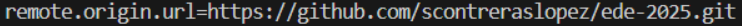

Aquí entramos en dos escenarios posibles que vamos a trabajar. El quid de la cuestión es si partimos de un repositorio ya existente en GitHub o si vamos a crear uno nuevo:

1. **Clonar un repositorio existente**: Si el repositorio ya existe en GitHub, podemos clonarlo directamente desde nuestro IDE. Esto crea una copia local del repositorio con **`origin`** ya configurado.

2. **Crear un nuevo repositorio**: Si estamos empezando un proyecto nuevo, primero creamos el repositorio en GitHub (usando la web o la CLI) y luego lo clonamos o lo vinculamos desde nuestro IDE.

### 4.1. Clonar un Repositorio Existente

En mi modesta opinión, la mejor manera de clonar un repositorio es utilizar la terminal, ya sea la del propio IDE o una externa. El comando es bien sencillo:

```bash
git clone <URL-del-repositorio>
```

Por ejemplo, para clonar el repositorio que tenemos en la **URL** [https://github.com/EbookFoundation/free-programming-books](https://github.com/EbookFoundation/free-programming-books) bastaría con ejecutar

```bash
git clone https://github.com/EbookFoundation/free-programming-books
```

Si lo probáis desde vuestra terminal veréis cómo automáticamente se crea una carpeta llamada `free-programming-books` con todo el contenido del repositorio y con el remote **`origin`** ya configurado.

> [!NOTE]
> La carpeta se creará sobre el directorio en el que estés situado en ese momento en la terminal. Presta atención a esto para no crear la carpeta en un sitio no deseado.

Si en la misma terminal navegáis al directorio de `free-programming-books` y miráis su configuración veréis que tiene el remote `origin` apuntando a la URL del repositorio clonado:

```bash
cd free-programming-books
git remote -v
```

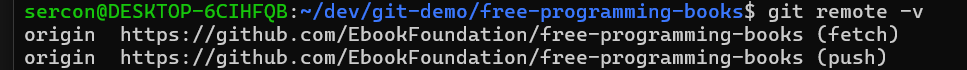

Si este fuera un repositorio nuestro (no es el caso, como imaginaréis) podríamos utilizar las dos instrucciones más importantes para sincronizar nuestro trabajo con GitHub:

- `git push origin <rama>`: para subir nuestros cambios a GitHub.
- `git pull origin <rama>`: para descargar los cambios de GitHub a nuestro equipo

Con esto volcamos los cambios y los traemos respectivamente desde el repositorio remoto `origin`. En la sección 7 veremos con más detalle qué hace cada uno y qué hacer cuando fallan.

### 4.2. Crear un Nuevo Repositorio

También puede ocurrir que hayamos estado trabajando en un proyecto localmente y queramos subirlo a GitHub para compartirlo. En este caso el proceso es ligeramente diferente. Primero debemos crear el repositorio en GitHub. Podemos hacerlo desde la web o usando la CLI. Os dejo aquí un ejemplo usando la CLI que podéis ejecutar desde la terminal **en el directorio raíz de vuestro proyecto**:

```bash
gh repo create NOMBRE-DEL-REPO --public --source=. --remote=origin --push
```

Este comando crea un nuevo repositorio público en GitHub con el nombre `NOMBRE-DEL-REPO` a partir del repositorio local del directorio actual (`--source=.`), configura el remote **`origin`** para que apunte a él (`--remote=origin`) y sube vuestros *commits* (`--push`). ¡Todo en un solo paso, por eso me gusta tanto **GitHub CLI**! Ojo: sin `--push` el repositorio se crea vacío en GitHub y tendréis que hacer el primer `push` a mano.

Si el repositorio ya existiera, pero quisiéramos volcar **ahí** nuestros cambios, tendríamos que configurar el remote **`origin`** manualmente. **Siempre desde el directorio raíz de nuestro proyecto**, ejecutaríamos en la terminal:

```bash
git remote add origin <URL-del-repositorio>
```

Este paso también se puede hacer desde el IDE, siguiendo la secuencia de clics que puedes ver en la siguiente imagen. Icono de configuración de Git -> los tres puntos ... al lado de Changes -> Remote Add Remote

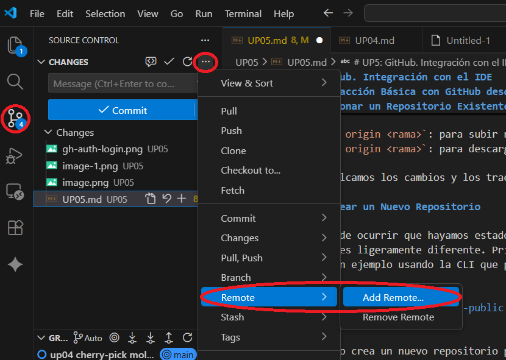

En este punto, con el remote `origin` ya configurado, ya podríamos usar los comandos `git push origin <rama>` y `git pull origin <rama>` para sincronizar nuestro trabajo con GitHub, igual que en el caso anterior.

> [!WARNING]
> Si en la UP04 configurasteis `init.defaultBranch main`, vuestra rama principal ya se llama **`main`**, igual que en GitHub, y no tenéis que hacer nada. Pero si `git status` os dice `On branch master` (un repositorio antiguo, o que os saltasteis ese paso), os daréis cuenta en cuanto intentéis `git push origin main`: Git se quejará de que la rama `main` no existe (`error: src refspec main does not match any`). En ese caso, renombrad vuestra rama local a `main` antes del primer `push` con `git branch -M main`. También se podría renombrar la rama principal en GitHub, pero eso ya es más lioso.

### 4.3. Antes del primer push: revisa qué vas a subir

Una vez hacéis `push` a un repositorio público, cualquiera puede ver (y copiar) **todo su historial**, no solo la última versión. Antes de subir un proyecto que ya tenía *commits*, comprobad que no se os ha colado nada que no debería estar.

**El `.gitignore` no saca lo que ya está en el repositorio.** En la UP04 vimos que el `.gitignore` le dice a Git qué archivos ignorar. Pero solo afecta a archivos **sin seguimiento** (*untracked*). Si `node_modules/` o un `.env` ya entraron en un *commit*, añadirlos después al `.gitignore` no hace nada: Git los sigue rastreando. Hay que decirle explícitamente que deje de hacerlo:

```bash
git rm -r --cached node_modules
git commit -m "chore: deja de rastrear node_modules"
```

El `--cached` es la clave: quita los archivos del repositorio pero **no los borra de tu disco**. Es la flecha `git rm --cached` que veíais en el diagrama de estados de la UP04 (sección 3.3), que devuelve un archivo a *untracked*. A partir de ese *commit*, el `.gitignore` ya hará su trabajo.

> [!CAUTION]
> Si lo que se coló fue un **secreto** (una contraseña, una clave de API, un token) y ya habéis hecho `push`, **dadlo por filtrado y cambiadlo** (generad una clave nueva y revocad la antigua). Borrarlo en un *commit* nuevo no sirve: sigue en el historial, y hay bots que rastrean GitHub buscando precisamente esto en cuestión de minutos.

Este es el flujo básico para integrar GitHub con nuestro IDE y gestionar repositorios remotos. Ahora toca subir de nivel y aprender a colaborar con otros desarrolladores usando **branches**, **pull requests** y otras herramientas que Git y GitHub nos ofrecen.

## 5. Branches

Las ramas o **branches** son una característica fundamental de Git que permite a los desarrolladores trabajar en diferentes versiones de un proyecto simultáneamente. Cada branch es una línea independiente de desarrollo que puede contener cambios específicos sin afectar la rama principal (generalmente llamada `main` o `master`).

Cuando trabajamos solo esto puede parecer innecesario, pero en un entorno colaborativo es esencial para gestionar nuevas funcionalidades, correcciones de errores y experimentos sin interferir con el código estable. En proyectos grandes típicamente se sigue una convención llamada **Git Flow**, que define un flujo de trabajo estructurado usando branches para organizar el desarrollo.

Leed, por favor, el siguiente artículo: [https://www.atlassian.com/es/git/tutorials/comparing-workflows/gitflow-workflow](https://www.atlassian.com/es/git/tutorials/comparing-workflows/gitflow-workflow)

Este flujo de trabajo nos permite mantener la estabilidad del código en la rama principal mientras se desarrollan nuevas características en ramas separadas. Una vez que una característica está completa y probada, se puede fusionar de nuevo en la rama principal mediante un **pull request**. También facilita la introducción de correcciones rápidas (**hotfixes**) a través de ramas de hotfix sin afectar el desarrollo en curso.

En proyectos más pequeños suele ser suficiente con:

- Rama principal (`main` o `master`): Contiene el código estable y listo para producción. Producción significa el entorno donde los usuarios finales interactúan con la aplicación. Es decir lo que ven los usuarios.
- Ramas de características (`feature/`): Se crean para desarrollar nuevas funcionalidades o mejoras. Una vez completadas, se fusionan de nuevo en la rama principal. Por ejemplo si tenemos que implementar un sistema de login podríamos crear una rama llamada `feature/login`, mientras un compañero trabaja en `feature/dashboard`.
- Ramas de corrección de errores (`bugfix/`): Se utilizan para solucionar errores específicos. Al igual que las ramas de características, se fusionan de nuevo en la rama principal una vez corregidos los errores.
- Rama de desarrollo (`develop`): En algunos flujos de trabajo, se utiliza una rama de desarrollo para integrar todas las características antes de fusionarlas en la rama principal. Esto permite pruebas adicionales y garantiza que la rama principal siempre esté en un estado estable. Por ejemplo si tenemos un entorno de pruebas (staging) podríamos desplegar ahí la rama `develop` para hacer pruebas antes de pasar a mover ese código a producción (`main`).

Idealmente deberíamos etiquetar con **tags** las versiones estables de nuestro software en la rama principal para facilitar el seguimiento de versiones y despliegues. Esto facilita encontrar versiones concretas de la aplicación en caso de necesitar hacer un rollback o investigar un problema.

Crear ramas es muy sencillo. Por ejemplo, vamos a hacer una nueva rama sobre el **repositorio** clonado del ejemplo anterior y a añadir un libro. Aunque esto se podría hacer desde la terminal, lo vamos a hacer desde el IDE (VS Code en este caso) para que veas cómo se hace gráficamente.

Abrimos el proyecto en VS Code y vamos a la sección de control de versiones (icono de la rama con un círculo). Ahí vemos el nombre de la rama actual (probablemente `main` o `master`).

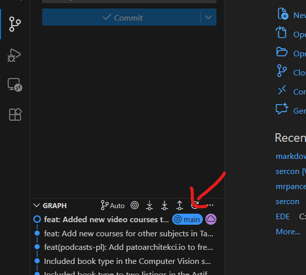

En este punto podríamos hacer **clic** con el botón derecho sobre esa fila que tiene la etiqueta de la rama actual y darle a "Create Branch". Nos pedirá el nombre de la nueva rama, que en este caso será `feature/new-book-robotics`.

Arriba os saldrá para escribir y podréis crearla directamente

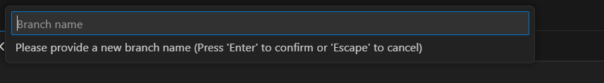

Si preferís hacerlo desde la terminal (puede ser la terminal integrada del IDE), en mi opinión es más cómodo y rápido; solo tenéis que ejecutar:

```bash
git switch -c feature/new-book-robotics
```

Listo, ya tenemos nuestra nueva rama creada y estamos situados en ella. Ahora podemos hacer los cambios que queramos sin afectar la rama principal.

Navegamos al archivo /books/free-programming-books-es.md y añadimos una nueva línea con el libro que queremos añadir:

Por ejemplo en la línea 124 añadimos:

`* [Robotics Programming: Build Robotic Projects Using Raspberry Pi and Arduino](https://www.example.com) - Author Name (PDF)`

hacemos ahora **git add** y **git commit** para guardar los cambios en nuestra rama:

```bash
git add . 
git commit -m "feat: add new book on robotics"
```

> [!IMPORTANT]
> No os olvidéis de que antes de hacer el add tenéis que **guardar los cambios** en el archivo que habéis editado. Aseguraos de pulsar `Ctrl+S`.

En este punto veréis cómo la rama `feature/new-book-robotics` tiene un commit más que la rama principal.

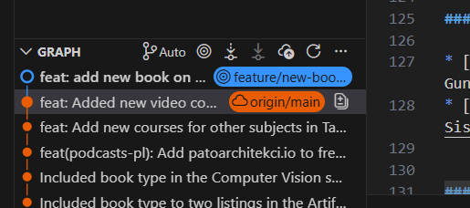

Esta "línea temporal alternativa" es lo que nos permite trabajar en nuevas funcionalidades sin afectar el código estable en la rama principal.

> [!WARNING]
> **Cambiar de rama con cambios sin confirmar.** Si tenéis archivos modificados sin hacer *commit* e intentáis cambiar de rama, pueden pasar dos cosas: que Git se niegue (`error: Your local changes to the following files would be overwritten by checkout` ... `Please commit your changes or stash them before you switch branches`) o, peor, que os deje cambiar y **los cambios viajen con vosotros** a la otra rama sin que os deis cuenta. La regla de oro: **haced *commit* antes de cambiar de rama**. Si el trabajo está a medias y no queréis hacer *commit* todavía, `git stash` lo guarda en un cajón temporal y deja el directorio limpio; al volver a la rama, `git stash pop` lo saca del cajón.

## 6. Git Merge y Resolución de Conflictos

En algún momento **querréis** fusionar los cambios de una rama en otra. Esto se hace con el comando `git merge`. Por ejemplo, si queremos fusionar los cambios de nuestra rama `feature/new-book-robotics` en la rama principal `main`, primero debemos cambiar a la rama `main` y luego ejecutar el merge:

```bash
git switch main
git merge feature/new-book-robotics
```

Si no hay conflictos, los cambios se aplicarán automáticamente. Si hay conflictos (es decir, si los mismos archivos han sido modificados en ambas ramas), Git te pedirá que resuelvas esos conflictos manualmente.

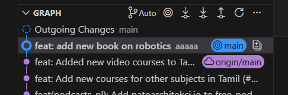

Como veis, `main` ha avanzado pero `origin/main` sigue igual. Esto es porque no hemos subido los cambios al repositorio **remoto** en GitHub. Para hacerlo, simplemente ejecutaríamos:

```bash
git push origin main
```

> [!WARNING]
> Esto os va a fallar porque nosotros **NO** tenemos permisos en este repositorio. Pero si el repositorio fuese vuestro no habría ningún problema.

Vamos a forzar ahora un conflicto: para esto vamos a crear dos nuevas ramas a partir de `main`, una llamada `feature/sistemas-operativos-1` y otra `feature/sistemas-operativos-2`. En ambas **ramas** vamos a intentar añadir un libro diferente en la misma línea del mismo archivo.

```bash
git switch -c feature/sistemas-operativos-1
git switch -c feature/sistemas-operativos-2
```

> [!NOTE]
> Recordad que para crear y cambiar de rama en un solo paso usamos `git switch -c NOMBRE-RAMA`.
> Si ya tenéis la rama creada y solo queréis cambiar a ella, usad `git switch NOMBRE-RAMA`.

Ahora mismo estamos en la rama `feature/sistemas-operativos-2`. Vamos a ir a la línea 129 del archivo `/books/free-programming-books-es.md` y añadimos el siguiente libro:

`* [Operating Systems: Three Easy Pieces](https://pages.cs.wisc.edu/~remzi/OSTEP/) - Remzi H. Arpaci-Dusseau and Andrea C. Arpaci-Dusseau (PDF)`

Hacemos git add y git commit para guardar los cambios en esta rama:

```bash
git add . 
git commit -m "feat: add new book on operating systems: three easy pieces"
```

Para que veas cómo se resuelve. Volvemos a la rama `feature/sistemas-operativos-1` (recuerda el comando exacto para cambiar de ramas y ¡no olvides este paso!) y editamos el mismo archivo `/books/free-programming-books-es.md`, también en la línea 129, vamos a añadir otro libro. Estamos simulando que dos desarrolladores han trabajado en paralelo y han modificado la misma línea en sus respectivas ramas.

`* [Introduction to Operating Systems](https://openosorg.github.io/openos/textbook/intro/pref.html) - Several Authors the Open OS (PDF)`

Guardamos y volvemos a ejecutar los pasos típicos de git:

```bash
git add . 
git commit -m "feat: add new book on operating systems: introduction to OS"
```

Estupendo, ahora mismo tendríamos 5 líneas temporales en puntos diferentes:

- origin/main: Esta es la que inicialmente clonamos. No se ha movido: es la "foto" de cómo estaba `main` en GitHub cuando clonamos, y solo se actualiza cuando volvemos a hablar con el remoto (lo vemos en la sección 7). No es una rama en la que podamos trabajar.
- main: A la que hemos añadido el libro de robótica en la línea 124.
- feature/new-book-robotics: Fue la que usamos para añadir el libro de robótica en la línea 124. Aunque la hemos fusionado (merge) con main, no se borra automáticamente. Ya lo haremos más adelante porque su misión está cumplida.
- feature/sistemas-operativos-1: A la que hemos añadido el libro *Introduction to Operating Systems* en la línea 129.
- feature/sistemas-operativos-2: A la que hemos añadido el libro *Operating Systems: Three Easy Pieces*, también en la línea 129.

Las dos ramas de sistemas operativos salieron de nuestro `main` local, así que las dos incluyen también el libro de robótica.

Tras esto, ahora nos pondremos el sombrero del **responsable del proyecto** (vamos, al que le toca juntar todo), y saltamos a nuestra rama main local `git switch main`. Nuestra misión en este rol es ir juntando los cambios, por lo que vamos a fusionar las dos ramas **de sistemas operativos**.

Empezamos fusionando la primera de ellas con `git merge feature/sistemas-operativos-1`

Deberíamos ver una imagen de confirmación similar a la siguiente.

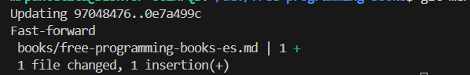

Fijaos en la palabra **Fast-forward**. Desde que creamos `feature/sistemas-operativos-1`, `main` no ha avanzado: la rama que fusionamos simplemente va "por delante" en la misma línea. En ese caso Git no necesita mezclar nada; se limita a **mover el puntero** de `main` hacia delante, hasta el último *commit* de la rama. No se crea ningún *commit* nuevo. Lo mismo pasó antes con `feature/new-book-robotics`.

Cuando las dos ramas han avanzado por separado (las dos tienen *commits* que la otra no tiene), mover el puntero ya no basta. Git crea entonces un **commit de fusión** (*merge commit*), un *commit* especial con dos "padres" que junta ambas historias. Es justo lo que va a pasar ahora, porque `main` ya incluye `feature/sistemas-operativos-1` y `feature/sistemas-operativos-2` tiene un *commit* distinto.

Ahora vamos a fusionar la otra rama, sin movernos de main ejecutamos `git merge feature/sistemas-operativos-2`

🚩 En este punto nos saltará **en la terminal** un aviso de conflicto, dado que Git ha encontrado un conflicto y no ha podido decidir por nosotros.

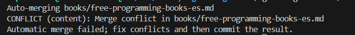

También veremos el nombre del fichero en rojo con una exclamación y una muesca azul en la barra lateral derecha, señalando el punto donde se encuentra el conflicto

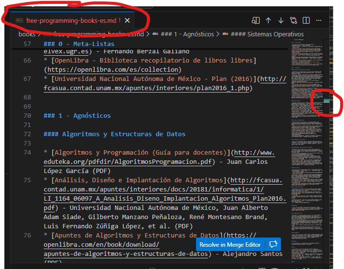

Aunque nos da la oportunidad de **Resolve in Merge Editor** e incluso de **Resolve with Ai** (el bocadillo de la derecha). Esta funcionalidad del **Merge Editor** a mi me parece bastante confusa, y me resulta más sencillo resolverlo manualmente sobre el archivo.

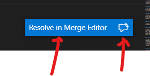

Si nos situamos en la muesca azul, veremos un panel como **el** de la imagen. Este nos señala un texto en verde (los cambios de la rama actual, en este caso `main`) y otro en azul (los cambios de la rama que estamos intentando fusionar, en este caso `feature/sistemas-operativos-2`). Nuestro trabajo es decidir qué hacer con estos cambios. Para ello tenemos 3 opciones principales (justo arriba de <<<<<< HEAD), nótese que los textos son **clicables**.

- Accept Current Change: Aceptar el cambio de la rama actual (main).
- Accept Incoming Change: Aceptar el cambio de la rama que estamos fusionando (feature/sistemas-operativos-2).
- Accept Both Changes: Aceptar ambos cambios, lo que puede implicar combinar el texto de ambas ramas.

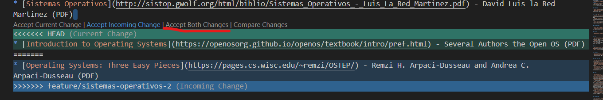

En este caso concreto, lo que queremos es aceptar ambos cambios, por lo que haremos **clic** en **Accept Both Changes**. El resultado final en el archivo será el siguiente:

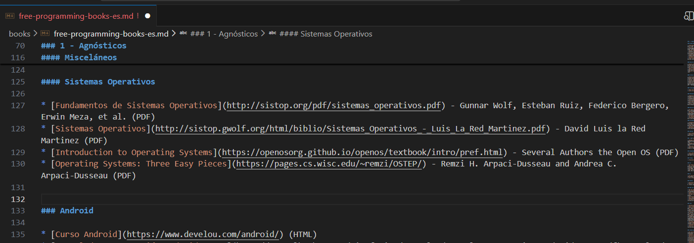

Pero todavía queda trabajo por hacer: una vez resuelto el conflicto, debemos marcar el archivo como resuelto y completar la fusión. Para ello, **guardamos los cambios** (fíjate que está con la bolita blanca) en el archivo y luego ejecutamos:

```bash
git add books/free-programming-books-es.md
git commit -m "fix: resolve merge conflict in free-programming-books-es.md"
```

También serviría `git add .`, que añadiría todos los archivos modificados; en este caso solo hay uno, por lo que lo mismo tiene. Hecho esto **sí** que veremos que la fusión se ha completado correctamente. Mirando el gráfico de ramas veremos que `main` ha avanzado y ya incluye los cambios de ambas ramas de sistemas operativos.

> [!TIP]
> Si en lugar de `git commit -m "..."` escribís solo `git commit`, Git propone un mensaje por defecto (`Merge branch 'feature/sistemas-operativos-2'`) y abre el editor para que lo confirméis: con el ajuste de la sección 3.3, una pestaña de VS Code que tenéis que **guardar y cerrar**. Si os vale el mensaje propuesto, `git commit --no-edit` lo acepta tal cual sin abrir nada. Lo mismo ocurre con un `git merge` que crea un *commit* de fusión sin conflictos: también abre el editor, salvo que añadáis `--no-edit`.

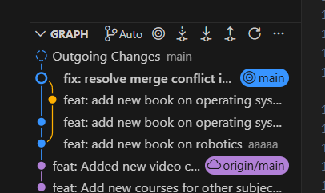

También lo podéis consultar en consola con

```bash
git log --oneline --graph --decorate --all
```

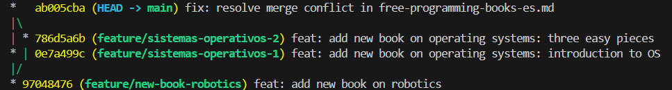

Solo quedaría un último paso: si en este punto ejecutas `git branch` verás que todavía tenemos las ramas de características que ya hemos fusionado. Un buen **hábito**, para que no nos hagan la vida más difícil en el futuro, es **borrarlas** una vez que ya hemos fusionado los cambios en la rama principal, para mantener el repositorio limpio. Esto lo haríamos con:

```bash
git branch -d feature/sistemas-operativos-1
git branch -d feature/sistemas-operativos-2
git branch -d feature/new-book-robotics
```

**Nota acerca de la terminal interactiva**: A veces, al ejecutar comandos en la terminal, tanto la integrada del IDE como la externa, puede quedarse en el modo interactivo; esto lo reconoceremos (aunque hay otros modos similares, este es el más típico) por la presencia de los **:** en la esquina inferior izquierda. Esto ocurre típicamente cuando un comando espera una entrada adicional o una confirmación. Para salir de este modo, simplemente **pulsad** la tecla `q` (de "quit") y **volveréis** al prompt normal de la terminal. Para avanzar en este modo interactivo, **podéis** usar las teclas de flecha arriba y abajo para navegar por el contenido, o **pulsad** la barra espaciadora para avanzar una página a la vez.

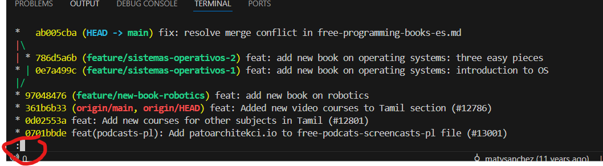

El otro "modo" en el que os podéis quedar atrapados es **Vim**, el editor de texto que abre Git cuando necesita un mensaje y no habéis configurado VS Code como editor (sección 3.3). Lo reconoceréis porque la terminal se llena de un texto con líneas que empiezan por `#` y varias `~` en el margen izquierdo, y `q` no funciona. Para salir guardando: `Esc`, `:wq` y `Enter`.

Con esto ya hemos cubierto los conceptos básicos de ramas, fusiones y resolución de conflictos en Git. Estos son fundamentos esenciales para trabajar de manera efectiva en proyectos colaborativos utilizando Git y GitHub. El resto habitualmente **se aprende** por la combinación de la curiosidad y la necesidad.

## 7. Sincronizar con el remoto: fetch, pull y push

Hasta ahora hemos usado `push` y `pull` casi como cajas negras. Ahora que sabéis qué es un *merge*, podemos ver qué hacen de verdad, y qué hacer cuando fallan. Esto es lo que más os va a pasar en cuanto trabajéis en equipo.

**Las ramas remotas: `origin/main`.** En los gráficos de la sección anterior aparecía `origin/main` sin moverse mientras nuestro `main` avanzaba. `origin/main` es una **rama de seguimiento remoto** (*remote-tracking branch*): una copia local, de solo lectura, de cómo estaba `main` en GitHub **la última vez que hablasteis con él**. No se actualiza sola: solo cambia cuando hacéis `fetch`, `pull` o `push`. Si un compañero sube cambios a GitHub, vuestro `origin/main` no se entera hasta entonces.

**`git fetch`: mirar sin tocar.**

```bash
git fetch origin
```

Descarga de GitHub los *commits* nuevos y actualiza `origin/main` (y el resto de ramas `origin/...`), pero **no toca vuestras ramas ni vuestros archivos**. Es completamente seguro. Después podéis ver si hay algo nuevo con `git log --oneline --graph --decorate --all`, o con `git status`, que os dirá algo como `Your branch is behind 'origin/main' by 2 commits`.

**`git pull`: traer y fusionar.**

```bash
git pull origin main
```

`git pull` es simplemente **`git fetch` + `git merge`**: descarga lo nuevo y lo fusiona en la rama en la que estáis. Y como es un *merge*, todo lo de la sección 6 se aplica: puede ser un *fast-forward*, puede crear un *commit* de fusión (y abrir el editor) y **puede dar conflictos**, que se resuelven exactamente igual.

**`git push`: subir.** `git push origin main` sube vuestros *commits* de `main` a GitHub, y actualiza `origin/main`. Pero GitHub solo acepta el `push` si vuestro `main` **incluye todo lo que ya hay** en el `main` remoto. Si un compañero ha subido algo que vosotros no tenéis, veréis el error más típico del trabajo en equipo:

```text
To https://github.com/usuario/mi-proyecto.git
 ! [rejected]        main -> main (fetch first)
error: failed to push some refs to 'https://github.com/usuario/mi-proyecto.git'
hint: Updates were rejected because the remote contains work that you do not
hint: have locally. This is usually caused by another repository pushing to
hint: the same ref. If you want to integrate the remote changes, use
hint: 'git pull' before pushing again.
```

No pasa nada, Git os protege de pisar el trabajo de otro. La solución es la que dice el propio mensaje:

1. `git pull origin main`: traéis lo que subió vuestro compañero y se fusiona con lo vuestro.
2. Si hay conflictos, los resolvéis como en la sección 6 (`git add` + `git commit`).
3. `git push origin main` otra vez. Ahora sí.

> [!CAUTION]
> Buscando el error en Internet encontraréis la "solución" `git push --force`. **No lo hagáis**: obliga a GitHub a aceptar vuestra versión **borrando** los *commits* de vuestro compañero. Volveremos a este comando en la sección 12.

**Ramas divergentes.** Si tanto vosotros como el remoto tenéis *commits* nuevos, `git pull` tiene que elegir entre fusionar (*merge*) o reorganizar vuestros *commits* encima de los remotos (*rebase*). Si no configurasteis `pull.rebase false` en la sección 3.3, Git se negará con este mensaje:

```text
hint: You have divergent branches and need to specify how to reconcile them.
...
fatal: Need to specify how to reconcile divergent branches.
```

Con el ajuste de la sección 3.3 hecho, Git hará un *merge* sin preguntar.

**Desde VS Code.** En el menú `...` de *Source Control* tenéis **Fetch**, **Pull** y **Push**. En la barra de estado inferior, junto al nombre de la rama, VS Code muestra unas flechas con números (por ejemplo `↓2 ↑1`): dos *commits* en el remoto que no tenéis y uno vuestro que el remoto no tiene. El botón **Sync Changes** hace `pull` y después `push`.

> [!NOTE]
> Fijaos en que hasta ahora siempre escribimos `git push origin main`, con el remoto y la rama. Se puede abreviar a `git push` y `git pull` a secas si la rama local está **enlazada** con una remota. Ese enlace se crea la primera vez que subís una rama con `-u` (`git push -u origin feature/mi-rama`), y es lo que hace el botón **Publish Branch** de VS Code. Lo usaremos en la sección 11.

## 8. Git Blame

*Por mi culpa, por mi culpa, por mi gran culpa...* La culpa (o al menos la responsabilidad y **accountability**) es algo fundamental en el trabajo profesional. Debemos saber **a quién** preguntar por el **porqué** de un determinado cambio, y **Git** gestiona el **historial** de cambios dentro de un archivo a través de una funcionalidad llamada **git blame**.

Revisar esto desde la terminal puede ser bastante complicado, esta es otra característica donde los IDEs brillan para el control de versiones. Lo primero es activarlo, en cada IDE puede ser diferente, explicaré el proceso para VS Code

Pulsamos la combinación de teclas `Control + Shift + P` para desplegar la paleta de comandos del IDE (alternativamente View -> Command Palette), y activamos las **funcionalidades** de **git blame**. Aconsejo activar las dos, una es inline y la otra en la barra inferior del editor.

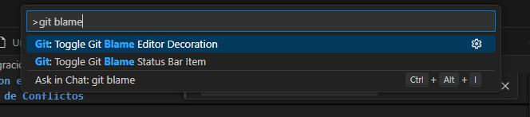

Una vez activado, al situarnos sobre cualquier línea del archivo veremos en la barra inferior del editor información sobre el último commit que modificó esa línea, incluyendo el autor, la fecha y el mensaje del commit. Si hacéis clic en esa información, se abrirá un panel lateral con más detalles sobre el commit, incluyendo un enlace para ver el commit completo en GitHub.

Por ejemplo, si nos situamos en la última línea, en este momento la que dice **Entendiendo Angular**, veremos algo como lo que muestro en la siguiente imagen:

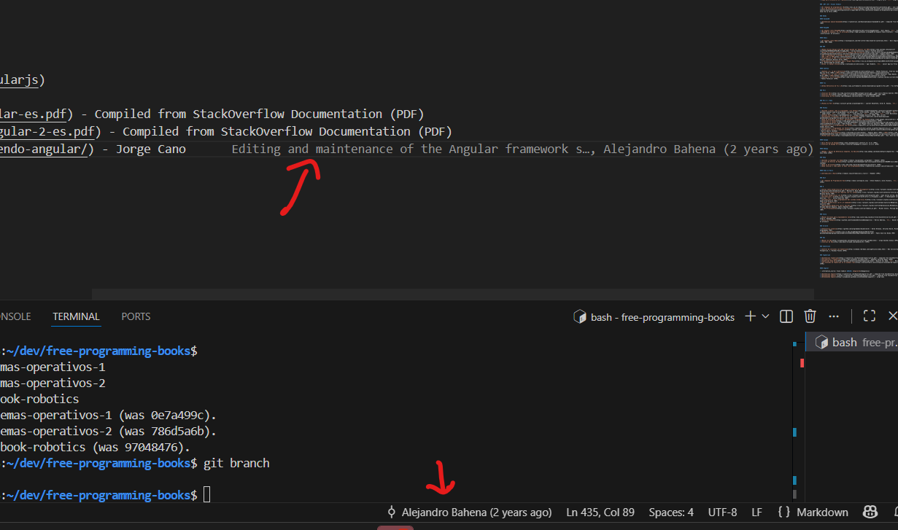

Si dejamos el cursor sobre cualquiera de los elementos remarcados (tanto el **texto en línea** como el icono de la barra inferior) aparecerá un tooltip con más información sobre el commit: autor, fecha, hash del commit y mensaje.

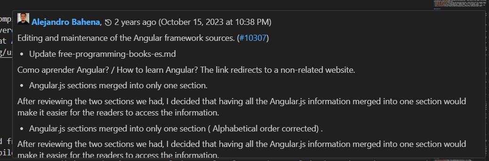

> [!TIP]
> Con el *hash* que os da el *blame* (o cualquier *hash* de `git log`) podéis ver ese *commit* completo desde la terminal: `git show <hash>` muestra el autor, la fecha, el mensaje y el *diff* de todos los archivos que cambió.

## 9. Deshacer cambios: amend, revert y reset

En la UP04 (sección 4.2.F) visteis `git restore`, que deshace cambios que **todavía no estaban en un *commit***. Ahora vamos un paso más allá: deshacer *commits*.

Antes de elegir comando, haceos siempre una pregunta: **¿ese *commit* ya está en GitHub?** (es decir, ¿habéis hecho `push`?).

- **Si no**, el *commit* solo existe en vuestro ordenador y podéis reescribir la historia sin molestar a nadie: `amend` y `reset`.
- **Si sí**, otras personas pueden tenerlo ya en su repositorio. Reescribir la historia les rompería el suyo. Lo correcto es **añadir** un *commit* nuevo que deshaga el anterior: `revert`.

### 9.1. Arreglar el último commit: git commit --amend

Acabáis de hacer *commit* y os dais cuenta de que os habéis dejado un archivo, o de que el mensaje tiene una errata. No hace falta un *commit* nuevo para eso:

```bash
# Os habéis dejado un archivo: lo añadís y lo metéis en el último commit
git add archivo-olvidado.css
git commit --amend --no-edit

# El mensaje estaba mal: lo reescribís
git commit --amend -m "feat: add login form"
```

`--amend` **sustituye** el último *commit* por uno nuevo (con un *hash* distinto) que incluye lo que hubiera en el *Staging Area*. `--no-edit` mantiene el mensaje anterior.

> [!WARNING]
> Solo con *commits* que **no habéis subido**. Si ya hicisteis `push`, el *commit* "corregido" no encaja con el que hay en GitHub y el siguiente `push` será rechazado.

### 9.2. Deshacer un commit compartido: git revert

`git revert` crea un **commit nuevo** que hace exactamente lo contrario de otro: si el original añadía una línea, el *revert* la quita, y viceversa.

```bash
git log --oneline
```

```text
c4d5e6f (HEAD -> main, origin/main) feat: add dark mode
b3a2f10 fix: corrige el cálculo de IVA en la factura
a1b2c3d feat: add invoice page
```

Si el modo oscuro ha roto algo en producción y hay que quitarlo ya:

```bash
git revert c4d5e6f --no-edit
```

```text
f7e8d9c (HEAD -> main) Revert "feat: add dark mode"
c4d5e6f (origin/main) feat: add dark mode
b3a2f10 fix: corrige el cálculo de IVA en la factura
a1b2c3d feat: add invoice page
```

El historial no se toca: el *commit* original sigue ahí, y queda registrado que se deshizo (y quién lo hizo). Por eso `revert` es **seguro en ramas compartidas** y es la opción por defecto para deshacer algo que ya está en GitHub: después se hace un `push` normal. Sin `--no-edit`, Git abre el editor para que podáis explicar el motivo en el mensaje, cosa que es buena idea.

> [!NOTE]
> Revertir un *commit* de fusión (*merge commit*) necesita una opción extra (`-m 1`) para indicar qué lado de la fusión conservar. Queda fuera del alcance de esta unidad.

### 9.3. Reescribir la historia local: git reset

`git reset <commit>` **mueve la rama actual (y `HEAD`) a otro *commit***. Los *commits* que había por delante dejan de pertenecer a la rama. La pregunta es qué pasa con los cambios que contenían, y eso depende de la opción. Aquí vuelven las **tres zonas** de la UP04 (sección 3.2):

| Opción | Repositorio (la rama) | *Staging Area* | Directorio de Trabajo | Para qué sirve |
| --- | --- | --- | --- | --- |
| `--soft` | Se mueve | Se conserva: los cambios de los *commits* deshechos quedan **preparados** | Se conserva | "Deshago el *commit* pero me quedo todo listo para volver a hacerlo" (por ejemplo, para juntar varios *commits* en uno) |
| `--mixed` (por defecto) | Se mueve | Se vacía: los cambios quedan como **modificados**, sin preparar | Se conserva | "Deshago el *commit* y quiero volver a elegir qué preparo" |
| `--hard` | Se mueve | Se vacía | **Se descarta**: los archivos vuelven a como estaban en ese *commit* | "Quiero tirar todo lo que he hecho desde entonces" |

Para referiros a "el *commit* anterior" no hace falta copiar *hashes*: `HEAD~1` es el padre de `HEAD`, `HEAD~2` el abuelo, etc. El uso más típico, deshacer el último *commit* sin perder nada:

```bash
git reset --soft HEAD~1
```

En VS Code es la opción **Commit → Undo Last Commit** del menú `...` de *Source Control*, que hace exactamente esto.

> [!CAUTION]
> `git reset --hard` **borra sin preguntar** todo lo que tengáis sin confirmar en el Directorio de Trabajo, igual que `git restore` (y sin vuelta atrás, por la misma razón: nunca llegó a un *commit*). Los *commits* que "desaparecen" de la rama sí se pueden rescatar durante un tiempo con `git reflog`, pero eso ya es nivel S de la tier list de la sección 12.

> [!WARNING]
> **Nunca hagáis `reset` sobre *commits* que ya habéis subido.** Vuestra rama dejaría de coincidir con la de GitHub, el `push` sería rechazado y la única forma de "arreglarlo" sería `git push --force`, que borra la historia del remoto y rompe el repositorio de todo el que ya tuviera esos *commits*. Es uno de los **comandos destructivos** de la sección 12. Para *commits* compartidos, `revert`.

### 9.4. Resumen: ¿qué comando uso?

| Situación | Comando | ¿Reescribe la historia? |
| --- | --- | --- |
| He estropeado un archivo y aún no he hecho *commit* | `git restore <archivo>` (UP04) | No (no hay *commit* implicado) |
| He preparado algo que no quería | `git restore --staged <archivo>` (UP04) | No |
| Mi último *commit* tiene una errata o le falta un archivo, y **no** lo he subido | `git commit --amend` | Sí, solo el último *commit* |
| Quiero deshacer uno o varios *commits* que **no** he subido | `git reset` (`--soft`, `--mixed` o `--hard`) | Sí |
| Quiero deshacer un *commit* que **ya está en GitHub** | `git revert <hash>` | No: añade un *commit* nuevo |

## 10. Llevar un commit a otra rama: cherry-pick

A veces no queréis fusionar una rama entera, sino **un único *commit*** de ella. El caso típico: estáis en una rama de característica, corregís de paso un error que también está en `main`, y esa corrección (un *hotfix*) no puede esperar a que termine la característica.

Volvamos al repositorio de libros. Imaginad que estáis en una rama `feature/libros-python` y vuestro historial es este:

```bash
git log --oneline --graph --decorate --all
```

```text
* 7c1d2e4 (HEAD -> feature/libros-python) fix: corrige enlace roto en el índice
* 4b5a6f7 feat: add book on Python testing
* 0e7a499 (main) feat: add new book on operating systems: introduction to OS
```

El libro de Python todavía no está listo, pero el enlace roto hay que arreglarlo en `main` ya. Copiáis el *hash* de ese *commit*, os cambiáis a `main` y lo "recolectáis":

```bash
git switch main
git cherry-pick 7c1d2e4
```

```text
* 9d8c7b6 (HEAD -> main) fix: corrige enlace roto en el índice
| * 7c1d2e4 (feature/libros-python) fix: corrige enlace roto en el índice
| * 4b5a6f7 feat: add book on Python testing
|/
* 0e7a499 feat: add new book on operating systems: introduction to OS
```

Git ha aplicado en `main` los mismos cambios de ese *commit*, en un *commit* nuevo (fijaos en que el *hash* es distinto). El libro de Python sigue solo en su rama. Cuando más adelante fusionéis `feature/libros-python`, Git verá que ese cambio ya está en `main` y no dará problemas.

Si el *cherry-pick* tiene conflictos, se resuelven igual que en un *merge* (sección 6): arregláis el archivo, `git add`, y después `git cherry-pick --continue`. Si os arrepentís a mitad, `git cherry-pick --abort` lo deja todo como estaba. Desde VS Code, con la extensión **Git Graph** que instalasteis en la UP04, tenéis la opción *Cherry Pick* en el menú contextual de cualquier *commit*.

> [!NOTE]
> `cherry-pick` es un apaño útil, no un flujo de trabajo. Si os veis haciéndolo a menudo, probablemente esas correcciones deberían haber nacido en su propia rama `hotfix/...` creada desde `main` (como en Git Flow, Anexo II).

## 11. Forking y Pull Requests

El **forking** es una característica de GitHub que permite a los usuarios crear una copia personal de un repositorio existente en su propia cuenta de GitHub. Esta funcionalidad es especialmente útil para colaborar en proyectos de código abierto, ya que permite a los desarrolladores trabajar en sus propias versiones del proyecto sin afectar el repositorio original, donde carecen de permisos de escritura.

Una vez que has hecho un fork de un repositorio, puedes clonar tu copia localmente, hacer cambios y luego proponer esos cambios al repositorio original mediante un **pull request**. Un pull request es una solicitud para que los mantenedores del repositorio original revisen y potencialmente integren tus cambios en su código base.

Vamos a verlo con un ejemplo práctico, para ello podemos usar el repositorio que he creado en [https://github.com/scontreraslopez/recetas-cocina](https://github.com/scontreraslopez/recetas-cocina). La propuesta es que vamos a crear de manera colaborativa una colección de recetas de cocina. Esto es una simplificación didáctica de lo que podría ser un proyecto colaborativo real, cambiando que en lugar de recetas serían funcionalidades de software.

A través de la plataforma podemos navegar al proyecto en cuestión, y darle al botón de **Fork** en la esquina superior derecha. Esto creará una copia del repositorio en nuestra propia cuenta de GitHub.

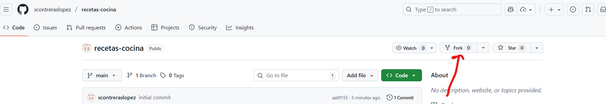

Si preferimos la acción con el teclado y la terminal, podemos usar `gh cli` para hacer el fork directamente desde la terminal. **Primero nos aseguramos de estar en el directorio donde queremos clonar el repositorio**, y luego ejecutamos:

```bash
gh repo fork NOMBRE-REPOSITORIO
```

Por ejemplo:

```bash
gh repo fork scontreraslopez/recetas-cocina
```

Esto creará un fork del repositorio `recetas-cocina` en nuestra cuenta de GitHub y nos preguntará si queremos clonar el fork localmente. Elegimos que sí.

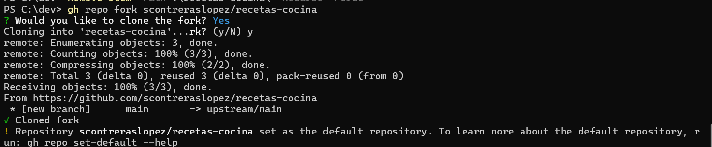

Ahora tendremos una carpeta copia del proyecto; abrámosla en nuestro IDE favorito. Vamos a crear una nueva rama para añadir nuestra receta. Por ejemplo, si queremos añadir una receta de paella, podemos crear una rama llamada `feature/paella`.

> [!NOTE]
> No lo hagáis todos con paella, que si no me vais a saturar de conflictos

Creamos la rama desde la terminal integrada del IDE.

```bash
git switch -c feature/paella
```

Creamos un nuevo archivo llamado `paella.md` y añadimos nuestra receta (las recetas de paella siempre son polémicas). El siguiente es solo un ejemplo:

```markdown
# Receta de Paella

**Autor:** Sergio Contreras

## Ingredientes

- 1 taza de arroz
- 2 tazas de caldo de pollo
- 200g de pollo
- 100g de mariscos
- 1 pimiento rojo
- 1 tomate
- 2 dientes de ajo
- Aceite de oliva
- Sal y pimienta al gusto

## Instrucciones

1. Calienta el aceite en una paella y sofríe el pollo hasta que esté dorado.
2. Añade el pimiento, tomate y ajo picados, y cocina hasta que estén tiernos.
3. Agrega el arroz y mezcla bien con los ingredientes.
4. Vierte el caldo de pollo y cocina a fuego medio hasta que el arroz esté cocido y el líquido se haya absorbido.
5. Añade los mariscos y cocina por unos minutos más hasta que estén hechos.
```

Añadimos el archivo al staging area y hacemos commit de los cambios:

```bash
git add paella.md
git commit -m "feat: add paella recipe"
```

Antes de subir los cambios, vamos a echar un vistazo a nuestros remotes para asegurarnos de que estamos apuntando a nuestro **fork** y no al repositorio original. Para ello ejecutamos: `git remote -v`

Veremos que tenemos dos remotes configurados: **`origin`**, que apunta a nuestro fork, y **`upstream`**, que apunta al repositorio original. Estos nombres son convenciones comunes; por defecto GitHub (y la mayoría de los desarrolladores) usa estas convenciones, por lo que nos adheriremos a ellas.

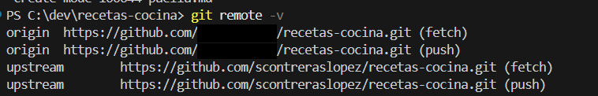

> [!IMPORTANT]
> **La regla de oro del fork: vuestro `main` no se toca.** En el fork, `main` solo sirve para tener una copia al día del `main` original, y se actualiza **únicamente** desde `upstream`. Todo vuestro trabajo va en ramas (`feature/...`), y las *pull requests* salen de esas ramas. Si hacéis *commits* en `main`, dejará de coincidir con el original y cada sincronización será un lío.

Ahora, un tema importante: para el `pull` puede ser que la rama **`main`** del repositorio original (**`upstream`**) avance mientras estamos trabajando en nuestra rama de características. Para asegurarnos de que nuestra rama está actualizada con los últimos cambios del repositorio original, primero cambiamos a la rama `main` y hacemos pull desde `upstream`:

```bash
git switch main
git pull upstream main
```

Fijaos cómo el `pull` lo hacemos desde `upstream` y no desde `origin`, ya que queremos traer los cambios del repositorio original, no de nuestro fork. Si quisiéramos traernos cambios de nuestro fork, haríamos `git pull origin main`. Este es un tema capital que debéis entender bien.

Si quisiéramos traer esos cambios (**solo en el caso de que los hubiera**) a nuestra rama de características (feature/paella) tendríamos que hacer un merge o un rebase. Ciñéndonos al merge que es lo que hemos visto en este tema, haríamos:

```bash
git switch feature/paella
git merge main
```

Si `main` traía *commits* nuevos, este *merge* crea un *commit* de fusión y Git abrirá el editor para el mensaje (sección 6): guardad y cerrad la pestaña, o usad `git merge main --no-edit`. Si alguien tocó las mismas líneas que vosotros, aquí aparecerá el conflicto, y se resuelve igual que en la sección 6.

Ya podríamos continuar trabajando en nuestra rama de características. Una vez que ya tenemos todo listo, **subimos la rama** (no `main`) a nuestro fork:

```bash
git push -u origin feature/paella
```

El `-u` enlaza nuestra rama local con la nueva rama `origin/feature/paella` de GitHub (sección 7). A partir de ahora, estando en `feature/paella`, basta con `git push` para subir más cambios.

> [!NOTE]
> Cuidado con la palabra *upstream*, que en Git significa dos cosas distintas. Por un lado, `upstream` es el **nombre del remoto** que apunta al repositorio original. Por otro, la rama remota con la que está enlazada una rama local (la que se configura con `-u`, de `--set-upstream`) también se llama su *upstream*. Aquí, el *upstream* de `feature/paella` es `origin/feature/paella`, en vuestro fork, no el remoto `upstream`.

Vamos a navegar ahora a nuestro repositorio fork en GitHub. Abrimos GitHub, iniciamos sesión y **pinchamos** en **Repositories** en nuestro perfil y seleccionamos el repositorio `recetas-cocina`.

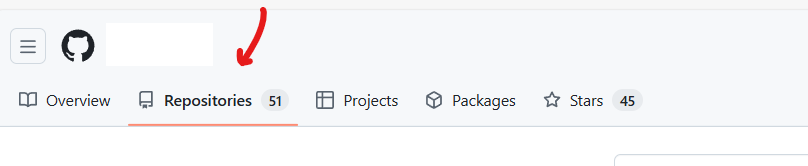

Justo después de un `push` de una rama nueva, GitHub suele mostrar un aviso amarillo (*feature/paella had recent pushes*) con un botón **Compare & pull request**, que es el camino más corto. Si no aparece, seleccionad la rama `feature/paella` en el selector de ramas (arriba a la izquierda, donde pone `main`). GitHub os avisará de que esa rama está (al menos) 1 *commit* por delante del original: nuestra receta de paella. *También puede hacerse desde la terminal con `gh pr create`, pero para no liarnos vamos a hacerlo desde la web.*

 Pinchamos en el botón de **Contribute** y ahí seleccionamos **Open pull request**.

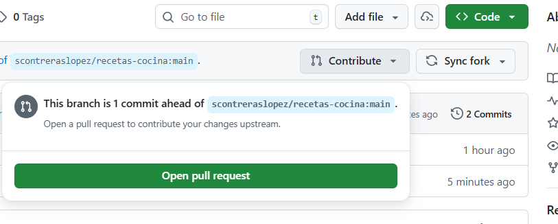

Comprobad arriba que la PR va **de** vuestra rama `feature/paella` **a** la rama `main` del repositorio original. Escribimos un título descriptivo para nuestro pull request, por ejemplo "feat: recipe for paella added", y una descripción detallada de los cambios que hemos realizado. Luego pinchamos en **Create pull request**.

Si todo ha ido bien, veremos nuestro pull request creado y listo para revisión por parte de los mantenedores del repositorio original.

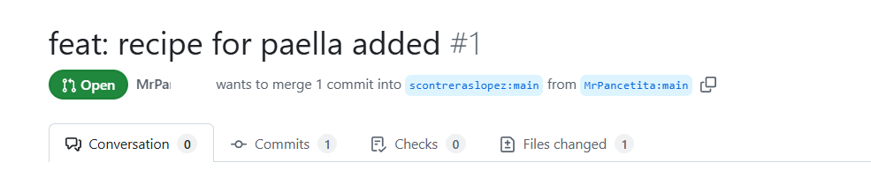

Mientras la PR esté abierta, **cada `push` que hagáis a `feature/paella` se añade automáticamente a la PR**. Así se corrige lo que os pida el revisor, y así se arregla una PR con conflictos: sincronizáis `main` con `upstream`, hacéis `git merge main` en vuestra rama, resolvéis el conflicto y hacéis `git push`. No hace falta abrir una PR nueva.

Esto desde el punto de vista del colaborador. Ahora imaginemos que somos los mantenedores del repositorio original. Si navegamos a este veremos que tiene una pull request pendiente (y una notificación en la campana si lo tuviéramos activado).

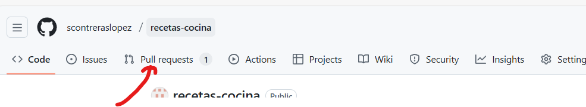

Si navegamos veremos todas las pull requests que tenemos abiertas (pendientes de revisión). Pinchamos en la que hemos creado antes.

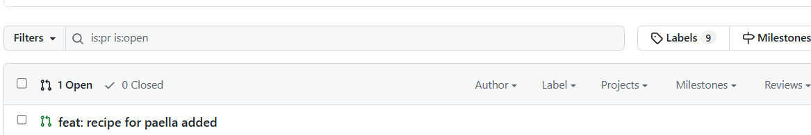

Abajo tendremos un panel que nos avisará si hay conflictos o si se puede fusionar automáticamente. En este caso debería poderse fusionar sin problemas. Revisamos los cambios propuestos y, si todo está en orden, pinchamos en el botón de **Merge pull request** para integrar los cambios en el repositorio original. Nota: el desplegable nos dará varias opciones de merge; elegimos la que más nos convenga (normalmente "Create a merge commit" está bien para la mayoría de los casos, además es la opción por defecto) y confirmamos la fusión.

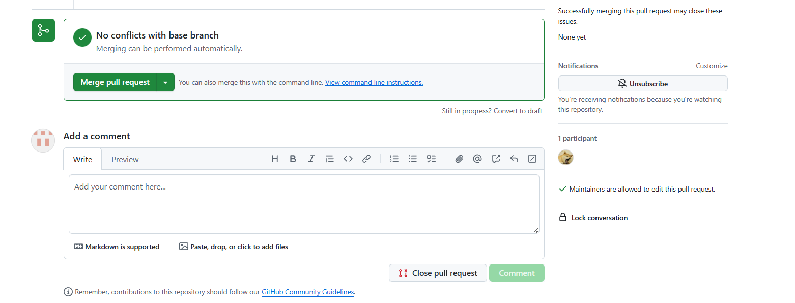

Damos un mensaje para el commit y hacemos clic en **Confirm merge**.

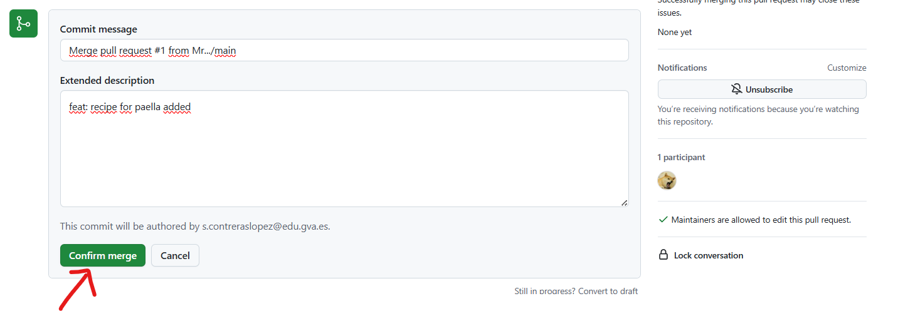

Si todo ha ido bien, veremos un mensaje confirmando que la pull request ha sido fusionada exitosamente.

```text
Pull request successfully merged and closed
You're all set — the branch has been merged.
```

Y el icono cambiará a lila y pondrá **Merged**.

Volvemos a ponernos el sombrero de colaborador para cerrar el ciclo. Nuestra receta ya está en el `main` original, así que actualizamos nuestro `main` desde `upstream` y borramos la rama, que ya ha cumplido su misión:

```bash
git switch main
git pull upstream main
git push origin main               # opcional: deja también al día el main de vuestro fork en GitHub
git branch -d feature/paella
```

La rama remota `origin/feature/paella` se puede borrar con el botón **Delete branch** que aparece en la propia PR tras la fusión, o con `git push origin --delete feature/paella`. Para dejar al día el `main` del fork también tenéis el botón **Sync fork** de GitHub.

Para la **siguiente contribución**, el ciclo empieza siempre igual: `git switch main` → `git pull upstream main` → `git switch -c feature/nueva-receta`. Así cada rama nace del `main` más reciente y cada PR lleva solo sus cambios.

Enhorabuena, acabas de contribuir a un proyecto de código abierto utilizando forking y pull requests en GitHub. Este flujo de trabajo es fundamental para la colaboración en proyectos de software modernos y es ampliamente utilizado en la comunidad de desarrollo.

## 12. Otros temas avanzados muy interesantes

**Git** tiene mucha tela que cortar. Hemos visto lo fundamental, y es una herramienta *core* en el desarrollo profesional: si queréis profundizar, cosa que os recomiendo, hay cursos completos dedicados a Git. Aquí tenéis una *tier list* de funcionalidades de Git, ordenadas de básico (D) a *ninja* (S). Por supuesto, no todas se usan por igual: algunas son muy de nicho.

![Tier list de funcionalidades de Git ordenadas de básico (D) a ninja (S): en D init, clone, add, commit, push, pull, status y log; en C merge, branch, gitignore, diff, config, checkout/switch/restore, gitattributes, show y rm/mv; en B merge --squash, fetch vs pull, commit --amend, tags, remote, log avanzado, remote tracking branches, revert, add -p, clean y describe; en A rebase, cherry-pick, reset, stash, blame, merge strategies, hooks, gc/prune, archive, apply y aliases; en S reflog, bisect, rerere, filter-repo, worktrees, submodules, plumbing, rebase -i, bundle y format-patch/am](/img/UP05/git-tier-list-funcionalidades.png)

Para que os situéis: con la UP04 y la UP05 tenéis las filas **D** y **C**. De la **B** habéis visto `fetch` vs `pull`, las ramas remotas, `commit --amend`, `remote` y `revert`; de la **A**, `reset`, `cherry-pick` y `blame`, y `stash` de pasada. El resto lo iréis necesitando.

De la fila C solo nos ha quedado por mencionar `git mv` y `git rm`. Si movéis, renombráis o borráis un archivo rastreado con el explorador de archivos, Git ve "un archivo borrado y otro nuevo sin seguimiento", y tenéis que hacer `git add` de ambos para que lo entienda. Con `git mv viejo.md nuevo.md` o `git rm archivo.md` el cambio queda directamente preparado en el *Staging Area*.

Tened en cuenta también que hay comandos que pueden ser **peligrosos** si no se usan correctamente, como `git reset --hard` o `git push --force`, ya que pueden sobrescribir cambios y causar pérdida de datos. Estos se conocen como **comandos destructivos** y deben usarse con precaución. Si hacemos uno de estos en un repositorio compartido, podemos afectar negativamente a otros colaboradores... Como un DELETE sin el WHERE.

Os dejo una breve descripción de algunas de las funcionalidades de la tier list que no hemos visto y cuyo nombre no lo dice todo:

- Git Rebase: Una alternativa a git merge para integrar cambios de una rama a otra, que reescribe el historial de commits para crear una línea temporal más limpia. Hay que tener cuidado al usar rebase en ramas compartidas, o podemos causar problemas a otros colaboradores.
- Git merge --squash: Una técnica para combinar múltiples commits en uno solo, útil para limpiar el historial antes de fusionar una rama. Imagina por ejemplo que has hecho 10 commits pequeños en una rama de feature, pero al final solo quieres un commit en main que diga "feat: add new feature X", para no contaminar el historial del main con commits intermedios.
- Git Stash: Guarda temporalmente cambios no confirmados para limpiar el área de trabajo sin perderlos (lo citamos en la sección 5). Tiene más opciones: `git stash list` para ver el cajón, `git stash apply` para recuperar sin vaciarlo, `-u` para incluir archivos sin seguimiento...
- Git Tag: Una forma de marcar puntos específicos en el historial de commits, típicamente usados para versiones de lanzamiento. Lo hemos visto por encima, pero las tags son muy útiles para gestionar versiones. Ojo que `git tag` no sube las tags al remoto; tampoco `git push origin main`. Para eso hay que hacer `git push origin <tagname>` o `git push --tags` para subir todas las tags.
- Git LFS (Large File Storage): Una extensión de Git para manejar archivos grandes de manera eficiente, almacenándolos fuera del repositorio principal. Lo que os comentaba de los binarios.
- Git Bisect: Una herramienta para encontrar el commit que introdujo un error mediante una búsqueda binaria en el historial de commits.
- Git Reflog: El "diario" de todo lo que ha apuntado `HEAD`. Es la red de seguridad para rescatar *commits* que parecían perdidos tras un `reset --hard` o un `rebase` desafortunado.
- Git Archive: Una herramienta para crear archivos comprimidos (tar, zip) de un estado específico del repositorio.
- Git Hooks: Scripts que se ejecutan automáticamente en respuesta a ciertos eventos en el ciclo de vida de Git, como antes de un commit o después de un push.
- Git Submodules: Una forma de incluir un repositorio Git dentro de otro, útil para gestionar dependencias o librerías externas.
- Git Alias: Una funcionalidad para crear atajos personalizados para comandos de Git, facilitando su uso. Por ejemplo, con `git config --global alias.nicelog "log --oneline --graph --decorate --all"`, a partir de entonces `git nicelog` hace lo mismo que el comando largo.

## Bibliografía

Si os interesa mucho el tema de Git, podéis ir directamente a la fuente del conocimiento: [https://git-scm.com/book/en/v2](https://git-scm.com/book/en/v2), el libro de **Pro Git**.

Os dejo también un **vídeo** de Git, continuación del primero que vimos: [https://www.youtube.com/watch?v=HyCaL6ld8pI](https://www.youtube.com/watch?v=HyCaL6ld8pI)

También tenemos documentación oficial de VS Code sobre el soporte integrado de Git:

- Documentación principal sobre usar Git en VS Code: [https://code.visualstudio.com/docs/sourcecontrol/overview](https://code.visualstudio.com/docs/sourcecontrol/overview).  
- Guía introductoria a Git en VS Code: [https://code.visualstudio.com/docs/sourcecontrol/intro-to-git](https://code.visualstudio.com/docs/sourcecontrol/intro-to-git)
- Colaboración con GitHub en VS Code: [https://code.visualstudio.com/docs/sourcecontrol/github](https://code.visualstudio.com/docs/sourcecontrol/github)
- Git FAQ en VS Code: [https://code.visualstudio.com/docs/sourcecontrol/faq](https://code.visualstudio.com/docs/sourcecontrol/faq)

Extensiones de VS Code útiles para trabajar con Git y GitHub:

- **Git Graph** y **Git History**: ya las instalasteis en la UP04 (sección 4.4.E). Si no lo hicisteis, ahora que trabajáis con varias ramas os van a venir de perlas.
- **GitHub Pull Requests and Issues**: permite revisar, comentar y crear *pull requests* e *issues* sin salir del editor. [https://marketplace.visualstudio.com/items?itemName=GitHub.vscode-pull-request-github](https://marketplace.visualstudio.com/items?itemName=GitHub.vscode-pull-request-github)

> [!NOTE]
> GitLens es muy popular, pero a mi personalmente no me convence del todo por el modelo Freemium de GitKraken (la empresa que lo desarrolla). Hay muchas funcionalidades que son de pago, y la versión gratuita es bastante limitada. Por eso no la he incluido en la lista.

Por último, os dejo algunos clientes gráficos de Git que podéis probar si no os gusta trabajar con la terminal o el soporte integrado del IDE:

- Sourcetree: [https://www.sourcetreeapp.com/](https://www.sourcetreeapp.com/)
- GitHub Desktop: [https://desktop.github.com/](https://desktop.github.com/)
- GitKraken: [https://www.gitkraken.com/](https://www.gitkraken.com/)

## Anexo I: Commits Semánticos

En la UP04 (sección 4.3) visteis qué hace bueno a un *commit*: que sea una unidad lógica, que lo que compartís funcione y que el mensaje sea descriptivo. El ejemplo era "Fix: Corrige el cálculo de IVA en la factura". Ahora le damos a ese mensaje un **formato estándar**: `fix: corrige el cálculo de IVA en la factura`. En la práctica de la UP04 ya usasteis los prefijos `feat:` y `chore:`; aquí tenéis la explicación completa.

Los **Commits Semánticos** (en su versión formal, *Conventional Commits*) son una convención sobre cómo escribir los mensajes de commit. Adoptar un estilo consistente puede mejorar enormemente la legibilidad del historial de un proyecto, facilitar la colaboración y automatizar tareas como la generación de *changelogs*.

Veréis cómo un pequeño cambio en vuestro estilo de mensajes de commit puede haceros mejores programadores y facilitar el trabajo en equipo. Es importante ser constantes: un historial donde la mitad de los *commits* siguen la convención y la otra mitad no pierde casi todas sus ventajas.

### Formato

El formato general es el siguiente:

```text
<type>(<scope>): <subject>
```

- **type**: Indica el tipo de cambio que estás introduciendo.
- **scope**: (Opcional) Especifica la parte del código afectada por el cambio (ej. `api`, `ui`, `auth`).
- **subject**: Una descripción corta y concisa del cambio, escrita en presente e imperativo (ej. `add` en lugar de `added` o `adds`).

### Ejemplo

```text
feat: add hat wobble
^--^  ^------------^
|     |
|     +-> Resumen en tiempo presente.
|
+-------> Tipo: chore, docs, feat, fix, refactor, style, o test.
```

### Tipos de Commit más Comunes

- **feat**: Una nueva funcionalidad para el usuario (no una nueva característica para un script de compilación).
- **fix**: Una corrección de un error para el usuario (no una corrección en un script de compilación).
- **docs**: Cambios en la documentación.
- **style**: Cambios de formato, puntos y coma que faltan, etc. No afecta al código de producción.
- **refactor**: Refactorización del código de producción, como renombrar una variable. No añade funcionalidades ni corrige errores.
- **test**: Añadir tests que faltan, refactorizar tests. No afecta al código de producción.
- **chore**: Actualización de tareas de build, configuración, etc. No afecta al código de producción.

Adoptar esta convención desde el principio en tus proyectos te ayudará a mantener un historial de cambios limpio, claro y profesional.

## Anexo II: Git Flow

Git Flow es una metodología de ramificación que define un flujo de trabajo estructurado para gestionar el desarrollo de software utilizando Git. Fue propuesto por Vincent Driessen en 2010 y se ha convertido en una práctica popular en equipos de desarrollo debido a su claridad y organización.

Se basa en la idea de utilizar ramas específicas para diferentes propósitos, lo que facilita la colaboración y el mantenimiento del código. A continuación, se describen las ramas principales y su propósito en Git Flow:

- **main**: Esta es la rama principal que contiene el código estable y listo para producción. Cada commit en esta rama representa una versión desplegable del software.
- **develop**: Esta rama sirve como la rama de integración para las características en desarrollo. Aquí es donde se combinan todas las nuevas funcionalidades antes de ser preparadas para una nueva versión.
- **feature/**: Las ramas de características se crean a partir de la rama `develop` para trabajar en nuevas funcionalidades. Una vez que una característica está completa, se fusiona de nuevo en `develop`.
- **release/**: Cuando se está preparando una nueva versión, se crea una rama de lanzamiento a partir de `develop`. Aquí se realizan pruebas finales y correcciones de errores antes de fusionar los cambios en `main` y `develop`.
- **hotfix/**: Las ramas de corrección rápida se crean a partir de `main` para abordar errores críticos en producción. Una vez corregido el error, los cambios se fusionan tanto en `main` como en `develop`.

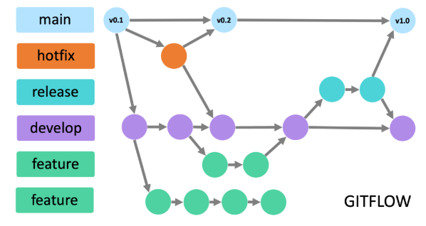
